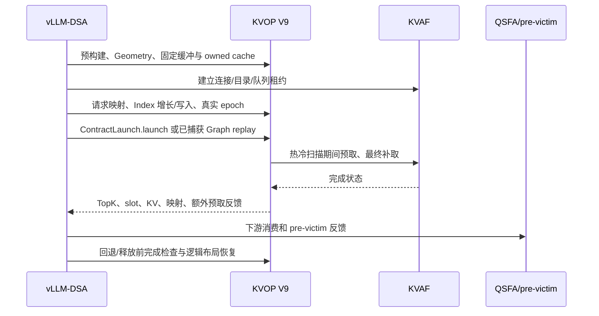

# KVOP

公开契约实现版本：包 `0.2.0` / 契约 `2.0.0` / 设备 ABI `13`。
独立仓实现说明见 [公开契约与生命周期](docs/public_contract.md)，原始执行需求见
[implementation_prompt.md](docs/implementation_prompt.md)，完整处置与验证见
[implementation_report.md](docs/implementation_report.md)。

本版增加 host 契约、校验和显式 session；设备源码和数值 oracle 保持抽取基线不变。
当前 `hardware_certified=False`，真实 NPU/KVAF/Graph/TPOT 验收尚未完成；不要将
host 回归通过或源码一致解读为生产功能/性能已无影响。

```bash
python -m kvop.v9.contract_info
PYTHONPATH=. python -m pytest tests/v9 -q
PYTHONPATH=. python tools/check_contract.py
PYTHONPATH=. python tools/verify_baseline.py
```

独立 Ascend 算子仓。当前包含 V9 融合算子，以及性能基线需要的原生 LIDU。
不依赖 vLLM、vllm_ascend 或模型权重；KVAF 是外部传输依赖，不由本仓修改或构建。
本目录已从框架子树创建独立 Git 仓，包含来源历史；框架内镜像仍是普通目录，不含嵌套
`.git`。代码不依赖原框架 checkout；发布远端由使用方配置，本次不执行远端发布。

```text
kvop/v9/                 Python API、ABI 13、缓存、布局适配、构建
operators/v9/            生产设备源码及代码生成依赖
operators/native_lidu/   原生 LIDU 的 OPP 和最小 Torch 注册
tests/v9/                框架契约输入、独立校验、传输桩和 benchmark
build.sh / env.sh        构建入口和可选 LIDU vendor 环境
```

新增算子在 `kvop/`、`operators/`、`tests/` 下各增一个子目录即可。
设备源码来源和迁入时 SHA256 见 `operators/v9/SOURCE.json`。
V9 计算、预取、最终补取、Index 交换及 KVAF 默认策略保持迁入版本实现。

## 安装与构建

Host 测试仅需 Python 3.10+、NumPy、pytest；NPU 需要匹配的 CANN、Torch、Torch-NPU。
先进入本目录：

```bash
bash build.sh package
python3 -m pip install pytest
python3 -m pytest tests/v9 -q
```

普通 wheel 包含 V9 设备源文件，不要求保留框架 checkout：

```bash
python3 -m pip wheel --no-deps --no-build-isolation . -w dist
python3 -m pip install dist/vllm_ascend_kvop-0.2.0-py3-none-any.whl
python3 -c 'from kvop.v9 import ABI_VERSION, native_source; print(ABI_VERSION, native_source())'
```

`build.sh package` 只安装 Python 包。每种 B/Q/容量的设备库可提前构建：

```bash
# 先 source 当前服务器 CANN 的 set_env.sh。
bash build.sh v9 \
  --batch 4 --history 131072 --resident 12288 --aic-count 28 \
  --windows 4 --soc Ascend950DT_9574 \
  --cann /usr/local/Ascend/cann \
  --kvaf-include /path/to/KVAF/access_operator/demo/aiv_batch_get/include \
  --build-dir /path/to/kvop-build
```

核数取实际设备资源，SoC 按服务器填写。框架仍在图捕获前预构建，并按源文件、KVAF头文件、
CANN、SoC和配置缓存；Graph capture 内不得编译。库仍是 `libv9_bridge.so`，不是 vendor OPP。
建议源码和构建路径使用 ASCII，避免部分 CANN/CMake 对中文路径的转义错误。

只有测试原生 LI→LIDU→KVAF 基线时才需要另外构建 LIDU：

```bash
bash build.sh native-lidu
source env.sh
```

此命令构建当前框架同源的 `A5LiduFusedBatchGetPrepareMtp`，加载
`nanovllm_dsa_lidu_fused_batch_get_prepare_mtp` 最小注册，不导入框架注册模块。
框架进程继续使用其已有的原生注册；不要在同一进程重复注册两个 LIDU 扩展。

## 公开接口和调用责任

```python
from kvop.v9 import (
    Geometry, ContractLaunch, OwnedIndexCache, pack_query_heads,
    validate_request, build_library,
)
```

`Geometry.tensor_spec()` 是 dtype/shape 契约，`validate_buffers` 校验设备、布局和别名。
`ContractLaunch(torch, library, tensors, owner, geometry, ...)` 绑定固定缓冲；
`launch()` 提交 init、LI、resolve、fetch；`completion()` 在图外核验最终状态。
同一生产接口同时用于独立 NPU 测试和框架 eager/Graph。

`owner` 必须持有 output、独占队列以及所有异步访问的分配，提供
`build_device_args`、`mark_completed`、`quarantine` 和 keepalive；
完整 KVAF owner 示例见 `tests/v9/contract_session.py` 及 `real_fetch_session.py`。
框架连接管理、PUT、跨 rank 协调和模型生命周期仍由框架负责。

主要输入：Q/权重/scale，paged Index key/scale，实际宽度的 Index/resident 页表，
candidate/logical lengths、pool row、budget、row mode、forward/reverse/cursor、
pre-victim slots/bitmap、地址目录/valid、resident KV 输出池。
输出包括 logical TopK、destination slot、miss count、有效 resident length、
额外预取 slot/count、status；映射、KV 和 owned Index Cache 会原地更新。

约束：

- 固定 MTP3/Q4、batch 内等长；32/64 heads 由 `pack_query_heads` 适配到 kernel 64 heads。
- 热区扫描包括 pre-victim 候选；`>=` 热区阈值者受保护；最终补取保持启用。
- 尾部窗口不参与历史 Top2048；resident 页表必须含实际尾部容量。
- cache 归属于请求/层/代次，packed batch 下标不能充当身份。
- 正 mapping epoch 仅在外部真实变更被完整追踪时使用；未知写入使用精确校验。
- Graph 绑定地址必须稳定；请求换序更新指针表；dummy/PAD 不修改持久缓存或提交 GET。
- 回退先等待完成并 `restore_logical()`，再使用 native；错误后不能直接复用不确定的队列。
- TODO：全 batch Q2/MTP1、Q3/MTP2；统一 Q 下非等长请求。当前拒绝，不做静默截断。
- 不规划同 batch 混合 Q，不扩展混合 resident budget。

框架调用顺序：



## 不启用 KVAF 的测试

Host 契约模型会真实填充测试 payload，并验证 slot、映射、尾部和反馈；不执行 NPU kernel：

```bash
python3 tests/v9/benchmark_contract.py --backend cpu \
  --case-suite full --batches 1,2 --queries 4 --layers 2 \
  --intermediate-fetches 4 --output results/host_contract
python3 tests/v9/benchmark_contract.py --backend cpu \
  --case-suite lifecycle --batches 2 --steps 6 --layers 2 \
  --same-length-rewrite --output results/host_lifecycle
```

NPU 内存传输桩运行实际 V9 kernel，用真实生成的 GET 描述符把设备测试源 KV 复制到目标 slot。
需要 CANN/NPU 和对应 KVAF **头文件**，不需要 KVAF Python runtime、网络连接或服务：

```bash
python3 tests/v9/benchmark_contract.py --backend npu --transport npu-memory \
  --kvaf-root /path/to/KVAF --native-baseline off --qsfa off \
  --soc Ascend950DT_9574 --device 4 --batches 1 --queries 4 \
  --history 16385 --resident 12288 --layers 1 --case-suite full \
  --execution graph --intermediate-fetches 4 --warmup 1 --iterations 3 \
  --output results/npu_memory
```

`memory_build.py` 在测试输出目录生成单独源码树，替换 doorbell/完成边界为设备内存复制。
生产目录不改；测试库导出标记，生产 `ContractLaunch` owner 拒绝加载它。
测试桩不模拟真实通信时间、CQ 轮询和网络故障，不允许 performance suite，也不输出真实性能加速比。
Host 另有延迟完成、失败保留资源、拒绝提前释放和 sticky failure 测试。

## 真实通信正确性与性能

先启动匹配的 KVAF 服务，准备相同构建的 runtime 和设备头文件。以下参数按服务器实际修改：

```bash
COMMON=(--backend npu --transport kvaf --device 4 \
  --soc Ascend950DT_9574 --cann /usr/local/Ascend/cann \
  --kvaf-root /path/to/KVAF --kvaf-server 127.0.0.1:28960 \
  --queries 4 --resident 12288 --index-storage owned \
  --intermediate-fetches 4 --intermediate-profiling off --qsfa off)

python3 tests/v9/benchmark_contract.py "${COMMON[@]}" \
  --batches 1,4 --history 16385 --layers 2 --case-suite full \
  --execution eager --output results/contract

python3 tests/v9/benchmark_contract.py "${COMMON[@]}" \
  --batches 2 --history 16385 --layers 2 --steps 6 \
  --case-suite lifecycle --same-length-rewrite --execution eager \
  --output results/lifecycle

python3 tests/v9/benchmark_contract.py "${COMMON[@]}" \
  --batches 4 --history 131072 --layers 1 --case-suite performance \
  --cache-miss-rates 0,15,30 --execution graph --native-baseline on \
  --warmup 5 --iterations 20 --measurement-order alternate \
  --output results/performance_w4
```

QSFA 默认不构成本仓独立依赖，逐 token 的下游 payload 校验始终保留。
若环境已单独加载 QSFA 注册，可以指定 `--qsfa required`；缺失会失败，不伪装通过。

每种链路先做正确性预检。非融合测的是**原生 LI → 真实 LIDU → KVAF BatchGet → 完成**。
两侧使用相同输入快照、量化和 Q4 因果语义；GET 数可能因保护策略而不同，报告会记录实际 miss。
默认交替测量顺序，可指定 native-first/fused-first 排查顺序效应。

- `fused_p50_us/native_p50_us`：设备事件记录的完整算子链，包含补取和最终完成。
- `api_wall`：固定已准备输入的 Python submit/replay 到 stream completion，排除 fixture 恢复、校验、首次接管。
  它不是模型 forward 端到端延迟；不把测试的大量 CPU 快照恢复计作框架准备成本。
- `caller_prepare_device_span_us`、首次 ownership/build/capture 属独立口径，不与 kernel 中位数相加。
- snapshot 用于固定 workload 公平对照；stateful 用于连续增长/换序正确性，诊断同步不代表生产性能。
- `native_over_fused_speedup = native / fused`；大于1为融合更快，目标1.2意味着 fused≤native/1.2。

结果包含 `summary.json`、逐案例 `report.json`、fixture、日志、逐样本计时及不超过14500字符的
`data_record.md`。首次构建/接管、snapshot恢复和输出验证不在设备计时内。

## 框架使用

在 vLLM-DSA 环境安装 `python3 -m pip install -e third_party/KVOP`。
完整安装脚本已加入此步骤。框架的 `v9_backend`/`v9_graph` 改调 `kvop.v9`；
请求调度、Graph bucket/边界、native 回退和禁用开关保持原位置。
关闭 V9 不要求导入 KVOP。不要把本仓 native-lidu 测试扩展额外导入已注册 LIDU 的框架进程。

本地验证只覆盖 Host 与编译；eager/Graph、真实网络及性能必须在服务器复验。
