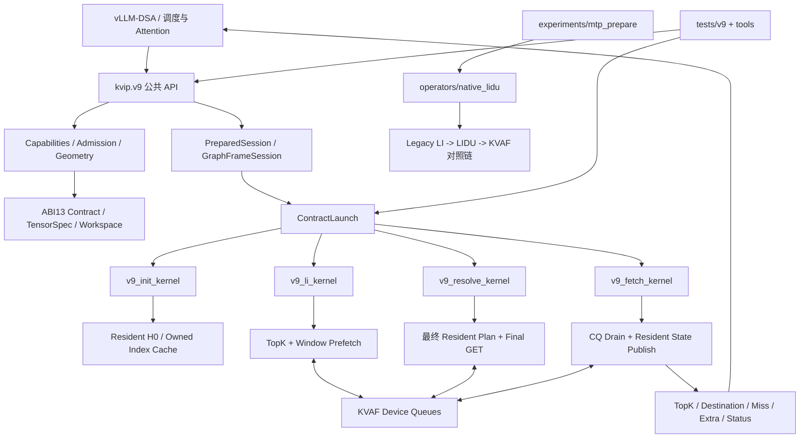
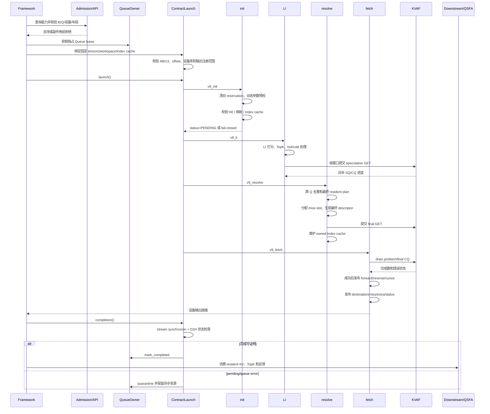
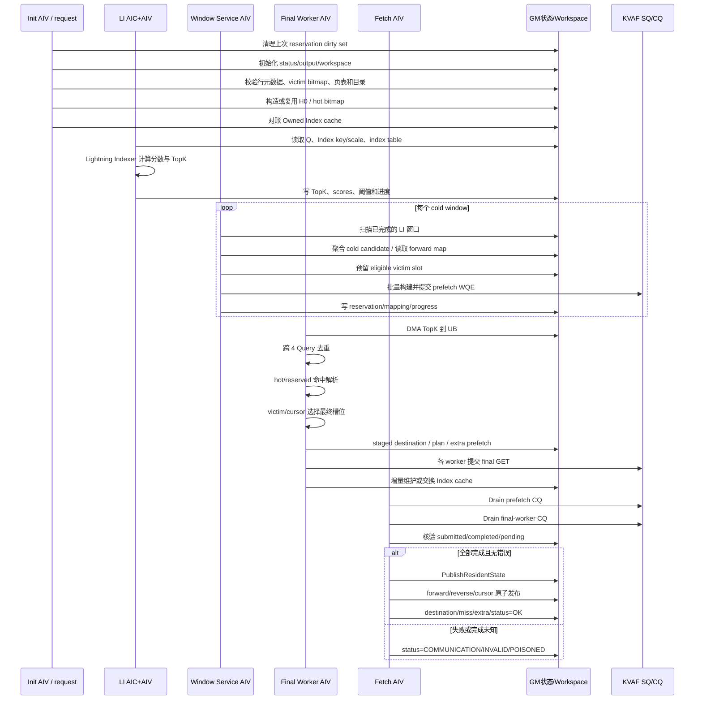
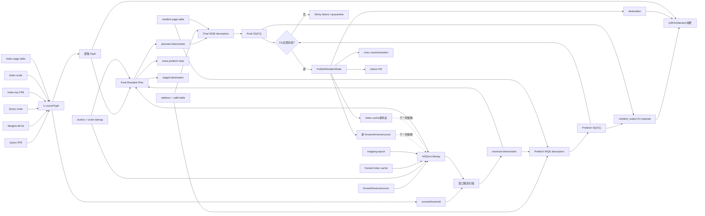
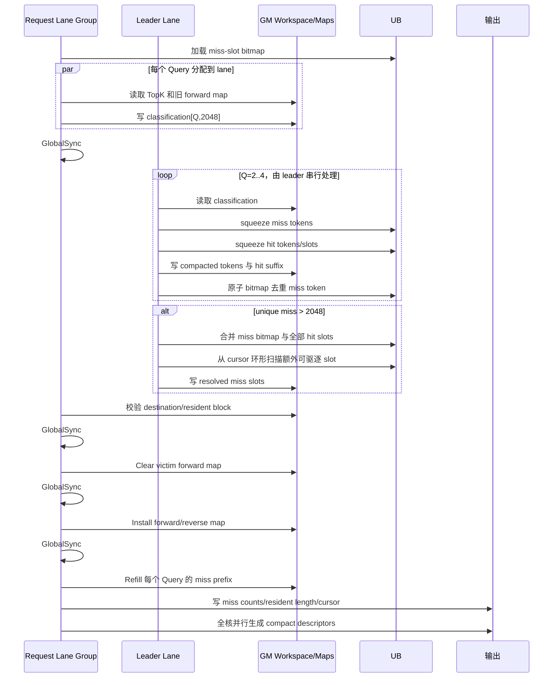

# KVIP 仓库架构与融合算子执行流程分析

本文梳理 KVIP 代码仓的整体分层、生产 V9 融合链路、原生 LIDU 对照算子的数据流和
潜在性能瓶颈。分析基于当前 ABI 13 实现；真实 A5、KVAF、Graph 和模型端到端性能仍需
以硬件 profiler 结果为准。

## 1. 总体结论

本仓不是单一“大融合 Kernel”，而是包含两条可独立演进的执行链：

- **生产主链 KVIP V9**：将 LI 选择、中途预取、最终槽位规划、KVAF 补取、CQ 回收和
  resident 状态发布组织为 `init -> li -> resolve -> fetch` 四阶段设备流水。
- **原生对照链 native_lidu**：单算子完成 classify、compact、dedup、换槽、映射更新和
  BatchGet descriptor 生成，实际 KV 搬运仍由外部 KVAF 完成。

进一步优化不只等于扩大融合范围。减少重复扫描、降低 GM/UB 搬运、优化并行分工、隐藏
通信延迟、减少 eager 同步、提高预取质量和降低实际 miss 数，通常具有同等或更高价值。

## 2. 代码仓整体架构



主要目录职责：

| 目录 | 职责 |
|---|---|
| `kvip/v9` | 公开契约、几何、缓冲绑定、生命周期、构建与 transport 适配 |
| `operators/v9` | V9 生产设备实现 |
| `operators/native_lidu` | 原生 `A5LiduFusedBatchGetPrepareMtp` 对照算子 |
| `experiments/mtp_prepare` | native LIDU 实验变体、oracle 和 simulator 性能数据 |
| `tests/v9` | 契约、生命周期、NPU-memory、KVAF、Graph 和基准测试 |
| `tools` | 符合性检查、构建和性能资格门禁 |

## 3. 整体执行时序



## 4. V9 融合算子内部处理时序

V9 的“融合”主要是跨计算与传输的流水融合，而不是把全部逻辑合并成一个 Kernel。



## 5. 数据流和依赖关系



关键依赖包括：

1. TopK 依赖 Query、Index key/scale 和 Index page table。
2. 是否需要搬运同时依赖 TopK、调用开始时的 H0、forward/reverse 和 speculative reservation。
3. 最终槽位不能在 prefetch reservation 未知时独立确定。
4. 映射和 destination 不能在 CQ 成功前成为权威状态。
5. 下一轮 H0 依赖本轮发布的映射、cursor 和 owned Index cache，形成跨调用状态环。

## 6. native_lidu 单算子内部时序



## 7. 潜在瓶颈

下表是基于代码结构的瓶颈候选，不能替代真实硬件 profiler 排名。

| 瓶颈候选 | 原因 | 主要增长维度 |
|---|---|---|
| LI 全历史打分 | Q、head、candidate 计算及 Index key 读取 | candidate length |
| `init` H0/映射检查 | 扫 forward/reverse、bitmap、Index cache 和页表 | candidate/resident capacity |
| Final plan 重复工作 | 多个 final worker 各自读取完整 TopK 并构造一致 plan | final worker 数、Q |
| 网络与 CQ polling | Fetch 逐 CQE 检查，受 RTT、queue depth 和错误重试影响 | miss 数 |
| 全局发布门槛 | final payload 完成前不能发布权威 map | final miss 数 |
| Workspace 中间落盘 | TopK、scores、reservation、plan、descriptor 多次 GM/UB 往返 | B、Q、miss 数 |
| eager completion | stream synchronize 与多份 D2H 状态读取阻止跨层重叠 | 层数、调用频率 |
| 固定 Q4/等长 | 不规则请求需要 padding 或分 bucket | workload 不规则度 |
| native LIDU leader 串行段 | compact、dedup、slot selection 集中在 lane 0 | miss 数 |
| native LIDU 全局屏障 | classify、prepare、clear、install、refill 之间均有 barrier | batch/波次数 |

已有 simulator 数据显示：

- classify/compact 融合与 output/descriptor overlap 在低 miss case 改善约
  `13.96%~15.57%`；
- multi-lane dedup 在 M2048 改善约 `11.84%`；
- row-control prefetch 在 M1280~M2047 改善约 `11.39%~12.95%`。

上述数据不包含真实网络、CQ、Graph 或模型端到端延迟，实验候选也尚未进入生产路径。

## 8. 优化方向判断

优化不应只围绕“扩大融合”展开，建议分为六条路线：

1. **减少工作量**：改善 pre-victim/预取命中率、降低 logical miss、增量维护 H0 和
   Index cache。
2. **减少重复计算**：重点评估 final workers 重复构建完整 resident plan，研究一次规划、
   多 worker 消费；但必须先解决跨 AIV 调度和完成保证。
3. **计算与传输重叠**：细化 LI window、WQE build、SQ post 和下一窗口打分的流水。
4. **内存路径优化**：减少中间结果写 GM、复用 UB、按 cache line 分区并降低随机依赖链。
5. **传输与队列优化**：调整窗口、prefetch limit、WQE bank、queue depth、final worker 数，
   合并 doorbell 并让 CQ drain 与其他计算重叠。
6. **Host/Graph 优化**：减少 eager 每次 completion 的同步和 D2H，优先验证 Graph frame、
   批量完成、lease 复用和跨层异步。

推荐验证顺序：

```text
真实 A5 profiler 建立分阶段基线
-> 分离 LI / init / resolve / CQ / publish / host-sync
-> 先减少扫描和重复规划
-> 再调窗口、队列与计算通信重叠
-> 最后评估是否合并 Kernel launch
```

`resolve` 与 `fetch` 的阶段分离本身有诊断和流水价值，可以分别测量 final submit 与 CQ
等待。直接合并虽可能减少 launch 开销，但也可能增加 UB 压力、延长 Kernel 驻留，并破坏
通信重叠和失败隔离边界。
