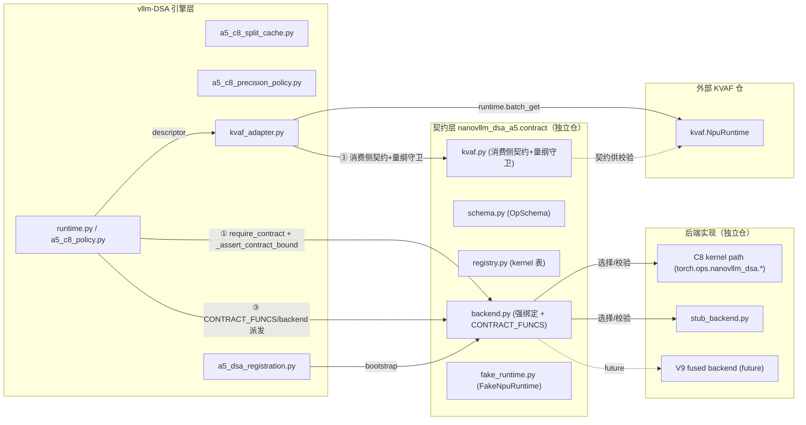
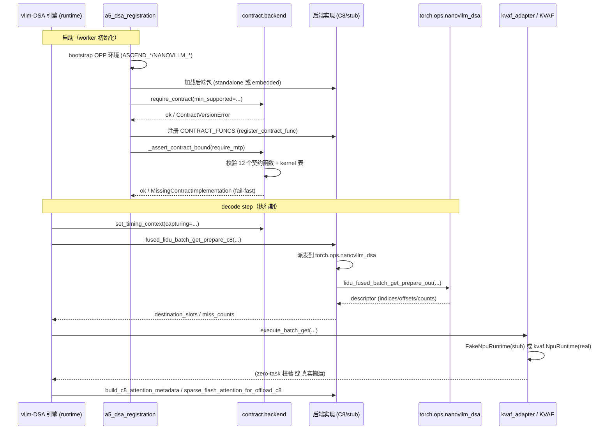

# 契约链设计与扩展性分析

> - 版本：`1.1.0`
> - 配套：[重构分析及实现方案.md](重构分析及实现方案.md) · [融合算子接口契约.md](融合算子接口契约.md) · 代码仓契约描述包 `nanovllm_dsa_a5/contract/`
> - 范围：回答四个问题——(1) 融合算子 ↔ vLLM-DSA ↔ KVAF 之间的"契约链"如何设计、如何打桩、如何收敛为一套可校验的链式契约；(2) 后续扩展融合算子流程时，接口隔离之后修改复杂度会怎么变化；(3) **仅有契约描述是否足够、强绑定如何真正生效**（第 9 节）；(4) **接入契约面后端后的时序与依赖图**（第 10 节）。
> - 核对基线：`vllm-ascend-v0.23.0-custom-v1`；`kvaf_adapter.py`、`a5_c8_policy.py`、`ops_nanovllm.py`、`a5_dsa_registration.py`。

---

## 目录

1. [为什么要"契约链"而不只是一份契约](#1-为什么要契约链而不只是一份契约)
2. [跨仓链路与四类接口](#2-跨仓链路与四类接口)
3. [既有隐式契约：量纲耦合 656/128](#3-既有隐式契约量纲耦合-656128)
4. [契约链设计](#4-契约链设计)
5. [KVAF 消费侧接口契约](#5-kvaf-消费侧接口契约)
6. [FakeNpuRuntime 打桩规格](#6-fakenpuruntime-打桩规格)
7. [契约链 CI 校验](#7-契约链-ci-校验)
8. [扩展性分析：接口隔离后扩展融合算子流程的复杂度](#8-扩展性分析接口隔离后扩展融合算子流程的复杂度)
9. [契约描述不等于已接入：强绑定生效的三处接线](#9-契约描述不等于已接入强绑定生效的三处接线)
10. [修改后的框架契约：时序图与依赖图](#10-修改后的框架契约时序图与依赖图)
11. [结论与建议](#11-结论与建议)

---

## 1. 为什么要"契约链"而不只是一份契约

融合算子不是孤立存在。它上游接引擎（vllm-DSA 的 runtime/policy），下游通过 descriptor 接 KVAF（外部仓）完成真正的 KV 搬运。整条链横跨 **三个仓、四种接口**：

```
┌────────── 融合算子仓 (nanovllm_dsa_a5) ──────────┐
│  fused_lidu_batch_get_prepare(_out)             │
│    └─ 产出 descriptor(indices/offsets/...)      │
└──────────┬──────────────────────────────────────┘
           │ ① Descriptor 布局契约（单仓拥有）
           ▼
┌────────── vllm-DSA 引擎 (KvafAdapter) ──────────┐
│  KvafBatchGetBuffers · execute_batch_get(...)  │
│    └─ ② 引擎内部缓冲→参数适配                    │
└──────────┬──────────────────────────────────────┘
           │ ③ KVAF 消费侧契约（引擎消费侧拥有）
           ▼
┌────────── KVAF 仓 (外部 ak_mtp_yq) ─────────────┐
│  kvaf.NpuRuntime.batch_get(...)  真正搬运       │
└─────────────────────────────────────────────────┘
```

**关键判断**：仓库之间的握手**不能只靠一份"总契约"**，因为每一对相邻仓的边界、权威持有方、变更节奏都不同。隔离的正确形态是**"链式契约"**——每一跳有独立、可版本化、可打桩、可 CI 校验的接口，而不是让引擎代码"手递手"传参、靠默契维护。

只做单仓契约 + "打桩 fake"没解决真问题：如果 fake 的 `batch_get` 签名和真实 KVAF 不一致，或者 656/128 量纲在某一环漂移，整条链会悄悄坏掉，而各个环节各自"看起来没报错"。

---

## 2. 跨仓链路与四类接口

| 编号 | 接口 | 边界 | 权威持有 | 是否跨仓 | 自由度 |
| --- | --- | --- | --- | --- | --- |
| ① | Descriptor 布局（含 `KvafBatchGetBuffers`） | 单仓 → 引擎 | 融合算子仓 | 是 | 单仓可改，需升契约 MAJOR |
| ② | `KvafBatchGetBuffers` → `execute_batch_get` 参数 | 引擎内部 | vllm-DSA | 否 | 引擎自由改 |
| ③ | `kvaf.NpuRuntime.batch_get(...)` 调用 | 引擎 → KVAF | KVAF（引擎持消费侧副本） | 是 | KVAF 可改，引擎适配 |
| L1 | 量纲常量（656/128 等） | 单仓 L1 → KVAF 构造参数 | 融合算子仓（KVAF 消费） | 是 | 需跨仓联检 |

- **① 是强契约**，进单仓 L2（见 [融合算子接口契约.md](融合算子接口契约.md) 的 `fused_lidu_batch_get_prepare(_out)` 与 `KvafBatchGetBuffers`）。
- **③ 是消费侧契约**，权威在 KVAF，但 vllm-DSA 引擎作为消费者必须持有并校验自己对其的假设。
- **L1 量纲**是关键粘合点，见第 3 节。

---

## 3. 既有隐式契约：量纲耦合 656/128

分析代码时发现：vllm-DSA 构造 KVAF 时，把融合算子单仓的 **L1 常量直接作为 KVAF 的构造参数**（`kvaf_adapter.py:176-184`）：

```python
self.runtime = npu_runtime(
    batch_get_kernel_object_path=batch_get_kernel,
    batch_get_token_bytes=DSA_PACKED_KV_DIM,                 # 656（来自 L1）
    batch_get_tokens_per_block=DSA_REQUIRED_CACHE_BLOCK_SIZE, # 128（来自 L1）
    device_id=device_id,
    npu_core_count=...
    batch_put_kernel_object_path=...,
    jettys_per_core=...,
)
```

**结论：单仓 ↔ KVAF 之间存在一条真实但"未被显式定义"的契约**。`DSA_PACKED_KV_DIM=656`、`DSA_REQUIRED_CACHE_BLOCK_SIZE=128` 同时是：
- 融合算子单仓的 L1 常量（决定 packed KV 布局）；
- KVAF 的 `batch_get_token_bytes` / `batch_get_tokens_per_block`（决定 KVAF 按多少字节、多少 token 一块搬运）。

**风险**：一旦单仓改了 packed KV 布局（656 → x），KVAF 会在未察觉的情况下用错误的字节数搬运，整条链静默损坏；单仓、引擎、KVAF 各自都不报错。

因此契约链第一步是：把这条隐式依赖**显式化**，并加**跨仓量纲守卫**（见第 4、7 节）。

---

## 4. 契约链设计

### 4.1 总体原则

1. **每跳有明确权威**：谁能改这个接口、谁必须是消费者侧的校验者。
2. **量纲显式化**：跨仓的量（656/128、2048/16384 等）在不同仓各自有定义时，必须有**一致的命名来源 + CI 一致性校验**。
3. **强绑定范围收敛**：`CONTRACT_FUNCS` / `_assert_contract_bound` 只强绑定**单仓拥有的算子**（① 与 L1），**不强绑定 KVAF**（③ 是对端仓，通过契约 + 打桩衔接，不通过强绑定）。
4. **打桩对齐真实签名**：fake 必须按对端真实契约实现，否则打桩失去意义。

### 4.2 三环 + 一守卫

```
┌ 环A：单仓 descriptor 契约（①，强绑定）
│   fused_lidu_batch_get_prepare(_out) → KvafBatchGetBuffers
│   校验：形状/dtype/有效域/别名
│
┌ 环B：量纲守卫（L1 ↔ KVAF 构造）
│   assert DSA_PACKED_KV_DIM == runtime.batch_get_token_bytes
│   assert DSA_REQUIRED_CACHE_BLOCK_SIZE == runtime.batch_get_tokens_per_block
│
┌ 环C：KVAF 消费侧契约（③，弱绑定、可打桩）
│   FakeNpuRuntime.batch_get(...) 严格复刻签名
│   引擎 execute_batch_get 只依赖该签名
```

### 4.3 契约所有权矩阵

| 契约 | 写入归属 | vllm-DSA 中的载体 | 单仓中的载体 | 打桩实现 |
| --- | --- | --- | --- | --- |
| Descriptor 布局 | 单仓 L2 | 读取 | `stub/stub_runtime.py` | 纯 torch 产 descriptor |
| 量纲守卫 | 共享 | `kvaf_adapter.py` 增强 | `contracts/constants.py` | 一致性检查脚本 |
| KVAF batch_get | KVAF（引擎持消费侧副本） | `kvaf_adapter.py` 的调用处 + `_kvaf_contract.py` | （不在单仓） | `stub/stub_transport.py`（引擎侧） |

---

## 5. KVAF 消费侧接口契约

> 这是第 ③ 跳的**消费侧**契约：vllm-DSA 引擎对 KVAF 的调用假设。权威仍属 KVAF；本契约用于让引擎自校验、并作为 `FakeNpuRuntime` 的实现蓝本。

### 5.1 构造契约

```python
kvaf.NpuRuntime(
    batch_get_kernel_object_path: str,    # BatchGet kernel .o 路径（KVAF_ENABLE_AIV_BATCH_GET=ON）
    batch_get_token_bytes: int,           # 必须 == DSA_PACKED_KV_DIM (656)
    batch_get_tokens_per_block: int,      # 必须 == DSA_REQUIRED_CACHE_BLOCK_SIZE (128)
    device_id: int,
    npu_core_count: int,                  # env VLLM_ASCEND_KVAF_NPU_CORE_COUNT
    batch_put_kernel_object_path: str,    # BatchPut kernel .o
    jettys_per_core: int,                 # env VLLM_ASCEND_KVAF_JETTYS_PER_CORE
)
```

约束：`NpuRuntime` 必须存在（否则报 "external kvaf package does not provide NpuRuntime"）；构造器若为 legacy 签名抛 `TypeError` → 需重建。

### 5.2 batch_get 调用契约（位置参数，`execute_batch_get` 内部的真实样式）

```python
runtime.batch_get(
    address_table,       # int64, 连续, device, numel==geometry.directory_cell_count
    valid_table,         # uint8, 连续, device, numel==geometry.directory_cell_count
    indices,             # int32  ← 来自 fused prepare（KvafBatchGetBuffers.indices）
    offsets,             # int32  ← 来自 fused prepare（KvafBatchGetBuffers.offsets）
    total_miss_count,    # int32[1] ← 来自 fused prepare（miss_counts 末端，设备标量）
    output_indices,      # int32  ← 来自 fused prepare（KvafBatchGetBuffers.output_indices）
    output_rows,         # packed KV 输出缓冲（byte view）
    stream,              # NPU stream
    synchronize_batch_get,  # bool
)
```

### 5.3 5.2 语义 / 边界

- `indices/offsets/output_indices` 的有效域为全局 `[0, total_miss_count[0])`，**不是**每行固定步长 miss 前缀（与 [融合算子接口契约.md](融合算子接口契约.md) §4.5/4.6 一致）。
- `address_table`/`valid_table`/`output` 必须**预先注册/pin 地址**（graph capture 前 `require_graph_batch_get_output_prewarmed`）。
- **返回值 ≠ 数据到位**：payload 可用性取决于 KVAF 的完成机制 + stream/event 依赖；引擎在 QSFA 前必须建立完成依赖，`execute_batch_get` 默认不额外 `synchronize()`（除非 `synchronize_batch_get=True`）。
- 补充路径（非 PR23 紧凑 descriptor）：
  - `full_restore`：`self.runtime.batch_get(...)` 每 budget token 一条 descriptor（`kvaf_adapter.py:1985` 注释），eager-only。
  - `remote_prefill`：source 为 canonical 页，`indices` 是私有 compact table 的 page slot，非原始 key。

---

## 6. FakeNpuRuntime 打桩规格

> 在 vllm-DSA 引擎侧（或在单仓测试 harness）用一个 FakeRuntime 打桩 KVAF 传输，**严格执行第 5 节契约**，从而在无 NPU / 无真实 KVAF 时端到端验证链的正确性。这对应 KVOP 的 "zero-task transport" 打桩模式。

### 6.1 打桩目标

- **不执行真实跨 rank 搬运**（zero-task）。
- 但**严格校验** 每个参数的形状/dtype/有效域，即验证"引擎对 KVAF 的调用符合第 5 节契约"。
- 可选：把 `output_rows` 就地写为 sentinel（或 `prev`），使下游 QSFA 能读到形状合法的 fake 输出。

### 6.2 FakeRuntime 蓝本

```python
class FakeNpuRuntime:
    """Zero-task KVAF runtime：不搬运，只做契约校验。"""

    def __init__(self, *, batch_get_token_bytes, batch_get_tokens_per_block,
                 device_id, npu_core_count, ...):
        # 量纲守卫（环B）
        assert batch_get_token_bytes == DSA_PACKED_KV_DIM
        assert batch_get_tokens_per_block == DSA_REQUIRED_CACHE_BLOCK_SIZE
        self.calls = 0

    def batch_get(self, address_table, valid_table, indices, offsets,
                  total_miss_count, output_indices, output_rows,
                  stream=None, synchronize_batch_get=False):
        self.calls += 1
        # —— 契约校验（第 5.2/5.3 节）——
        _check_device_contig(address_table, torch.int64)
        _check_device_contig(valid_table, torch.uint8)
        _check_device_contig(indices, torch.int32)
        _check_device_contig(offsets, torch.int32)
        _check_device_contig(total_miss_count, torch.int32)  # shape (1,)
        _check_device_contig(output_indices, torch.int32)
        total = int(total_miss_count.detach().to("cpu")[0])
        # 有效域校验：indices/offsets/output_indices 的有效项数为 total
        _check_descriptor_domain(indices, offsets, output_indices, total)
        # —— zero-task：写入合法 sentinel，不真正搬运 ——
        if output_rows is not None:
            output_rows.fill_(-1)   # 示例；也可本地 memcpy 模拟
```

### 6.3 挂接方式

```python
# vllm-DSA 测试 harness
adapter = KvafAdapter(...)
adapter.runtime = FakeNpuRuntime(
    batch_get_token_bytes=DSA_PACKED_KV_DIM,
    batch_get_tokens_per_block=DSA_REQUIRED_CACHE_BLOCK_SIZE,
    device_id=0, npu_core_count=...,
)
adapter.execute_batch_get(address_table=..., valid_table=...,
                          total_miss_count=..., output=..., ...)
```

### 6.4 打桩能验证什么

- 引擎 `execute_batch_get` 传参是否符合第 5 节契约（签名、形状、量纲）。
- fused prepare 产出的 descriptor（环A）是否能被 KVAF 消费侧接受（有效域、对齐）。
- 量纲守卫（环B）是否被触发。
- 不能验证真实搬运正确性与性能（需 NPU + 真实 KVAF）。

---

## 7. 契约链 CI 校验

| 校验 | 归属 | 说明 |
| --- | --- | --- |
| 环A：descriptor 契约 | 单仓 CI | `test_contract_shapes.py` 验证 stub 产 descriptor 满足 [融合算子接口契约.md](融合算子接口契约.md) §4.5/4.6：形状/dtype/有效域/别名 |
| 环B：量纲守卫 | 单仓 CI + vllm-DSA CI | 比对 `contracts/constants.py`、vllm-DSA `contracts.py`、KVAF 构造参数三者一致的检查脚本 |
| 环C：KVAF 消费侧 | vllm-DSA CI | `test_kvaf_adapter.py` 用 FakeNpuRuntime 走通 `execute_batch_get` 契约校验 |
| 链完整 | 联合 CI | `prepare(stub) → fake batch_get` 端到端（无 NPU） |
| 跨文档一致性 | 两者 | V9/precision 等其他文档中引用的常量，统一以 [融合算子接口契约.md](融合算子接口契约.md) L1 为准 |

---

## 8. 扩展性分析：接口隔离后扩展融合算子流程的复杂度

### 8.1 可能的扩展方向（以 V9 融合后端为典型样本）

现有链路：`quant LI → fused LIDU prepare → KVAF BatchGet → metadata → QSFA`。

未来扩展包括（部分已在 [V9 融合后端接入](../../jiangpinfeng/dsa_fused_backend_interface.md) 中作为目标）：

| 扩展类型 | 例子 | 改动落在哪 |
| --- | --- | --- |
| 新增阶段 | LI 与 BatchGet 之间插入冷热 index 扫描、投机预取 | 融合算子仓 + 引擎编排 |
| 算子融合 | 把 LI→LIDU→BatchGet 融成一个 kernel（V9） | 融合算子仓 |
| 布局/量化 | packed KV 尺寸变化（656 → x）、新量化（W8 等） | **量纲 L1 变化 → 触发链式传播** |
| 接口重组 | 融合后端内部消化 descriptor，引擎不再显式调 BatchGet | 契约链 ①②③ 的重排 |

### 8.2 接口隔离对扩展的影响（诚实评估）

**先给结论：隔离整体上是**净收益**，但"对扩展的友好"是有条件的——它降低了"改一个算子不牵连引擎"的耦合，却把**跨仓量纲/布局变更**变成一次需要多方协同的"契约升级"（比改动后做隔离的现状更"重"一档，但更可控）。

#### 有利面（隔离后扩展变得简单的地方）

1. **单仓内部算子进化为透明**：加新 kernel、改 kernel 内部算法、加算子，都在单仓内完成，通过 L2 契约暴露。引擎只需看到一个稳定 wrapper，**不随单仓内部迭代而改**。
2. **引擎重排流程更自由**：只要保持相邻跳的接口，引擎可自行调整调用顺序（LI 是否启预取、BatchGet 是否启用、QSFA 在哪步），单仓不需要知道编排细节。
3. **可打桩 → 扩展可先行验证**：新接口先在 stub 里实现契约校验，引擎端到端（假 kernel + FakeRuntime）先验证，再落真 kernel。**扩展的反向依赖被打破**——不必等 NPU/真 KVAF 才能合入接口改动。

#### 不利面/成本（隔离后扩展反而要小心的）

1. **跨仓量纲变更变"重"**：packed KV 尺寸等 L1 常量牵动 KVAF（量纲守卫）。一旦变 656→x，需要单仓升契约 MAJOR + KVAF 侧同步 + vllm-DSA 升级版本区间。**这是"显式化"的代价**——改前必须协同，但改后不会静默坏。
2. **新增"对端依赖"需要新契约**：若扩展引入新的对外仓能力（如新的远程通信后端），需要新增一跳契约 + 新 FakeRuntime，成本增加。
3. **接口重组需重排契约链**：若 V9 把 BatchGet 消化进后端内部（引擎不再显式调用），则 ③ 这一跳从引擎转移到后端内部，契约链需重排——这是架构级变更，隔离不消除这项工作，只是让它在"受控的边界"内发生。
4. **schema 校验的僵化风险**：若把 schema 精确校验做死（任何签名字符串变化都 fail），会阻碍合理的扩展。**缓解**：schema 校验区分"MAJOR 变化（硬失败）"与"MINOR 扩展（新增可选参数，向后兼容放行）"。

### 8.3 隔离与否的复杂度对比（扩展视角）

| 场景 | 现状（未隔离） | 隔离后 |
| --- | --- | --- |
| 改某个 kernel 内部 | 可能牵连 `vllm_ascend_C` 重编译、OPP 重装、引擎同步 | 单仓内独立发布、打 tag，引擎升级版本区间即可 |
| 引擎流程重排 | 直接改 policy/runtime，但算子实现细节渗入 | 只依赖 wrapper 契约，编排清晰 |
| 新量化/新布局 | 量纲散落多处，易漏改、静默坏 | 量纲守卫强制多点一致，改前必须协同（受控的"重"） |
| 新增独立算子 | 注册进 `vllm_ascend_C`，受 vLLM release 绑定 | 单仓独立迭代，独立发版 |
| V9 融合后端 | 大 patch，牵动 model runner / 图 / pipeline | 后端内部消化，对外只改 L2 契约 + 引擎编排 |

### 8.4 让"隔离后的扩展"尽量简单的 4 条原则

1. **契约分级变更**：区分 MAJOR（破坏性）与 MINOR（向后兼容新增），让扩展多数走 MINOR（新增可选参数/算子），不触发全链。
2. **量纲/布局变更设"独立升级流程"**：一旦触碰 L1 量纲，走"单仓 MAJOR → vllm-DSA 版本区间 → KVAF 同步"的固化流程，避免静默漂移。
3. **新能力先进 stub，后落 kernel**：接口先行、打桩验证、再实现，把扩展风险前移。
4. **schema 校验对 MINOR 放行**：允许新增可选参数/算子而不强制旧版本 fail，减少扩展摩擦。

---

## 9. 契约描述不等于已接入：强绑定生效的三处接线

### 9.1 现状核查（代码事实）

对 `nanovllm_dsa_a5/contract` 契约描述包在仓库中的接入程度做核查，结论是：**契约描述包目前是"悬浮"的，没有接入生产运行路径。**

| 检查项 | 现状 | 说明 |
| --- | --- | --- |
| `vllm_ascend` 是否 import `nanovllm_dsa_a5.contract` | **否**（grep 无命中） | 引擎侧完全没有引用契约包 |
| `_assert_contract_bound` 是否被任何引擎代码调用 | **否** | 只在 `nanovllm_dsa_a5/tests/` 内自测 |
| `CONTRACT_FUNCS` 是否由生产后端填充 | **否** | 仅 `stub_backend.install_stub()` 填充；C8 生产内核未接入 |
| 当前运行时的"强绑定" | **弱绑定** | `ops_nanovllm.py:52-99`、`a5_dsa_registration.py:75-84` 仅 `hasattr(torch.ops.nanovllm_dsa, name)` 存在性检查 |
| 当前怎么跑通整条流程 | 既有重接路径 | `ops_nanovllm.py` 直接调 `torch.ops.nanovllm_dsa.*`（内嵌 `vllm_ascend_C`） |

**结论：契约描述包单独存在，不等于当前仓已按契约隔离、也不保证强绑定生效。** 它当前的价值是：权威 ABI 描述、CI 校验对象、强绑定/打桩/量纲守卫的"蓝图起点"。

### 9.2 契约描述解决什么、不解决什么

| 目标 | 契约描述够吗 | 缺什么 |
| --- | --- | --- |
| 定义边界 / 可校验 ABI | ✅ 已够（`contract` 包 + doc） | — |
| 跑通 vllm-DSA 整条 decode 的既有路径 | ❌ 不是契约驱动 | 需 `vllm_ascend_C` 内嵌注册 + OPP + KVAF runtime（现有路径仍可用） |
| 让强绑定真正生效 | ❌ 未接线 | 见 §9.3 三处接线 |
| 切后端（C8→V9） | ❌ 未接入 | 需让 `ops_nanovllm` 走契约面的 backend 派发 |
| CI 校验契约一致 | ✅ 已够 | 已提供 `contract.validate`，需接入 CI |

### 9.3 强绑定生效的三处接线

要让"抽象接口必须有实现"真正生效，需要在 vllm-DSA 引擎侧做三处接线（现在都还没做）：

```text
接线① 启动调用：worker/runtime 初始化时调用
        contract.backend.require_contract()  +  _assert_contract_bound(require_mtp)
接线② 填充契约函数表：CONTRACT_FUNCS 由真后端（C8）register_contract_func 填充，
       而非只用 stub
接线③ 运行时派发：ops_nanovllm 从"直接 torch.ops.nanovllm_dsa.*"改为
       "经 CONTRACT_FUNCS / backend 分派"
```

**接线① 是"调用它"**：vllm-DSA 启动路径（如 `runtime.py` 的 `require_nanovllm_dsa_ops`，或 `a5_dsa_registration.py`）补一次调用，把 `require_contract` + `_assert_contract_bound` 接入 fail-fast。

**接线② 是"真实现填充"**：`stub_backend.install_stub()` 换成 C8 生产实现也调用 `register_contract_func(...)`，否则强绑定只会校验到 stub。

**接线③ 是"运行时指向契约面"**：`ops_nanovllm.py` 的内部调用收敛到 `contract.CONTRACT_FUNCS` 或 backend 分派，使后端切换（C8/V9/stub）对引擎透明。

三处都接上后，强绑定才真正审计"每个声明算子都有实现"；否则它只是测试里可跑的孤立模块。把这三点落到代码的位置（供实现参考）：

| 接线 | 建议落点 |
| --- | --- |
| ① | `vllm_ascend/a5_dsa_registration.py::require_a5_dsa_registration` 或 `dsa_offload/runtime.py` |
| ② | `nanovllm_dsa_a5/` 的 C8 backend（`backends/c8.py`，plug-in 点） |
| ③ | `vllm_ascend/dsa_offload/ops_nanovllm.py` |

---

## 10. 修改后的框架契约：时序图与依赖图

本节给出**接入契约面后端 + 强绑定生效之后**的框架契约时序与依赖关系（对应 §9 三处接线完成后的目标形态）。当前生产仍是既有重接路径；本节是目标蓝图。

### 10.1 依赖图（组件级）



说明：
- 引擎只依赖**契约层**（`CONTRACT_FUNCS` + kernel 表 + 量纲守卫），不依赖具体后端。
- 后端（C8/stub/V9）实现同一 L2 契约，由 `backend.backend_kind()` 选择。
- KVAF 为外部仓，通过 `kvaf.py` 消费侧契约 + 量纲守卫 + FakeRuntime 打桩衔接，不强绑定进 `CONTRACT_FUNCS`。

### 10.2 强绑定 + 运行时序（sequence diagram）



### 10.3 时序要点

1. **启动 fail-fast**：`require_contract`（版本）+ `_assert_contract_bound`（函数/kernel 全）在 worker 初始化完成，缺实现立即 `RuntimeError`，不进入 decode。
2. **capturing 显式注入**：`set_timing_context` 由引擎推动，契约层/后端不再读 `vllm.forward_context`。
3. **执行期走契约面**：引擎调用的是 `CONTRACT_FUNCS`/后端 wrapper，而非 `torch.ops.nanovllm_dsa.*` 直调；后端切换对引擎透明。
4. **KVAF 打桩可插拔**：`kvaf.NpuRuntime` 在测试/无 NPU 时替换为 `FakeNpuRuntime`（zero-task + 契约校验），强绑定范围不含 KVAF。

### 10.4 生产环境热路径性能设计（不带冗余）

**评审结论：契约化本身不会在 decode 热路径引入"冗余流程步骤"，前提是把"启动期约束"与"运行期调用"分离。** 下列约束必须在实现接线③（`ops_nanovllm` 收敛到契约面）时遵守，否则每步会平白增加 CPU 开销。

#### 10.4.1 启动期 vs 热路径开销分离

| 阶段 | 允许做什么 | 代价 | 频率 |
| --- | --- | --- | --- |
| 启动期（worker 初始化） | `require_contract` + `_assert_contract_bound` + `CONTRACT_FUNCS` 填充 + env 解析 | O(几十) 次 Python/字典，毫秒级 | 每 worker 一次，可忽略 |
| 热路径（decode 每 token） | 只做**一次已绑定的函数调用**，不做校验/查后端/env 读 | 一次直接函数调用，与现 `ops_nanovllm` 直调 `torch.ops` 等价 | 每步若干次 |

热路径必须**初始化期解析一次、运行期绑定引用**：

```python
# ---- 启动期（一次）----
_resolved_backend = resolve_backend_once()   # env 只读一次 + 校验一次
_fused_prepare = CONTRACT_FUNCS["fused_lidu_batch_get_prepare_c8"]  # dict 查一次，绑定引用
# ---- 热路径（每步，无法避免）----
_fused_prepare(topk_indices=..., ...)   # 直接函数调用，等价现有直调
```

#### 10.4.2 热路径绝对禁止项（遵守 AGENTS.md NPU 约束）

必须**拒绝**引入以下任何一项，否则会阻塞 `AsyncScheduler`/造成每步同步：

1. **`tensor.item()` / 设备标量 D2H**：不把 `miss_counts` 等转成 Python 下标读到 CPU（现有 `ops_nanovllm` 已遵守，契约化后不得退化）。
2. **隐式 `contiguous()` / 拷贝大 KV**：wrapper 只能做 metadata `view`（`_a5_topk_view`/`_squeeze_cache_head_dim`），不得 `clone`/`to(dtype)` 大张量。
3. **每步 shape/dtype 运行时强校验**：`contract.schema.OpSchema.validate_params()` 是**启动/测试期**工具，**禁止**在热路径每步调用（它的 20 参循环 + 分支虽 CPU 级，仍应避免）。
4. **每步 `torch.npu.synchronize()`**：保持现有 `capturing` 语义（仅 `capturing=False` 才 sync），契约化不得改为无条件 sync。
5. **每步动态后端查找**：`backend_kind()` / `resolve_backend_once()` 只在启动期调用，运行期用已绑定引用，避免每步读 env / 字符串比较。

#### 10.4.3 契约层 vs 算子的开销边界

真正决定 decode 吞吐的是 **NPU kernel 时延 + 通信**（数十微秒级），而非多一层 Python wrapper 的**微秒级 CPU 派发**。当契约层遵守 §10.4.1/§10.4.2 时，其热路径代价与现有 `ops_nanovllm` 直接调用 `torch.ops.nanovllm_dsa.*` **完全等价**，可视为零额外运行成本。性能风险不在"契约化"，而在"把启动期校验误放进每步"。

#### 10.4.4 文档与事实源收敛（配合 §9/§10）

| 现状 | 建议 |
| --- | --- |
| 3 份 md + 1 份代码契约包表达同一契约 | 以 `nanovllm_dsa_a5/contract/*.py` 为**唯一机器可执行事实源**；md 收敛为 2 份（《融合算子接口契约.md》= 人类可读契约手册，标注"以 contract 包为准"；《重构分析及实现方案.md》= 接入/扩展/热路径性能设计） |
| 《契约链设计与扩展性分析.md》独立成册 | 其内容并入方案（KVAF 边界、强绑定接线、时序/依赖图、热路径性能设计），删除独立文件，减少 4 处同步维护 |

——> 修订说明见文末。

---

## 11. 结论与建议

1. **契约链不是一份契约，而是"三环一守卫"的链式模型**：单仓 descriptor 契约（强绑定）＋跨仓量纲守卫＋KVAF 消费侧契约（可打桩），各跳各有权威与 CI。
2. **量纲 656/128 是当前唯一 "已经存在但未显式定义" 的跨仓契约**，必须最先显式化并加守卫。
3. **打桩要复刻真实签名**，FakeNpuRuntime 严格按第 5 节实现，否则打桩不能证明链正确。
4. **接口隔离对扩展是净收益，但有条件的**：它让"单仓内部进化"和"引擎流程重排"变简单，却把"跨仓量纲/布局变更"变成需协同的显式升级。**关键是契约分级变更 + 量纲独立流程 + 新能力先进 stub**——做到这三点，隔离后的扩展复杂度可控且可预测。

---

**修订说明**：
- v1.0 初版：基于对 `kvaf_adapter.py`（构造与 `execute_batch_get`）、`a5_c8_policy.py`（prepare→BatchGet 编排）的分析；量纲耦合与 KVAF 消费侧契约取自代码事实。
- v1.1 补充：新增第 9 节（契约描述 ≠ 已接入；强绑定生效的三处接线——启动调用、真实现填充 `CONTRACT_FUNCS`、运行时指向契约面）与第 10 节（接入契约面后端后的框架契约时序图 `sequenceDiagram` 与依赖图 `flowchart`），并增补 §10.4 生产环境热路径性能设计（启动期/热路径开销分离、热路径禁止项、契约层 vs 算子开销边界、文档收敛建议）。现状核查基于对 `vllm_ascend/` 的 grep（`_assert_contract_bound`/`nanovllm_dsa_a5.contract` 无引用）与 `ops_nanovllm.py:52-99`、`a5_dsa_registration.py:75-84` 的弱绑定确认。
