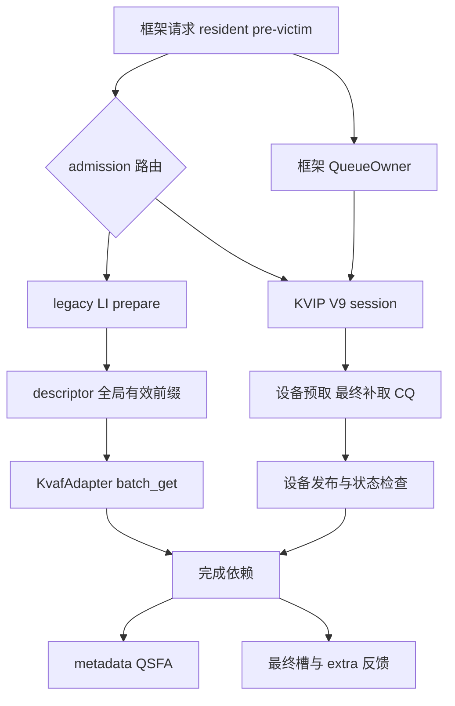
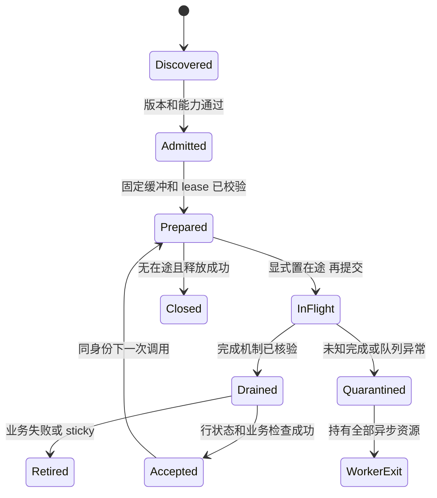
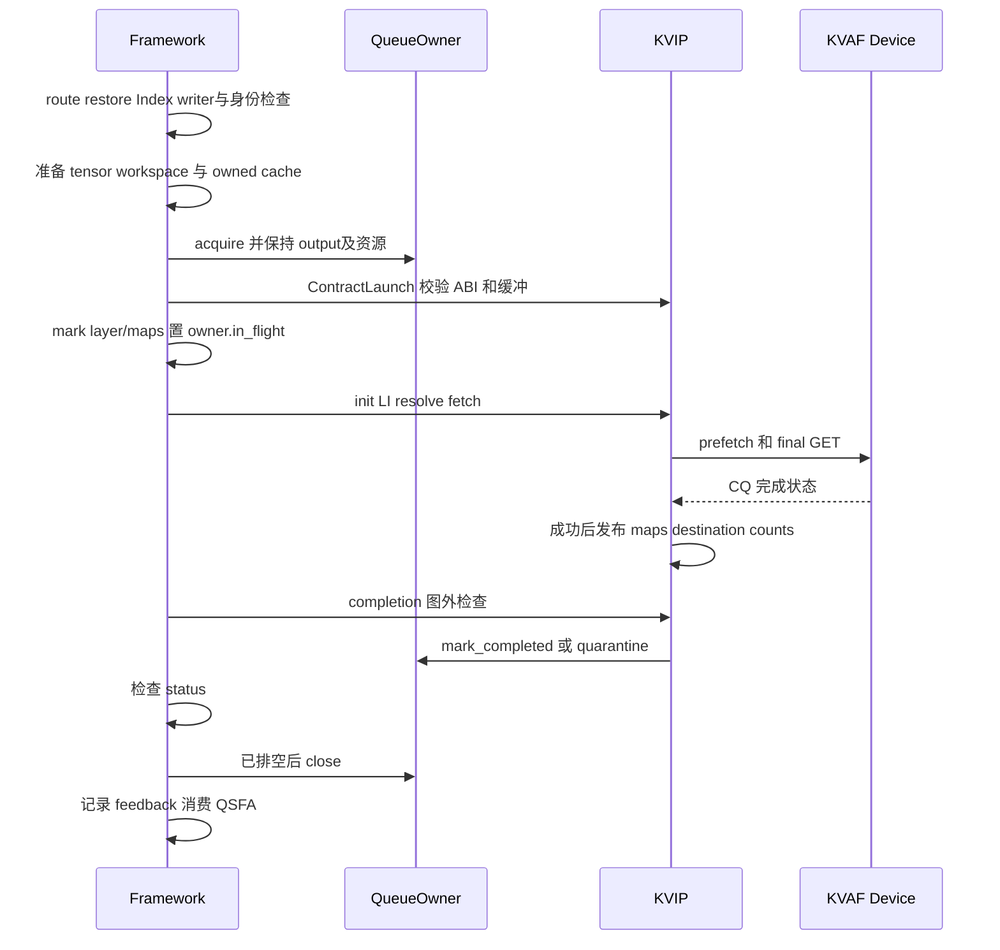

# 契约链设计与扩展性分析

版本：`2.0.0-draft.1`；日期：2026-10-31；基线：`fae4597f7`。
配套：[接口契约](融合算子接口契约.md)、[符合性审计与补齐清单](KVIP实现符合性审计.md)。
[原稿 1.1.0](原稿/契约链设计与扩展性分析_v1.1.0.md) 保留供追溯。

## 1. 当前应有的两条契约链

KVIP V9 已在最新分支接入；传统 descriptor 链仍保留为 fallback/对照，二者共用
布局、请求身份和下游语义，不共用强制的执行步骤或完整函数集合。

V9 内部直接使用 KVAF device ABI，框架仍负责 runtime、PUT、注册和 lease。
不能简单把 KVAF 从框架移至算子仓，也不能只对 batch_get 签名打桩就覆盖 V9。

## 2. 契约归属和分层

| 层 | 提供者 | 消费者 | 校验点 |
|---|---|---|---|
| LayoutSpec | 共同确认的公开规范，KVIP 发布 | framework、KVAF bridge | 启动/lease 的 token_bytes、block_tokens、量化布局 |
| legacy descriptor | prepare producer | framework/KVAF consumer | dtype、别名、全局 count、有效地址域 |
| V9 后端语义 | KVIP | framework adapter | capabilities、admission、SelectionResult、owned Index 生命周期 |
| queue/transport | KVAF runtime + device SDK | framework owner + KVIP kernel | 注册范围、版本、geometry、独占/完成/错误 |
| request/pre-victim/attention | framework | backend 与下游 | 身份、generation、epoch、还原、feedback 与消费顺序 |

共享常量应由机器规范发布并生成文档。重复常量一致只能证明拷贝一致，不能证明
真实 KVAF runtime 或设备布局兼容；要核对真实返回的 lease 和已编译库元数据。

## 3. 发现、绑定和 admission

启动发现与执行绑定分开：

1. 查询包版本、公开契约、layout 与所需 profile；生产禁止绑定测试 provider。
2. 按 profile 检查实现集合；legacy prepare、V9 fused、attention 可以独立提供。
3. admit 当前请求：Q、batch、长度、budget、资源、页共享/恢复状态。
4. prepare 固定 tensor/workspace/Index/lease，并校验设备库 ABI、大小、偏移、几何。
5. 将已验证句柄绑定至 runtime/session，enqueue 使用它；保持不可变 provider 选择。

不建议可变进程全局 CONTRACT_FUNCS，也不通过“存在同名 callable”推断语义正确。
真实绑定至少校验签名/版本、访问模式、实际调用和结果 fixture；不能让 stub 满足
生产能力。原稿的“12 个函数全部存在”改为最小能力组要求。

`admission` 拒绝可在副作用前走原生；若 owned Index 已重排，先完成必要 restore。
通信已提交或 resident 可能被覆盖后失败，隔离并按 worker 故障处理，不能重跑 legacy。

## 4. 正常与失败状态机

Drained 不是 Accepted；`mark_completed` 只解除 DMA 在途约束。
map 发布发生于设备 fetch/CQ 成功路径，host 接受之前可能已完成。多个请求的发布
不是全 batch 原子事务；host 一行失败可以导致整个 worker retired，不能假定其他行
自动回滚。Index 维护可早于 CQ，失败之后不得以“map 未发布”为由恢复正常消费。

### eager 时序

prepare 分成 host/buffer 准备和 launcher 初始化两部分；实际 eager 源码顺序为
准备 inputs/cache/workspace→owner.acquire→ContractLaunch→标记→launch→completion→
finally close→policy 的 metadata/feedback。close 与反馈先后不是结果语义的公共保证，
但必须满足异步资源生命周期。

## 5. Graph 的独立契约

预构建发生在 capture watchdog 之前；注册及固定 buffer 在 capture 之外完成。
profile=2 用于全 dummy capture；真实 replay 在 begin 前准备身份、growth、epoch
和指针表。begin_fused_graph 持有帧级独占，Graph 内执行 writer、四阶段 kernel 和 guard。
guard 将失败锁存并替换危险索引，结束边界读取 checks、end_fused_graph 或 quarantine。

`set_timing_context` 不使用进程级全局状态；将 capture/replay/stream/policy 显式绑定到
调用/session。若未来使用 ContextVar，必须定义嵌套恢复与跨线程传播，不能假设自动正确。
host 标记应在首次可能写入前生效。当前 `PreVictimRuntime.begin` 对 GRAPH_REPLAY
预置 `_maps_may_have_changed=True`；不能因 `GraphLayer.execute` 中的标记位于
launch 后，就断言 replay 缺少提前标记。后续测试须覆盖 replay 开始即失败的退场。

## 6. 桩和测试的责任

| 级别 | 应验证 | 不支持的结论 |
|---|---|---|
| legacy FakeNpuRuntime | 九参实际调用、布局、全局有效前缀、未写区保护 | V9 lease 协议、真实网络正确性 |
| host oracle/HostTransport | H0、选择、计划、延迟完成、失败保留资源与反馈 | 设备 kernel 执行或硬件进度 |
| NPU memory 桩 | 实际 V9 kernel 的 descriptor 和本地 payload 复制 | CQ 网络性能、真实 rank 完成 |
| 真实 KVAF | runtime/SDK ABI、lease、SQ/CQ、visibility、故障 | 完整模型 accuracy 或 TPOT |
| 框架模型测试 | Graph/eager、pre-victim、QSFA、服务恢复与性能 | 不同 SDK/SoC 的无条件兼容 |

zero-task 桩只报告“编排/metadata 检查通过”；正确性桩必须复制有限且可解码 payload。
测试库通过标记隔离，不能因 CI 环境不支持 NPU 就让 stub 自动替换生产后端。
Fake 不能全池 fill(-1)，count 的 D2H 仅限 CPU 或图外测试。

## 7. 扩展成本与稳定接口

| 扩展 | 预计改动范围 | 必须保留的约束 |
|---|---|---|
| 调整预取窗口、优化 kernel/队列提交 | KVIP 内部和 build fingerprint | logical 输出、完成与副作用保证不变 |
| Q2/Q3 或变长能力 | capabilities、device、oracle、adapter admission | 不能改常量后就宣称支持；普通 Q1 可继续 legacy |
| 新传输后端 | owner/transport profile 和专属测试桩 | 相同结果与生命周期，不泄漏 SDK 私有对象给框架通用层 |
| 新量化布局 | 新 LayoutSpec、算子与 consumer 协商 | 不把所有布局硬绑定为 656；旧布局继续可选 |
| 新 kernel 阶段切分 | KVIP private device ABI | 框架不依赖 kernel 数量和私有计数下标 |
| 公共生命周期/API 变化 | 单独 public version 协商与迁移 | C/torch/Python 分别定义兼容规则 |

原稿“V9 可以完全透明地替换 C8”改为：只要消费者要求的 profile/capability 满足，
内部实现可独立演进；职责改变、H0/计数语义变化和新增生命周期仍需显式集成。

## 8. 热路径约束与文档演进

启动绑定一次、prepare 校验当前 buffer、kernel 校验动态值；steady enqueue 只执行
已绑定实现。复用目标 buffer 不等于当前 Python 组合没有临时分配。
eager acquire/completion 会同步、32 头 packing 会分配复制；这些现状要纳入优化基线。
以 host dispatch/selection/TPOT 测量回归，删除“完全等价、零额外成本”的未经测量结论。

机器规范覆盖完整行为后生成字段表；本次仍由规范条款 C01..C18 配合审计差异 G01..G11
追踪。历史原稿保留于原稿目录。符合性审计明确已实现、部分实现、缺失、范围外与未验证；
当前目标规范不能因已有缺口自动标成已实现。
