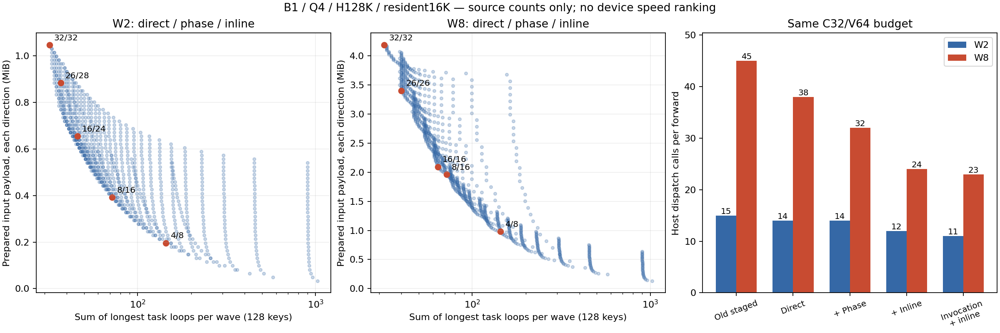

# A5 32 AIC / 64 AIV：MR14 分核实验

日期：2026-11-17。基于 `aa1ea91` 工作树，源码由结果 JSON 中的 SHA256 绑定。固定 B1、Q4、H131072、resident16384、indexHeads32、656B token、Fetch2。当前默认生产路由仍为 legacy。

本轮已完成源码调度实验和 A5 命令校验，**没有新增 A5 微秒数或可接受的 CANN Model 周期结果**。目标是筛选真机控制组，确认削减编排开销是否能转化为相对库上 P2 的整链收益。

## 已完成的实验

- 编译并执行当前及 `04ddfaa` 的实际 host 分发代码；设备 launch 用记录器替代，不执行设备指令。
- C32/V64 下，Ph/Pc=1..32、W2/W8、三种 prepare、两种 Service 共 12,288 项主网格，另有 12 项原版/当前控制及 30 项 Fetch 宽度组合。
- 每个 owner/Q 的 history 区间精确覆盖、无缺口和重复；每项数学工作保持 2,147,483,648 个 QK MAC、458,752 次 Cold predicate 比较。
- 现有 12 项 CPU host/prepare/pack/ready/harness 检查通过；80 条 W2/W8、prefetch512 的命令已由真实 `workloads.configuration` 校验。另校验默认完整计划及预算过滤：32/64为160条，28/56与32/56各144条，8/16为96条，共544条；均未启动设备。

原始产物为 `tests/results/a5-budget-3264-20261117/` 中的 CSV、summary、计划；仓库保存[结果索引](results/a5-budget-3264-20261117.json)和图。原始目录由 Git 忽略，交付包包含 CSV 与校验计划。

## 相同分片数下的机制变化

下面各项使用自动分片，在该几何和预算下为 Ph32/Pc32。Cold score 字节仅是 canonical/scratch 的有效读写载荷，不含完整 GM 事务、cache sector、bitmap 和其它阶段。

| 路线 | W2 dispatch | W8 dispatch | Cold score 载荷 |
|---|---:|---:|---:|
| 原 staged separate/wave | 15 | 45 | 3.5 MiB |
| direct/wave/separate | 14 | 38 | 0.875 MiB |
| direct/phase/separate | 14 | 32 | 0.875 MiB |
| direct/phase/inline | 12 | 24 | 0.875 MiB |
| direct/invocation/inline | 11 | 23 | 0.875 MiB |

W8 direct/phase/inline 减少 46.7% 的 host dispatch，Cold score 载荷减少 75%。这些都是相对原 staged 的源码成本，不能直接称为设备指令缩减或 A5 提速，也没有与 P2 的融合流式 score 流量作等价比较。

需要修正先前慢因解释中的一项：当前源码 resident TopK/唯一 θ 只生成一次；后续七次 Cold progress 分类互不重叠的区间并发布 ready。用户报告中的 progress 耗时是瓶颈，但不能归因为“每个窗口重新扫描全部 resident”。direct 已让 Cold predicate 继承每个 score task 的两个配套 AIV，inline 只减少 ready launch，仍等整个 epoch 的 score 完成。

## 分片数的权衡

以下均为 direct/phase/inline。循环列是“每个 score wave 最长 task 的 128-key 循环数求和”，并非 ISA 数量或实际周期。准备载荷为 Q/weight/qscale 每个读、写方向各自的字节。

| W | Ph/Pc | dispatch | 最长任务循环求和 | 准备载荷/方向 | θ padded DMA |
|---|---|---:|---:|---:|---:|
| 2 | 4/8 | 12 | 144 | 205,824 B | 8,192 B |
| 2 | 8/16 | 12 | 72 | 411,648 B | 16,384 B |
| 2 | 16/24 | 12 | 46 | 686,080 B | 24,576 B |
| 2 | 26/28 | 12 | 37 | 926,208 B | 28,672 B |
| 2 | 32/32 | 12 | 32 | 1,097,728 B | 32,768 B |
| 8 | 4/8 | 24 | 144 | 1,029,120 B | 57,344 B |
| 8 | 8/16 | 24 | 72 | 2,058,240 B | 114,688 B |
| 8 | 16/16 | 24 | 64 | 2,195,456 B | 114,688 B |
| 8 | 26/26 | 24 | 40 | 3,567,616 B | 186,368 B |
| 8 | 32/32 | 24 | 32 | 4,390,912 B | 229,376 B |

Ph4/Pc8 相对 P32 减少 76.56% 的准备载荷，却使关键循环计数增至 4.5 倍，因此必须同时测低、中、高分片。W8/P32 每个 Cold task 只有 512 keys、四次内循环；W8/P8 为 2048 keys、十六次内循环。独立 UB 允许这些任务并行，却不能消除短任务固定成本、阈值重复加载、launch 或整 epoch join。



W2/P32 的总循环计数与 W8/P32 都是 32，但前者准备载荷仅四分之一、Service 调用少六次。W8可能因更早产生 Cold 预取受益；只有真机能判断通信隐藏收益是否超过更多阶段边界的成本。

resident/Final TopK 的 history 分片仍各为 1，Service 仍按 owner 唯一规划。将 Ph/Pc 增大不会自动加速这些阶段。未来让 Service 与 score 真正重叠时，还必须预留实际 Service/Fetch AIV 预算；P32 占满 64 个配套 AIV，没有额外 AIV 供并发 Service 使用。

## A5 上如何比较

新入口[run_a5_budget.py](../../../tests/operators/lifetch/cold_parallel/run_a5_budget.py)包装当前 `test_lifetch.py`，使用窗口专属短名单，并保留五个同构建控制：legacy P2、原 staged、direct、direct+phase、direct+phase+inline。每轮路由交错，case 串行；r0 丢弃，r1/r2/r3 计时。实际资源不足时过滤超预算候选，不能将设备总核数视为可用预算。

先确认当前 checkout 包含此实验版本，启用原 CANN/TorchNPU/KVAF 环境，将 KVAF 路径换为实际路径。先跑 W2/prefetch512，共 40 个 case，比较 B1 下相同有效窗口策略：

```bash
python3 tests/operators/lifetch/cold_parallel/run_a5_budget.py \
  --repo "$PWD" --kvaf-root /path/to/KVAF --device 5 \
  --windows 2 --prefetch 512 --fetch-workers 2 \
  --aic-budget 32 --aiv-budget 64 \
  --output /home/w00568585/mr14_a5_3264_W2 --execute

python3 tests/operators/lifetch/cold_parallel/summarize_controls.py \
  /home/w00568585/mr14_a5_3264_W2/W2
```

去掉 `--execute` 只打印命令。32/64 仅在真实可用时填写；可改为28/56，脚本会过滤 P32，使用新 output。然后补 W2/W8、prefetch0/512；默认 160 个 case，结果分成 W2/W8 子目录：

```bash
python3 tests/operators/lifetch/cold_parallel/run_a5_budget.py \
  --repo "$PWD" --kvaf-root /path/to/KVAF --device 5 \
  --windows 2,8 --prefetch 0,512 --aic-budget 32 --aiv-budget 64 \
  --output /home/w00568585/mr14_a5_3264_full --execute

python3 tests/operators/lifetch/cold_parallel/summarize_controls.py \
  /home/w00568585/mr14_a5_3264_full/W2
python3 tests/operators/lifetch/cold_parallel/summarize_controls.py \
  /home/w00568585/mr14_a5_3264_full/W8
```

比较 `prototype_with_update`；candidate/legacy<1 才证明整链超过库上 P2，candidate/staged-before<1 只证明修复原 staged 劣化。`native_chain` 是 SDK QLI→LIDU→KVAF 参考，不作为 P2。

检查 manifest/receipt、全部 correctness PASS、实际 AIC/AIV、score wave queryGroup/rows/stride 和 binary SHA。请求 W8 的 B1 legacy 实际仍为 W2，所以 W8 比较包含预取策略变化，不能称两边有效窗口完全相同。原 `056fe62` 的 legacy 还需单独复跑，排查新增编译代码导致的基线漂移。

固定找到的参数再独立复跑，随后单独比较 phase/invocation 和 Fetch1/2/4。常规计时与 msprof 分开；精确首次 Fetch、未覆盖 join、ConsumerReady 仍需真机 trace/设备埋点。当前脚本测量整链完成，不能替代这些阶段时间点。

## 仿真状态及后续方向

CANN9.1/950 的完整 Model baseline 曾超时/exit139。本轮重试尚未得到完整 oracle 和正常结束 footer，状态为 NOT_ACCEPTED；不发布 Model 周期比值。[观察记录](results/model-exploration-20261117.json)绑定原始失败结果和日志。它使用 H8192/R6400 smoke、prefetch0、同步 GM Fetch adapter，不能替代 H128K/R16K 的 A5 URMA 实验。

当前已实现的分类融合与 launch 削减先由上述控制组检验。若仍不能超过 P2，按 trace 决定下一项：共享真实输入映射消除虚拟 row 复制；比较留在 vector reduction 内替代高频 SIMT bitmap pack；减少 θ padded DMA；段级 ready＋owner Service 重叠；最后以私有 buffer 分离 Final 与 classification。后两项需同时处理资源预留、可见性、乱序缺口和别名，当前尚未实现。

重现本地调度与图：

```bash
python3 tests/operators/lifetch/cold_parallel/explore_a5_budget.py \
  --aics 32 --aivs 64 --output tests/results/a5-budget-new
python3 tests/operators/lifetch/cold_parallel/plot_a5_budget.py \
  tests/results/a5-budget-new --output tests/results/a5-budget-new/tradeoffs.png
```

依赖：Python3.9+、NumPy、C++17；绘图另需 matplotlib；Git 中须有 `04ddfaa` 基准。
