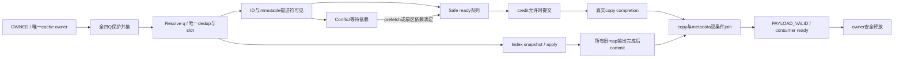

# 状态机、同核复用与自适应分核：当前42场景的计算模型及改造方案

分析基线：`155fa9707d67fa95a028df485592240f0dd23138`（业务逻辑与前次源码审计一致）。本次只新增分析、结构计数器和CPU核验，不修改生产调度、不执行新Model/NPU性能测试。对应前次[完整源码审计和trace](end_to_end_schedule.md)。

**建议优先研究“保留依赖状态机，Producer+Output同核复用，Index Consumer独立，Fetch按ready描述符和字节调度”的混合方案。小batch另优先补足history/Final并行度，大batch优先消除每request固定角色驻留。** 这是一项有源码依据、待实验的优先级判断；目前没有完整streaming的同条件A/B数据，不能宣称哪个方案已更快或给出收益百分比。

## 1. 三个问题应分别优化

| 维度 | 决定的问题 | 当前实现 | 建议 |
|---|---|---|---|
| 状态机/依赖 | 谁依赖谁，何时可提交、可见、消费、复用 | event/flag、safe/conflict、metadata与payload完成条件 | 保留语义，改为可让出的短步骤，显式ready队列 |
| 数据放置/核复用 | 哪些状态能留在同一核UB，何时换角色 | 三角色各有私有UB，经GM交换；role0已先Producer后Finalize | 优先融合P/O的活跃状态；按生命周期覆盖UB，C保留并行 |
| 任务派发 | 哪些就绪任务分给哪些核 | request固定3角色；Fetch按b mod W | 按owner、剩余工作、字节、依赖和credit派发 |

状态机可以驱动同核复用，也可以驱动分角色流水。把三角色函数顺序拼接不等于实现了安全复用：当前Producer末尾等待Output完成，再Destroy UB；必须把该等待改写为状态转移，才能合并Producer和Output。当前尾部本来就是一个kernel，融合角色**不会天然省一次kernel launch**。

现有重叠发生在两处：Cold score与Service交错；尾部Producer逐Q发布后，Consumer更新Index、Output打包、Fetch safe阶段可以并行，冲突阶段等prefetch完成。它在结构上试图隐藏搬运和元数据时间；历史Fusion3与串行6kernel的差值还包含融合、边界和其他变化，不能称为纯重叠收益。完整当前streaming“开/关重叠”与“开/关UB复用”尚未测量。

## 2. 标准场景到底改变哪些工作量

固定`H=131072、R=16384、Q=4、K=2048、D=128`，B=1/2/4/8/16/24/32，目标miss=3/5/10/15/20/50%，共42组。G32/G64、C32/V64与C28/V56、payload656/2624作为附加分析轴，形成336行结构计数，不代表336次执行。

| 名义miss | 每Q整数cold数m | 当前fixture每request冷集合并集U | 无prefetch等额外因素时656B冷payload/request |
|---:|---:|---:|---:|
| 3% | 61 | 122 | 80,032 B |
| 5% | 102 | 204 | 133,824 B |
| 10% | 205 | 410 | 268,960 B |
| 15% | 307 | 614 | 402,784 B |
| 20% | 410 | 820 | 537,920 B |
| 50% | 1024 | 2048 | 1,343,488 B |

该fixture特意令Q0=Q2、Q1=Q3的cold集合，两个集合不交叠，所以U=2m。batch内复制同一request seed，**没有覆盖request之间真实负载倾斜**。一般Q4的U可随交叠改变，不能总用2m。U是最终选中冷token的集合大小，既不是未满足位置M，也不是实际repair描述符D。20%的实际整数比例为20.01953125%。

每request固定有1024个128-token history tile（Hot128、Cold896）。数学QK工作量为`Q×H×G×D` MAC：G32为2^31，G64为2^32；全batch乘B。miss变化不减少这些MAC。score张量为`Q×H×2=1MiB/request`，写出加Final再读为2MiB逻辑字节；resident threshold另读128KiB；四Q classification读取hotValid+reserved合计512KiB逻辑字节。Key张量容量为16MiB/request；它不是测得的DRAM流量，query分组、缓存与重复加载会改变实际事务。

因此“miss高就必然IO主导”不成立：前半QK/TopK工作量不变，后半是否主导还取决于payload、链路、RTT、credit、Index闭包与冲突。2624B是656B的4倍payload，但UBmem的32B扇区冲突模式也不同。

## 3. 每个阶段的分核维度、任务长度和约束

下表列出当前通路的算法维度。SIMD行内并行、DMA流水与核间并行分别处理，不能把一个可向量化维度直接当独立可迁移任务。

| 阶段 | 决定任务长度的维度 | 当前分核 | 可探索策略及必须保留的依赖 |
|---|---|---|---|
| Init/reset | B、H映射重置为UINT32_MAX、changes日志容量10240 words/request、K个LRU项 | 一AIV/request | b×连续范围分块；共享计数和queue唯一初始化者，先完成再消费 |
| Hot QK/score | B、Q、G、D、R/128、M/N/K矩阵形状 | 条件P2分resident两半，各算Q4；否则query分组 | b/query/history联合规划；score元素唯一生产者；G/D切分必须先正确归约 |
| Resident TopK/θ | BQ、R、K、trunk与合并次数 | 每Q对resident求K并取最小key阈值 | query×history-local K后merge；局部θ不能替代全resident θ；保留LRU准备 |
| Cold QK/predicate | BQG、(H−R)/128、窗口尾部、候选密度 | P2在每个cold窗口拆两半，一般路径按query | 等工作tile分派加尾部补偿；完成score/predicate后才发布range-ready；兼顾Service deadline |
| Service/prefetch | epoch实际ready范围、四Q候选OR、去重、admission、slot/transport room | lane按b条带，读取可用快照；不阻塞等另一producer | 预估候选密度分配扫描份额，单owner有序分槽；预算随剩余窗口/时间重分配；不可把事件ready当payload完成 |
| Final Top2048 | BQ、有效H、K、trunk、local分片T、merge候选TK | 生产T1，每Q覆盖全H；研究入口有local/merge | 小B沿history拆，大B沿b/q为主；先local精确K再全局K；保留tie、locations、bitmap/error发布 |
| Classification | BQK、R、hotValid/reserved/tail、metadata块大小 | 每Q扫描selected并查hot元数据 | query拆分或同owner复用热metadata；须等Service mapping可见；保护图合并后才可分victim |
| Resolve/Plan | 四Q未满足位置M、unique首次认领D、重复率、hash探测、空槽/保护图 | 同request共享hash/保护并集，Q0..3顺序认领 | 不同owner间并行；先全Q保护再去重/分槽。Q内协作可行但要显式唯一slot与全局dedup，不可盲目query偷取 |
| Index exchange | E=prefetch事件+ΣD、512事件chunk、置换闭包、dense切换、H提交扫描 | 每request独立Consumer，按phase与chunk有序 | 以闭包为正确性边界，先snapshot再destructive write；闭包内按行/字段并行，不任意跨chunk并行改双向映射 |
| Output/pack | 4K输出、实际D、safe/conflict数、fanout | 一Output/request，逐Q发布 | 优先P/O同owner保留selected/loc；描述符区间唯一，旧metadata稳定到所有输出完成 |
| Fetch safe/conflict | Dsafe、Dconflict、payload、32B扇区、WQE批次、依赖、credit | 4W个worker按b mod W；URMA按组先等ready | 就绪描述符按估计时间/字节分块，safe先发，conflict依赖完成后入队；限制在途并保留owner映射 |
| Completion/valid | 实际CQE数、错误、prefetch drain、Index commit、四Q copy完成 | role0复用做Finalize；UBmem与URMA具体发布点不同 | 独立progress或有界轮询推进，避免数据任务占满资源；COPY_COMPLETE和METADATA_COMMITTED都满足才发布valid |

QK score还包含dot→ReLU→G加权归约→BF16转换。分D必须先得到完整dot再ReLU，分G必须先得到完整token score再TopK。分别对各head做TopK并集通常不能保持精确结果。当前Q2/G32的矩阵M64，而Q4/G32、Q2/G64为M128；拆分可能降低Key复用或改变矩阵效率，不能只追求任务数。

Final的Q2/独立路径trunk16K，general Q4为8K。H128K每Q送入TopK原语的逻辑key总数分别为`H+7K=145408`与`H+15K=161792`；生产没有只扫描cold或直接跳过hot。T路增加local任务，也增加TK候选和merge，任务数波次不是延迟预测。

Resolve一次扫描四Q共8192位置的未满足M，选择2048/4096/8192 hash桶（M≤1024/≤2048/更大）；不是按miss直接选择。Index按累计事件前缀达到2048切dense；每512事件闭包最多快照1024行Key+scale后写回。Index耗时应按E、闭包大小和dense分支分段拟合，不能全miss区间只拟合一条直线。

对尾部单独定义`S_b=实际prefetch分配事件数`、`M_b=四Q未满足位置数（含重复）`、`D_bq=Resolve首次认领的新unique数`，则`E_b=S_b+ΣD_bq`；源码事件区间上限为`2048+4×2048=10240/request`。成功路径token payload逻辑量为`L×Σ_b(S_b+Σ_q D_bq)`，不含协议开销与实际重传。对于已经被pending预取认领的需求应等待同一传输，不再计入D。

可标定的单阶段任务长度函数应显式保留分支，而不是由名义miss直接预测：

- `t_QK = f(tile数, M/N/K形状, G/D, Key复用, producer数, 并发干扰)`。
- `t_TopK_local = f(H/T, K, trunk, 尾块)`，`t_merge=f(TK,K)`；T1无merge。
- `t_Resolve = f(4K, M, D, hash容量/探测数, 保护/victim扫描, hot fallback)`。
- `t_Index = f(E, 闭包行数, sparse/dense分支, H提交扫描)`。
- `t_Fetch = f(safe/conflict字节, descriptor/WQE/CQE数, ready时间, 在途credit, queue深度)`。

这些函数由同环境重复实验拟合；其参数目前未标定。本次生成器只给守恒量、分支与预算，不输出估计时间。

## 4. 当前资源形状与数据规模的选择方向

G32、完整长度、默认请求8个窗口时：

| B | C32/V64的LI历史策略；C/V占用 | C28/V56的LI历史策略；C/V占用 | actual rounds | 尾部3B+8 | 建议优先验证的方向（非已测赢家） |
|---:|---|---|---:|---:|---|
| 1 | P2；2/4 | P2；2/4 | 2 | 11 | history/Final补并行、减少重复扫描；W2有空lane，先比较W1；PO是否值得看关键路径 |
| 2 | P2；4/8 | P2；4/8 | 4 | 14 | P/T联合规划，改善有效prefetch窗口；避免过多merge |
| 4 | P2；8/16 | P2；8/16 | 8 | 20 | PO+C混合，保留Index/Fetch重叠；校准T4/T8的局部选择和合并成本 |
| 8 | P2；16/32 | P2；16/32 | 8 | 32 | 已有32个query，主要查尾部倾斜、GM与link等待，不能默认T8更好 |
| 16 | P2；32/64 | P1/Q4；16/32 | 8 | 56 | V56尾部全占满；PO+C预算40释放16核，须有可用link/credit与任务才有收益 |
| 24 | 完整native入口拒绝 | 完整native入口拒绝 | — | 80 | 先解除ABI/owner/progress限制；PO+C仅计数56可容纳V56，未证明可执行 |
| 32 | 完整native入口拒绝 | 另违反B≤C | — | 104 | 一owner/有界owner池+独立Fetch/progress；PO+C计数72仍超过V64 |

尾部W默认2，是调用者参数（可1/2/4），不由miss自动算出。`3B+4W≤V`是当前尾部驻留/前进布局；不是整通路总核数，也不是硬件物理配对。前后kernel可以复用相同物理核。G64当前不走history P2；LI mixed的每AIC使用两AIV仍是这版代码的FIX/行布局/credit协议成本，不是硬件必需配对。

纯计数下三种尾部布局如下；未计入另行保留的progress资源；可采用专核或经验证的合作推进：

| B | 当前3角色+8Fetch | PO+C两角色+8Fetch（提出） | 一owner+8Fetch（提出） |
|---:|---:|---:|---:|
| 1 | 11 | 10 | 9 |
| 2 | 14 | 12 | 10 |
| 4 | 20 | 16 | 12 |
| 8 | 32 | 24 | 16 |
| 16 | 56 | 40 | 24 |
| 24 | 80 | 56 | 32 |
| 32 | 104 | 72 | 40 |

“计数能放下”不代表UB能放下、协议能前进、完整入口支持或速度更快。不能删掉预算检查后假定busy-wait角色过量启动安全；等待者可能占满执行资源而使发布者无法前进。也不能给不支持的B24/32基线填无限耗时来算收益。

默认prefetch总预算512、请求窗口8，公共URMA/UBmem入口均得到windowLimit64，actual rounds不会回写重摊该值。在hot全valid、无decoy/tail等额外miss、可入选cold集合恰为U且slot/transport room充足的特定fixture假设下：

`S_cold_admit ≤ min(512, 64×(rounds−1), U)`。

B1/2/≥4的cold admission上界分别64/192/448，仍不是实际完成量。该界**仅指cold admission，不约束总S_b为同一数值**：resident victim的score>θ也可形成hot predicate，Service可恢复victim并产生预取；hot全valid本身不保证epoch0总admission为0。hot-victim预取还会消耗共享预算，使cold实际量更小。ready快照落后、严格GT阈值、候选截断和时序也可进一步减少它。一般输入存在未进入最终K的cold decoy时，`S_cold≤U`不成立。优化窗口/Service预算应以**最终有用且在消费期限前完成的预取**为目标，不只追求admit数量。

低miss下，额外queue、Index或hash初始化可能比payload本身更显著；可优先试PO共享与更小Fetch pool。高miss/大payload下，要优先保护copy与Index的重叠、分safe/conflict并控制在途；但仍应测量实际关键路径后选择。U超过LRU2048不自动非法：Resolve还可扫描未保护hot槽补充，需核验实际slot/保护/闭包容量和回退成本。

## 5. 哪种优化更多：应比较关键路径上的净收益

对每个b/q记录阶段节点及owner、核、queue的顺序边，构造DAG。总耗时是加入资源顺序边后的最长路径，不是各阶段耗时简单相加：

`T = LongestPath(DAG + resource-order edges)`。

必要下界包括`max(CP依赖链, owner核心时间总量/R, Fetch核心时间总量/F, 实际GM字节/BW_GM, 实际链路字节/BW_link, WQE数/提交率, CQE数/排空率)`。各项均为时间；核心时间须按对应阶段服务率校准，不能把MAC/字节/descriptor直接除以核数后混比。credit也约束在途吞吐；只有credit单位确为字节时才可用`bytes×RTT/credit_bytes`，WQE/CQE单位要按实际批次建模。可重叠项不能直接相加。

对同核复用，只有满足下式才缩短当前关键路径：

`关键路径GM节省 + 同步节省 > 丢失的重叠 + UB spill/checkpoint + 切换/调度开销 + 新排队时间`。

不等式各项都是同一时钟域的关键路径时间贡献（例如`Δt_GM^CP`），不是字节数；不能拿下面的逻辑字节预算与周期相加，或按峰值带宽换算成已测收益。

PO融合在selected/loc可保留且无需spill的理想条件下，能避免约64KiB/request的重复读取，以及每新增unique事件8B的raw-event读取；无prefetch条件U122→2048时，总可避免逻辑读取预算约66,512→81,920B/request。它不是实测DRAM节省，更不是耗时比例。必要的locations、公开outputs、持久Index与Fetch描述符仍应按合同发布。

P和O现有各用223232B用户scratch，C用221696B，已接近软件218KiB用户UB限额。须画live-range、覆盖失效buffer或spill，不能同时保存三套buffer。优先PO而非PC，是因为PO能直接共享selected/loc/raw miss，而C大工作区和置换快照会覆盖Producer仍活跃的hash/保护/分槽状态；C独立还可保留Index重叠。

核复用的另一个权衡：将owner固定到一核直至安全释放，可保留UB；要让同一核轮换多个活跃request，必须压缩状态或checkpoint到GM，核迁移时也需恢复。不能同时假定任意work stealing、零GM交接和每request一套近218KiB live UB。

更大的潜在GM方向在**score生产→局部精确TopK**：若每个history producer在本地维护K，只向GM发布候选，P路每request候选容量为`QPK×6=48KiB×P`，写+读为`96KiB×P`。P2约192KiB、P8约768KiB、P16约1536KiB、P32约3072KiB，而完整score写+Final读是2048KiB。过度分片可能反而增加接口字节和merge工作。该比较只覆盖接口逻辑字节，未计局部选择、resident阈值/Service、scratch和同步；**现有P/T研究入口仍读完整score，并未实现此消除**。基于θ压缩候选需证明严格边界、tie、容量溢出fallback和全局精确性。

## 6. 如何提前感知长度并在线均衡

### 静态规划：无额外全history扫描

host从B/Q/H/R/G/D、有效长度、payload、C/V、requested windows和transport配置计算确定工作量、合法轴与UB。构建小型离线校准表，分别拟合QK tile、TopK local/merge、hash容量分支、Index sparse/dense/闭包、DMA与WQE/CQE开销。不同M形状、并发干扰和队列深度分开标定，不拿峰值算力直接当服务率。

小B先生成P/T候选补足任务；`ceil(V/(BQ))`只可作为T候选参考，仍需考虑merge与UB。B增大时query/batch已有并行，减少重复候选和分片。当前标准脚本只暴露T1/4/8；新增其他T须先补能力、oracle与脚本，不把公式候选当已经运行。

给定校准服务率，可先解`min max_s Work_s/(n_s×μ_s)`获得阶段宽度初值，其中μ_s是阶段每核服务率，单位与Work_s匹配，使各比值都是时间；多资源/非线性阶段使用前述分段时间函数。再把DAG依赖、并发带宽干扰、UB、owner和credit加入离散搜索，不能假设μ_s在任意并发度恒定。score阶段AIC/AIV和AIV-only尾部在不同kernel，应分别求预算；同kernel的pool必须满足`R_owner+F_fetch+D_progress≤V`。D_progress可以是专核或经验证不会饥饿的合作推进机制，不能凭空忽略。

### 逐阶段用已有结果细化

1. **Hot完成：**得到每Q θ，顺手累计candidate density、可用victim数等摘要；不为预测再多扫一遍H。
2. **Cold每窗口：**从range-ready、候选数、已admit/已提交/已完成和剩余deadline更新Service配额。按预计有用率、队列余量、剩余窗口决定是否提前发；避免预算全耗在低用处候选。实际ready快照仍不可阻塞等待可能被自己占资源的producer。
3. **Final/classification完成：**统计未满足位置M、跨Q重复率、保护槽数量，选择hash分支。真实D只有唯一owner完成dedup/分槽后确定；不能在host按miss预先准确知道。
4. **Resolve逐Q完成：**发布immutable描述符及`Dsafe/Dconflict、bytes、依赖epoch`。Index发布E、闭包和dense状态。Fetch按就绪描述符重排，而不是按request数均分。
5. **在途阶段：**根据实际提交/排空率、credit、queue high-water和后继消费期限，调整每次microbatch、active worker数与admission。估计剩余时间最长的ready owner优先；冲突、未commit或无credit任务暂存对应等待队列，不占满执行核自旋。

任务块建议按时间预算而非固定token数：结合`预计字节/BW、descriptor/提交率、闭包/Index率、固定开销`选块；min/max界限防止调度粒度过细。相同m下safe/conflict、重复率、slot扇区和queue位置可不同，因此搬运worker应取可执行的descriptor chunk；mutable Index owner不能一起随意偷取。新scheduler本身的统计与队列开销必须计入收益。

### 正确性状态机和关键同步



必须保持：

- 每个可变cache owner同一时刻唯一；owner换手有epoch，跨request共用owner需串行或版本化。
- 全Q保护先于victim分配；跨Q去重、slot认领唯一；Index置换闭包先快照后覆盖。
- descriptor字段与GM数据先完成可见性，再release发布；接收方acquire并执行对应DMA/cache同步。
- 所有仍依赖旧metadata的输出完成后才提交正式mapping；否则引入明确版本，不能让Output读到半更新映射。
- descriptor ready、提交完成、copy完成、metadata commit、payload valid、消费完可复用是不同状态；prefetch event不是CQE。
- credit在实际完成/安全取消后回收；progress不能依赖已耗尽的数据queue或credit。
- 空Q、错误、超时必须有终止发布；超时后不可在未排空/取消/隔离DMA时提前复用buffer。释放owner也不等于释放下游仍需的payload。

当前静态三角色改为可让出状态机时，应先把所有blocking wait转换为有界step+continuation，给progress保留执行机会，再引入owner pool；不是先删除预算guard。

## 7. 能归因的实验设计与目前结论边界

| 对照 | 保持相同 | 变化 | 能回答的问题 |
|---|---|---|---|
| A 当前role overlap vs B 同布局overlap-off | role数、任务宽度、输入、版本和transport | 依赖许可下的重叠开关 | 重叠收益，另计串行化/调度开销；不能插入会死锁的全局barrier |
| C_GM owner pool vs C_UB相同pool | R/F、优先级、队列、chunk、融合算法 | 相同交接点强制GM或保留UB | 隔离数据复用收益；记录spill/checkpoint |
| A vs C_UB | 同样合法的B与输入语义 | 整体调度策略 | 端到端综合收益，不能全部归因UB |
| A vs PO+C hybrid | 同样输入/输出与所有权 | P/O复用、保留C并行 | PO是否取得较好重叠与数据放置平衡 |

先在B≤16共有合法域做同binary策略开关；B24/32等ABI与前进协议完成后，以同样支持大B的pool基线做对照。共同冻结C/V上限、P/T、G、payload、Service窗口/预算、credit容量、初始Index/LRU/hot-valid、输入、transport、launch边界和instrumentation。尤其B16跨C28/C32会改变P1/P2，不能称只改变role策略。新42组先做CPU oracle和Model正确性，再做有代表性的完整链路Model对照；Model不能校准真实网络RTT/BW或硬件吞吐。已有TopK T1/T8 msprof仅覆盖选择组件，不能据此判定PO/C全链胜负；[trace与证据](scheduling-traces.html)保留原时钟/覆盖范围。

新增正交压力用例应保持平均m与总payload相同而改变交叠/倾斜。例如平均m410时，各request U820的均匀组，对照一半U410、一半U1230（Q内每Q仍410），可以区分静态b条带与动态字节均衡。另测同U不同safe/conflict、prefetch有用率/迟到率、Hot invalid、非均匀有效长度、空Q、hash碰撞、Index cycles和错误/timeout；这些不是已有42脚本已覆盖的项目。

记录每阶段start/ready/submit/complete/commit/valid、实际M/D/E、closure、S_admit/S_post/S_complete/S_useful/on-time、WQE/CQE、credit与queue峰值、logical/physical字节、有效算子周期和分类等待周期。相同CPU/设备时钟方可作差。PIPE busy不能跨pipe相加当利用率，busy-wait也不算有效工作。最终以consumer-ready的端到端延迟分布和重复样本置信区间、吞吐及正确性为准；42组等权均值不代表真实业务流量加权收益。

预取集合须区分：最终cold集合C_b、成功认领并提交的P_claim、完成且有用的P_useful、期限前完成的P_ontime（集合；前文M_b为未满足位置的计数）。未被P_claim认领的需求可能需要repair；被pending预取认领的需求应join，不重复发。`C_b−P_ontime`只表示“未被按时预取覆盖”的需求，其中repair也可能已按时完成，不能当成尚未满足的需求或新增repair数。真正可消费性须检查prefetch、repair及其他有效缓存来源的实际payload完成，并join metadata。总链路字节含必要selected、无用prefetch、实际重传/重复；预取主要前移传输而非天然减少字节。

可借鉴[FlashAttention-3](https://arxiv.org/html/2407.08608v2)的异步producer/consumer和流水消融方法，以及[NanoFlow](https://www.usenix.org/conference/osdi25/presentation/zhu-kan)对资源份额、批次顺序与并发干扰的联合规划。前者是Hopper注意力、后者是服务框架，都不能直接提供本Ascend通路收益。可研究的差异点在于：**精确TopK与Service期限联合P/T规划、按真实dedup与扇区依赖分派Fetch、保留唯一Index owner的UB复用与可证明前进**；是否具备论文创新性仍需系统查新和实测，不能把通用队列/双缓冲命名为首创。

## 8. 本次可复现交付

```bash
python3 experiments/split_core/adaptive_plan.py --output docs/research/split_core/results
python3 -m pytest tests/runtime/test_split_core_planner.py -q
```

- [42组标准结构计数](results/adaptive-standard42.csv)默认C32/V64、G32、656B。
- [336行轴展开CSV](results/adaptive-workloads.csv)、[假设与输入源码hash/JSON](results/adaptive-workloads.json)。
- [本次核验记录](results/adaptive-validation.json)记录实际CPU命令和独立审查范围。

所有延迟、实际prefetch/repair、physical DRAM bytes、预测加速与赢家字段保持null/空；预算可行列只用于排除明显超资源布局，不替代实现和实验。这些表回答“有多少工作、在哪里可能失衡、应测哪些分支”，没有把结构估算当仿真结果。

源码定位：[形状与rounds](../../../csrc/operators/lightning_indexer_with_fetch/include/runtime_shape.h#L29)、[P2条件](../../../csrc/operators/common/lifetch/sequence_schedule.h#L9)、[尾部预算](../../../csrc/operators/common/lifetch/independent_schedule.h#L5)、[Producer/Consumer/Fetch/Finalize](../../../csrc/operators/lightning_indexer_with_fetch/op_kernel/streaming.cpp#L103)、[角色派发](../../../csrc/operators/lightning_indexer_with_fetch/op_kernel/streaming.cpp#L599)、[Resolve与hot fallback](../../../csrc/operators/lightning_indexer_with_fetch/op_kernel/resolver_staged_dma2.h#L83)、[Index置换闭包](../../../csrc/operators/lightning_indexer_with_fetch/op_kernel/shadow_exchange_parallel.h#L28)、[Final/classification](../../../csrc/operators/lightning_indexer_with_fetch/op_kernel/indexer/indexer_vector.h#L680)、[Service快照](../../../csrc/operators/lightning_indexer_with_fetch/op_kernel/prefetch.h#L584)、[UBmem扇区依赖](../../../csrc/operators/lightning_indexer_with_fetch/op_kernel/staged_ubmem_fetch.h#L13)、[URMA预算入口](../../../python/kvip/operators/lifetch/binding.py#L93)、[UBmem预算入口](../../../python/kvip/operators/lifetch_ubmem/binding.py#L48)。行号基于上述基线；完整文件hash随JSON交付。
