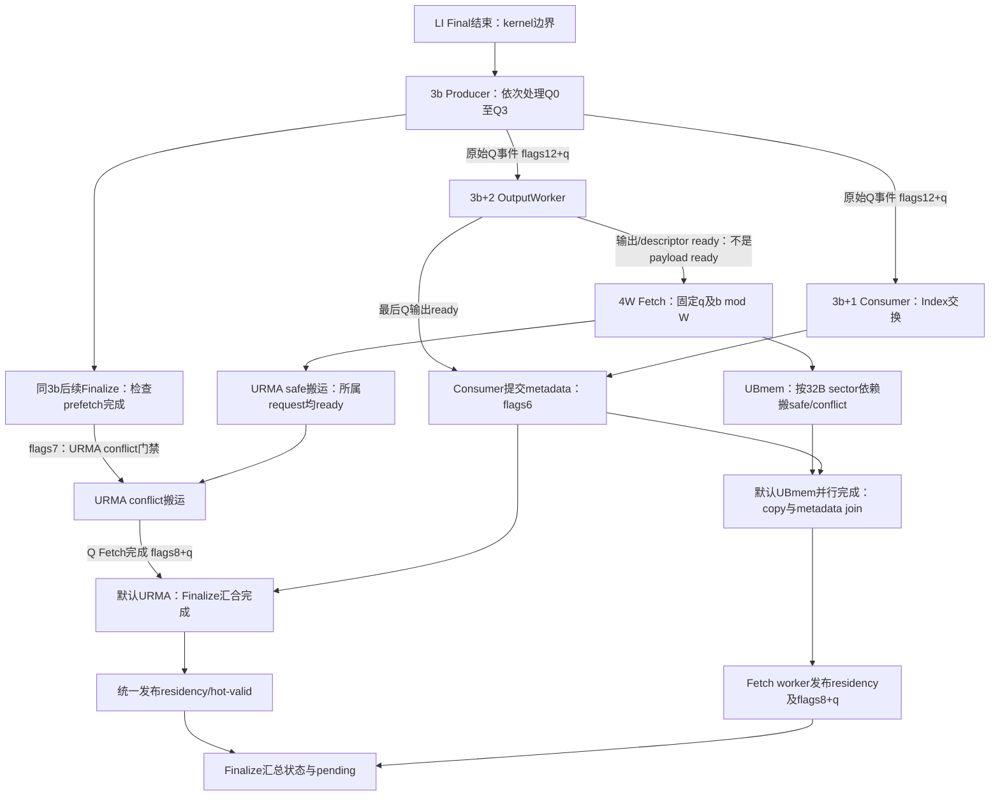

# 全通路分核审计与优化前后对比

审计代码：`f8155235c0bc4d946d1310f3fcc510053fdb0343`；上游streaming基础为`13d2898`。对比基线是`81b1472`旧serial6，以及该版本上的历史Fusion3/mock研究入口。源码结构、历史计数、本次新抓Model trace和未来假设分别标注，不能混为当前生产性能。

**当前生产是“条件P2 history分片 + 每query T1全H选择 + 每request固定三角色 + 跨batch条带Fetch”。它不是完整P32/T8，也没有按miss负载自适应平衡整个通路。** P2来自上游streaming改造，本分支主要补独立C/V预算、F4发布记录与研究组件，不能把上游全部变化归给本MR。

## 1. 先区分四种任务

| 任务 | 工作量/正确性对象 | 当前切分 | 尚未实现的完整优化 |
|---|---|---|---|
| score生产 | Q×H×heads、QK与score生成 | 符合条件时每request两history owner，P2；否则general query路径 | P按B/H/G/C/V联合规划、非均匀history切分 |
| Top2048选择 | 每query从H个score选精确K2048 | 生产Final为T1；P2 Final/Q2用16K trunk，combined Q4用8K，逐次保留K | 将共享local-K/merge T策略接入Final、保留classification/发布 |
| resolve | 对已选ID做命中判定、跨Q去重、选择slot、生成搬运事件 | 每request一个Producer，Q0…Q3顺序处理；另两角色并行处理Index和输出 | 受一致性约束的任务池化、重request拆解；不是简单再次做TopK |
| 搬运/完成 | 未满足token的字节量、目标依赖、queue与CQ、metadata可见 | 4W个Fetch workers，按`b mod W`静态分组，safe/conflict拆阶段 | 按实际descriptor字节/等待状态的ready队列、chunk均衡与deadline调度 |

**T8只分TopK选择，不等于把resolve或单个request的搬运再拆成8核。** W也不等于T：当前W划分同一query编号下的batch请求，不拆一个`(b,q)`里的2048项。

## 2. 生产LI：history怎么分

参考：`include/runtime_shape.h:35`、`common/lifetch/sequence_schedule.h:9`、`op_kernel/indexer.cpp:13`、`indexer/indexer.h:680`。

Host先按AIC预算决定是否可用两个LI core/request：`splitQ &= (2B <= C)`，`liCores=B×(1+splitQ)`，`rounds=min(requestedWindows,liCores)`。设备再检查G32、完整Q4、实际keyLengths等于H、rounds>1、resident/cold 512对齐、最后tile可排空等条件；不满足走general fallback。G64没有该P2路径。Host按shape派发四个LI入口时，某些实际长度不满足的后续入口会为空操作。

P2成立时：

- 每request两AIC都处理Q4，但读不同history；各AIC两AIV各负责两个query。这里MIX1:2是现有实现的占用，不是硬件任务配对约束。
- resident各扫一半；cold在**每个window各取一半**，不是全H两个连续大段。
- `halfTokens=256×ceil(((H−R)/512)/(rounds−1))`，最后一段按H裁剪。
- Hot → Resident Top2048/threshold → Cold＋轮转Service → Final是四个按同stream顺序启动的LI阶段。Threshold/Final沿用mixed入口元数据，但实际只有AIV执行。
- P2 Final每query由一个AIV读取**完整有效范围** score，当前42几何下为全H；一般情况仍受keyLengths/queryEnds裁剪。P2 Final与Q2路径为16K trunk，general combined Q4为8K，逐次保留K。没有跨AIV local-K候选归并。见`indexer_vector.h:896`。

当前42配置固定H131072、R16384、Q4，若G32/full-length/auto、请求windows8、Fetch W2：

| BS | 实际rounds | C32/V64：P，评分C/V | C28/V56：P，评分C/V | 尾部启动AIV `3B+8` |
|---:|---:|---|---|---:|
| 1 | 2 | P2，2/4 | P2，2/4 | 11 |
| 2 | 4 | P2，4/8 | P2，4/8 | 14 |
| 4 | 8 | P2，8/16 | P2，8/16 | 20 |
| 8 | 8 | P2，16/32 | P2，16/32 | 32 |
| 16 | 8 | P2，32/64 | P1，16/32 | 56 |
| 24、32 | — | 当前native全链拒绝 | 当前native全链拒绝 | 80、104，超预算 |

六档miss不参与P选择，因此同BS的3/5/10/15/20/50%都重复同一P决策。P2的rounds2/4/8对应halfTokens57344/19200/8192；B2两owner实际扫65792/65280 token，有512-token尾部差；其余上述P2行65536/65536，不能称全部严格等长。

元数据注意：`geometry.py:39–40`的`queries_per_aic=2/queries_per_aiv=1`仍是旧auto query切分公式。P2设备分支在`indexer.cpp:39`强制`tiling.splitQ=0`，实际score是Q4/Q2，不能用旧两字段解释P2。当前42批跑脚本实际跑的是AIV-only组件，AIC=0，没有这个生产P。

## 3. TopK与batch：增加T何时有利

共享研究组件按`4BT`个local任务轮转到`min(4BT,V)`个AIV，T>1才启动`min(4B,V)`个merge workers；每query将T×2048个候选归并为最终2048。研究history原型还可将P个score物理行映射为独立T个选择范围，避免全score重排。它没有接替生产Final classification、query bitmap/error及Service发布。

结构模型（非校准时延预测）：

`L_topk(T) ≈ launch_local + ceil(4BT/V)·c_local(H/T,K) + [T>1]·(launch_merge + ceil(4B/V)·c_merge(TK,K))`

B小时增T可增加并行度；B大时T1已占满AIV，继续增T会增加候选、merge和任务轮转。先前同driver、V56的单次组件对照为：

| BS/H比例/miss目标 | T1 whole Model ticks | T8 ticks | T8相对变化 |
|---|---:|---:|---:|
| 1/100%/10% | 50385 | 25867 | −48.66% |
| 4/50%/5% | 28151 | 32390 | +15.06% |
| 16/30%/15% | 36870 | 64954 | +76.17% |

这是本地SPLIT-CORE-005的三个点，单次无预热，不是全42矩阵、NPU、完整LI/Fetch或P32收益；三点同时改变B/H/m，不能将跨点差异仅归batch。新42的history固定128K，必须另测，不能复用H30/H50为新配置通过。

## 4. Resolve/Index/输出：固定三角色

尾部同一AIV-only kernel启动`3B+4W`个AIV。源码`streaming.cpp:588–607`：

| AIV block | 职责 | 任务边界 |
|---|---|---|
| `3b` | Producer；结束时FinalizeStreaming | 本request四Q的hit/miss、跨Q去重、victim/slot、逐Q事件；随后Finalize核验完成，默认URMA由此统一发布residency |
| `3b+1` | Consumer | 按prefetch及四Q事件执行Index交换，之后提交地址/logical metadata |
| `3b+2` | OutputWorker | logical/slot输出、FinalPost、Fetch descriptors与ready发布 |
| `3B+qW+lane` | FetchQueryGroup | 固定q和`b=lane,lane+W,…`的请求 |

Producer使用LI已产生的locations和四Q保护bitmap，先合并保护集合，再跨Q hash去重、选择LRU/未保护hot槽。同token首次出现才认领搬运；Q2/Q3还有Q0/Q1相同位置复用捷径。Producer在初始化时按未知项上界选择2048/4096/8192个hash桶；Consumer的交换shadow map才会在接近饱和时由sparse转dense。这两者都是数据结构适配，不是核任务动态均衡。

B增大时，resolve只是按request增加Producer核，单个重request的四Q仍顺序处理。三角色拆开后Index交换与输出可以和后续Q的resolve并行，但没有跨request work stealing。`3B+4W`也解释了为什么不能仅去掉BS16检查就宣称BS24/32全链可用：B24即使W1也要76 AIV，B32至少100，已经超过64。

## 5. Miss负载：已有依赖切分，没有字节均衡

`W∈{1,2,4}`，`b mod W`决定归属。非空Fetch lane最多`4·min(B,W)`；B1/W2仍只有4个非空lane，另外4个返回。W不切分单个`(b,q)`的token。

URMA（`streaming.cpp:385`、`staged_urma_pack.h:24`）：

- safe：目标槽不与仍在写入的prefetch冲突；可先取。
- conflict：reserved ordinal仍落在used范围，须等prefetch实际完成。
- 同`(q,lane)`先等自己所有batch请求的Q-ready，再按阶段聚合一次native BatchGet；可发生组内队头阻塞。
- queue编号`2B+2(qW+lane)`，总queue views为`2B+8W`。内层KVAF处理WQE/CQ与inflight，不代表外层已动态均衡。

UBmem（`staged_ubmem_fetch.h:9,89`）沿用同一batch静态归属，但逐b搬运；overlap模式按32B目标write sector与较早Q建立依赖，先safe连续run、等相关copy完成，再conflict run。656B相邻slot可能共享sector；2624B对齐，因此不能简单按token不同就当无冲突。

实际负载应由去重后descriptor而非名义miss率描述：

`N(q,lane,phase)=Σ_{b mod W=lane} N(b,q,phase)`；`Bytes=N×tokenBytes`。

`L_fetch ≈ max_{q,lane}(Σ copy_cost(Bytes_bq) + credit/CQ等待 + conflict依赖等待)`。

当前只均衡request数量，不能保证miss数、字节量或等待时间相等。相同名义miss率还可能有不同的跨Q重叠、cache状态、早Q认领和target冲突。当前受控fixtureU=2m；50%为U2048，是一种重叠构造，不能覆盖任意客户分布。

## 6. Ready不等于payload可消费

- `flags[12+q]`：Producer原始事件可读，locations DMA完成。
- Consumer和OutputWorker都消费原始事件；Consumer能先做Index交换，不能提前提交官方logical/address映射。
- `flags[1+q]`：OutputWorker完成logical/slot输出DMA、descriptor clean和FinalPost后，释放Q-ready。
- Consumer等最后Q输出ready，再提交metadata，发布`flags[6]`。
- `flags[7]`：prefetch真正完成，由Producer后续的FinalizeStreaming调用CompletePrefetch检查并发布，供URMA conflict Fetch等候。逐CQE检查错误及回收，不能用尾CQE代替全成功。
- `flags[8+q]`：该Q的Fetch完成。
- 默认URMA非parallel_finalize路径：Finalize汇合Index及搬运完成后统一发布hot-valid/residency。默认UBmem parallel_finalize路径：Fetch worker先完成copy、再等待metadata `flags[6]`，由PublishQueryCompletion发布residency与`flags[8+q]`；Finalize随后汇总状态和pending。错误及空Q也须释放完成信号。两路径均不能在payload与metadata未完成时宣称KV可消费。

同一kernel内，kernel边界已不能保证descriptor可见，需要显式DMA等待、clean/invalidate和ready/release协议。Service输出ready只说明ID/slot输出可读，不代表KV payload已经可被下游消费。

## 7. 与优化前的差别

| 维度 | 81b旧serial6 | 历史Fusion3 | 当前f815生产 | P32/T8研究原型 |
|---|---|---|---|---|
| LI分工 | 可行时Q2/AIC，各扫全H；否则Q4 | 保持当时LI配置 | 符合条件P2，每window分history；否则general | Q4×P个history producer |
| 精确选择 | combined LI内resident/final TopK | 保持原选择 | 四LI phase中的Final T1 | 独立T个local-K＋merge |
| 尾部 | resolve、输出/plan、apply、fetch按kernel顺序 | 一个request AIV依次Resolve→Publish→Plan/Apply→Finish | Producer/Consumer/Output与4W Fetch角色并行 | 沿旧mock尾部；不代表当前streaming |
| 依赖 | kernel边界较多 | tail内串行 | 同kernel显式Q-ready、safe/conflict及completion | Service0，削减resident/classify/progress等工作 |
| 启动数 | 旧六kernel | Init＋combined LI＋tail=3 | P2时Init＋四LI＋tail=6；fallback通常3 | 随local/merge方案变化 |
| 负载均衡 | 静态query/核分配 | 静态request tail | 静态request角色与batch条带；非自适应 | P/T可选，但约束`BP≤C`等 |

**当前的六launch与旧serial6不是同六个算子。** 48.24%旧分核收益包含组合路径变化，不能归为当前整条streaming的已测提升。

## 8. 时序图与trace证据

下图是当前尾部的静态依赖，不是msprof时长；三个per-request角色与Fetch在同一kernel中运行。

[交互式trace对比](scheduling-traces.html)、[本次TopK PIPE图](topk-msprof-pipes.png)、[历史Fusion3 native包络图](historical-fusion3-native-envelope.png)与[证据索引](results/scheduling-trace-evidence.json)已生成。

[静态依赖时序图](scheduling-sequence.png)中的宽度、空隙和箭头仅表达阶段/依赖，不代表测量时间。它展示旧serial6、Fusion3、当前P2以及独立P/T研究入口。

本次新抓的msprof是**当前共享TopK组件**的T1/T8对照，B1/Q4/H128K/G32、m205、V56、同driver/score，logging mask0x1；`--core-id=0`本身只选择解析核，不会限制全部dump。实际非空core0.veccore0/1记录及footer已核查：T1 local采样2/4块，T8 local采样2/32块，T8 merge采样2/4块。T1这两块分别是q0/q1的全H；T8 local则是q0的shard0/1，merge为q0/q1，不能把选中两块当全kernel平均负载。

[官方Simulator说明](https://github.com/Ascend/msopprof/blob/master/docs/en/user_guide/msopprof_simulator_user_guide.md)将此模式定位为CPU上的NPU行为仿真。[官方输出格式](https://github.com/Ascend/msopprof/blob/master/docs/en/user_guide/msopprof_simulator_performance_data.md)说明trace.json可用Chrome tracing或MindStudio Insight打开。vendor trace中的ts/dur与原始native Model start/tick分域显示，不转换成真机TPOT，不将分核不同run拼成一个测量的端到端时间轴。

旧serial6/Fusion3可视化只使用既有B1/H8192/R4096/G32/zero-miss/Service0的已归档raw日志；不是128K标准结果，也不是本次重跑。该小形状两侧LI均splitQ0、1C/2V；zero-miss的前2048个token为非零赢家，其余为0，并非全零输入。canonical完成日志为12/5份（原包另有重复副本不能双计），数量变化不能直接作为性能收益。旧collector被终止的状态保留，即便Model/oracle及raw覆盖完整，也不改称collector正常退出。

当前完整streaming的同标准msprof/NPU对比仍未执行：本机无NPU，现有mock driver针对81b而非13d新Context/16-bindings/bitmap与error ABI。不能拿旧Fusion3或TopK trace冒充整条当前流水。

## 9. 下一步真正有价值的优化

1. **P/T联合但独立规划。** 以(B,H,G,C,V,可用Service窗口)选P，以可用并行度与merge成本选T；先保持Final classification、bitmap/error和四Q publication语义。
2. **Resolve池化支持大batch。** 保留每request唯一Index/LRU owner，在有限R个角色核上轮转请求，避免3B线性占核。BS24/32需要同时重做workspace、queue、完成协议，不能只扩大上限。
3. **按ready descriptor/字节分发搬运。** Producer/Output发布不可变chunk后，Fetch池领取工作；保留request顺序、target sector依赖和credit约束，减少`b mod W`及整组等ready的队头阻塞。
4. **预算感知的safe/conflict调度。** 以实际miss去重数、tokenBytes、可用credits、prefetch完成进度与deadline计算优先级。将减少等待与减少字节分别评价，不以名义miss率直接分核。
5. **正交用例与真实分布。** 在当前42格基础上另测跨Q重叠、跨request异构miss、safe/conflict比例和transport长度；先同版本同binary建立serial/fused/split控制，再做真机重复统计。

以上为可研究方向，不是已实现或已验证收益。
