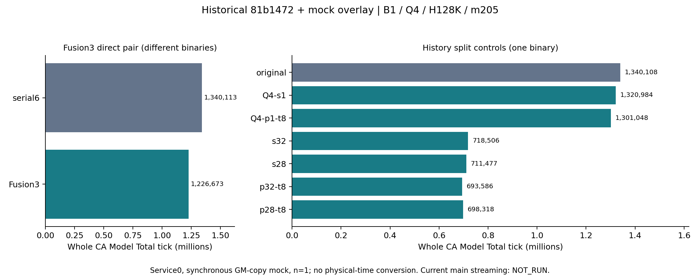

# 串行六 kernel、Fusion3 与分核策略统一比较

本次按已有 **Fusion3@81b1472** 证据汇总。所有数字都是软件 CA Model 的 **whole Model Total tick**，不是单独的 Forward span、微秒、TPOT或真机吞吐。新 main **13d2898 streaming** 没有同标准全链结果，单列为 NOT_RUN。当前共享 TopK 的三项组件结果也不混入此表。

## 标准场景与版本

共同有效几何为 **B1、Q4、H131072、resident16384、G32、TopK2048/query、miss205/query（10.009765625%）、唯一miss410/request**。均为 Service0、同步 GM-copy mock、单次无预热；不含实际网络、NPU或模型推理。输入 provenance manifest 自报 B16，它提供不变种子，harness 实际展开 B1；不能把该结果称为 B16 性能。requested prepare rounds=8，实际准备2轮，执行 Service 0轮。

原始主仓提交为 `81b1472809b7a5f3469e26467feee0ca1c61d71a`，两组均使用其上的 mock overlay。它们的 driver 不同，分别保留对照组：

| 实验族 | 方案 | whole Model ticks | 相对本族对照降低 | 预算C/V | P/T |
|---|---|---:|---:|---|---|
| Fusion3 direct | 六 kernel 串行 | 1,340,113 | 0% | 32/64 | 原LI |
| Fusion3 direct | Fusion3 | 1,226,673 | 8.46% | 32/64 | 原LI |
| 同 binary history pool | 原链对照 | 1,340,108 | 0% | 32/64 | 原LI |
| 同 binary history pool | Q4 score | 1,320,984 | 1.43% | 32/64 | 1/1 |
| 同 binary history pool | Q4 score + 分片选择 | 1,301,048 | 2.91% | 32/64 | 1/8 |
| 同 binary history pool | history分核 | 718,506 | 46.38% | 32/64 | 32/32 |
| 同 binary history pool | history分核 | 711,477 | 46.91% | 28/56 | 28/28 |
| 同 binary history pool | history分核 + 独立选择 | 693,586 | 48.24% | 32/64 | 32/8 |
| 同 binary history pool | history分核 + 独立选择 | 698,318 | 47.89% | 28/56 | 28/8 |
| 当前 main 13d2898 | streaming | **NOT_RUN** | — | 按设备查询 | 当前条件P2/T1 |

P是score生产的history分片数，T是每query精确TopK的分片数；Q4选择local为min(4BT,V)个AIV；T>1时merge为min(4B,V)，T=1不启动merge。预算C/V是两项独立硬件上限，表内32/64、28/56不是物理配对约束。旧mixed score实现恰好每生产分片使用1个AIC与2个AIV，这是该实现的调度占用。原LI的实际占用为2C/4V，不能把32/64预算当作已使用核数。

“六 kernel”特指旧 main 的 `init → LI → resolve → direct_update_outputs_early → direct_apply_owned → fetch_update` 六次启动；Fusion3将后四项并入tail，成为init、LI、tail三次启动。它不是新 main 的六独立算子 native_chain reference。启动数依据编译launcher与既有profile smoke，标准场景没有逐kernel动态trace。history分核包含新增score/local/merge步骤，不能从kernel数量直接推导总耗时。



## 可以得出的结论

计算统一采用 `reduction=100×(1−candidate/control)`，`speedup=control/candidate`。Fusion3同组单次结果降低8.46%，比值1.0925。分核族对照下P32/T8降低48.24%，比值1.9321；P28/T8降低47.89%，比值1.9191。

分核与原链的差异同时包含Q4 score生产、history并行、TopK local/merge及resident/classify/progress路径变化，48.24%不能归因于独立TopK分核一项。更接近单变量的同binary控制是：固定P32，T32→T8为718506→693586，降低**3.47%**；固定P28，T28→T8为711477→698318，降低**1.85%**。这支持把生产P与选择T独立规划，而不是绑定成同一分片数。P28/T8在更少预算下与P32/T8仅差0.68%，是值得继续验证的效率点，单次结果不足以建立统计结论。

两族串行对照仅差5 ticks（0.0003731%），并已核对共同输入和关键输出。若仅做跨driver描述，P32/T8相对Fusion3的计数低43.46%；此差值**不是同binary控制，不是分核的因果收益，更不是当前生产streaming收益**。下一轮应在一个binary内提供serial/Fusion3/history-P/T运行时开关，再做重复、预热和native transport验证。

## 证据与可比范围

- [机器表CSV](pipeline-comparison.csv)逐行绑定版本、driver SHA、日志与本族对照；[Fusion3原比较记录](results/fusion3-direct-comparison.json)、[摘录capture](results/fusion3-captures.json)、[35次既有Model记录](results/model-records.json)保留原证据。
- [hash核验记录](results/pipeline-comparison-proof.json)：20个共享fixture文件在两仓原始字节核对一致；六个关键输出topk、locations、logical-output、slot-output、changes、change-counts在两族标准记录中hash一致。串行/Fusion3的active plans相同；没有声称跨族整个plan allocation逐字节相同。大tensor未随包提交，离线检查器只能核摘要一致性，完整数值验收需重放。
- 两个Fusion3原日志原字节导出在`results/logs/fusion3-direct-b1-*-r1.log`；各有唯一Total tick与正常Model footer。capture保留原始`clock_equivalence_unverified=true`、`valid_for_standard_performance=false`，本汇总没有将它们改成通过；只使用原始whole-Model计数，禁止转换到物理时间。
- 两族config/config_stars及共同记录的5个runtime库hash相同，均限制7GiB内存、3GiB swap、4CPU。Fusion3另记载libnpu_drv_camodel.so，split未列出该库，故**完整加载库集合未核齐**。不把相同的共同子集说成完全相同的执行环境。
- 当前软件核心只集成独立预算、F4布局、ABI/queue校验与显式共享TopK研究入口。旧P32/T8尚未接入生产Final classification/publication及真实Service。本表不能批准该生产路径。
- BS1/2/4/8/16 × miss3/5/10/15% × history30/50/100%的60基础用例脚本已提供并通过CPU校验；完整60场景Model sweep仍未执行。其他batch/miss/sequence没有三条全链实测，不能由这一个标准点外推。

复核/重建派生表与图：

```sh
python3 experiments/split_core/verify_results.py
python3 experiments/split_core/compare_pipelines.py
python3 experiments/split_core/compare_pipelines.py --write --plot
```

前两条不依赖NPU；第三条额外需要matplotlib。重放旧分核source build与oracle的命令见[实验入口](../../../experiments/split_core/README.md)。Fusion3此处是既有capture导入，不声称本MR重新执行其完整driver或复测其时延。
