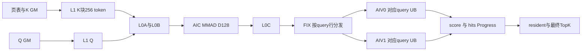

> 历史研究归档：测试基线为81b1472＋实验overlay，不代表本MR新流式main的性能。本地.aiinfra路径仅标识原始证据；可移交摘要见 results/model-records.json，当前集成状态见 README.md。

> 2026年11月12日修正：用户已明确32/28 AIC与64/56 AIV仅为物理资源数量，不存在研究模型上的1:2硬件配对约束。本文中的1:2及其分核上界仅描述当前mixed实现；新方案以独立C/V资源池为准，见后续 `split_core_independent_analysis.md`。

# KVIP AIC AIV 分核策略与优化研究

当前最值得解决的问题是：**在当前mixed局部数据通路、存储和传输资源约束下，如何让最终 selected KV 尽早可被下游消费。** 物理AIC与AIV资源分别建模，当前软件配对不能提升为硬件约束。目标包括 LI 完整打分、TopK、缓存管理和补取，不能用 AIC 占满率或 MMAD 耗时单独代表。小 batch 的主要结构问题是 `batch × query组` 并行任务少而 history 循环很长；BS16、28 AIC 预算下又出现整体退回 Q4 的离散变化。

最先应做两项可验证工作：拆开 requested/effective 预取窗口的预算影响；以 Q4/Q2 为基线研究 history 分片，并把 resident 阈值、精确 TopK 归并和 Service 协议一起设计。32/64 或 28/56 是本研究的资源预算，最优策略需要真机对计算、带宽、TopK、Service 与完成等待的校准，不能仅按核数推断。

## 1 研究范围和证据口径

工作目录：`${KVIP_ROOT}`。2026年11月12日从 `https://gitcode.com/CacheOS/KVIP.git` 拉取公开 main，固定提交 `81b1472809b7a5f3469e26467feee0ca1c61d71a`。原 KVIPAgent 主目录和实验 worktree 未改动。研究 prompt 见 [split_core_prompt.md](split_core_prompt.md)，120行解析场景见 [split_core_matrix.csv](split_core_matrix.csv)，生成器见 [build_split_core_matrix.py](build_split_core_matrix.py)。

复用原“复核 ComputeMm1 优化分析”会话的三项项目 skill、角色、工具及策略；同步清单和文件哈希在 `.aiinfra/sync-manifest.json`。只调整新目录 project.json 的 root/source_commit，旧任务、仿真、业务修改和资源预约不迁入。当前登记为 `SPLIT-CORE-001`，咨询研究交付与正式工作流封存分开；尚无人工接受的工作流/任务提交，不声称正式 gate/close。当前无 NPU/CANN 设备性能结果，所有运算量、字节和核数表是源码或解析结果。

### 1.1 输入默认值

| 项目 | 本研究口径 | 敏感性或边界 |
|---|---|---|
| BS | packed request 1/2/4/8/16 | 每请求4个 query，并非每请求一个 query |
| 最大 history | 128K=131072 | 主矩阵每个请求取同一有效长度 |
| history 30% | 有效39322，shape/key_lengths=39424，queryEnds=39322 | main要求shape.history为256倍数；102个padding不进入最终TopK |
| history 50%/100% | 65536/131072 | 都已对齐 |
| Q、D、Indexer heads | Q=4，D=128，G主值32；另列64敏感性 | 由当前算子形状而来，G改变不等于模型无损可调参数 |
| TopK | 每query 2048 | 三种长度都大于K |
| resident R | 固定16384，resident槽全valid，无额外ABC命中 | 这是与旧标准fixture一致的分析假设，用户未指定；不是history的30%/50%/100% |
| payload | 656B/token；2624B为四倍敏感性 | 主矩阵按一组payload计算，Index key自身是1B元素 |
| miss | 每query最终selected中的nonresident比例 | 不是history中cold比例，也不是去重后的request miss比例 |
| 默认预取 | 请求32窗口，总预算512，默认每窗16 | 实际窗口会按LI核数裁剪；必须分开记录 |
| 核预算 | C/V=32/64或28/56 | 用户已指定物理数量；具体SKU、运行时可用量和预留用途另核实，不增加硬件配对约束 |

30%主矩阵采用“分配并评分39424、有效长度39322”的可复现口径。`key_lengths=39322` 也有源码支持，但其最后 tile 的 MMAD N 可为26，不能与本矩阵308个完整128 tile的运算量混用；两种口径都需设备正确性验证。上取整只为把非整数token转成有效整数长度，没有把有效30%偷偷改成30.08%。

若原意是“128K中resident占30%/50%/100%”，那么H保持131072，LI主扫描仍1024 tiles，变化主要在resident TopK/阈值时刻和cold区；100% resident还会触发现有 `history>resident` 限制。若128K是整个batch的总history，则每请求H随B反比变化。本报告未混用这两种解释。

### 1.2 设备预算的含义

main已有真实逻辑设备资源查询：`python/kvip/runtime/device.py:7-26` 用 `aclrtGetDeviceInfo` 查询 AIC/AIV，取 `min(AIC,AIV//2,32)`；vLLM在 `python/kvip/adapters/vllm/binding.py:104-120` 使用该结果，不猜测32核。当前LI指定 `KERNEL_TYPE_MIX_AIC_1_2`，见 `csrc/operators/lightning_indexer_with_fetch/op_kernel/indexer.cpp:14-23`。Ascend官方文档说明该类型是1 AIC配2 AIV的逻辑执行组合；它不能证明具体SKU的物理核数。[GetSubBlockNum 官方文档](https://www.hiascend.com/doc_center/source/zh/CANNCommunityEdition/910beta1/API/ascendcopapi/atlasascendc_api_07_0280.html)

因此，28预算不自动意味着“另4个AIC的8个AIV专门负责Service”。当前Service借用LI的配对AIV；要改成专用服务池，需要显式新调度与所有权协议。逻辑launch block也不等同于固定物理核身份、实际同时驻留或实测利用率。UBmem当前host几何还要求SoC名称以Ascend950开头，见 `python/kvip/operators/lifetch_ubmem/build.py:39-40`；不能把“A50”未经核实地当作已适配设备。

## 2 当前全链路分核

当前main有两条需要区分的transport链路。vLLM的workspace准备入口要求 `transport='ubmem'`，见 `python/kvip/adapters/vllm/binding.py:104-108`。因此不能把旧URMA实验和当前vLLM路径统一成一个时序。

### 2.1 URMA原生forward的六kernel

`csrc/operators/lightning_indexer_with_fetch/op_host/launch.cpp:70-77` 调用 Init→LI→Resolve→UpdateEarly→FetchUpdate，其中UpdateEarly内部又launch Plan/Publish和Apply，见 `op_host/index_cache_update.cpp:35-39`，合计六个设备kernel。

| 阶段 | 逻辑grid | 主要资源和含义 |
|---|---:|---|
| Init | B | AIV初始化request状态/映射/队列 |
| LI | P=B×a | P个AIC与2P个AIV，评分、阈值、候选和最终TopK；内部插入Service |
| Resolve | B×F | AIV；默认F=4(Q2)或2(Q4)，最终selected解析/去重/描述符 |
| Plan/Publish | B | AIV；生成Index更新和输出计划 |
| Apply | 4B | AIV；每request分4个key字段搬运worker，执行Index key及相关元数据Apply |
| Fetch/Finalize | B | AIV；精确补取、预取CQ收尾和状态完成 |

低级 `LIFetchBinding.launch()` 是省略缓存更新的四launch接口，不代表完整原生forward；`wait/probe`另有入口。逻辑block应按具体入口计数，不能按Python函数个数计kernel。

URMA Service构造/发布WQE后返回，提交与CQ完成分开，最终路径还需join。可核对 `op_kernel/prefetch.h:626-740`、`csrc/operators/common/lifetch/final_phase_loop.h:1-5` 和 `op_kernel/lifecycle.cpp:316-318`。

### 2.2 当前UBmem forward的八kernel

`csrc/operators/lightning_indexer_with_fetch_ubmem/op_host/launch.cpp:14-40`：

```text
Init(B) → LI(P mix) → Resolve(BF) → FetchWorkers(BF)
→ Complete(B) → DirectUpdateOwned(B) → UpdateOutputs(B) → ApplyOwned(4B)
```

该路径共享LI计算头，但UBmem Service在返回前 `copyPipe.Finish()` 并校验已完成数，随后才发布完成事件，见 `csrc/operators/lightning_indexer_with_fetch_ubmem/op_kernel/controller/window_fetch.h:339-346,505-523`；LI结束时这些预取已完成，见UBmem算子的 `op_kernel/lifecycle.cpp:162`。其重叠主要来自部分AIV做搬运时其他计算组继续推进，不能假定本组Service只提交不等待。URMA的异步网络尾部模型不适合原样套到UBmem。

旧 `codex/fusion3-950-cann-20261111` 实验分支保留LI主切分，把若干尾阶段合并为Tail；它是比较候选，并未成为本次main。旧main标准128K A/B记录仍存在缺少完整有效pair的情况，本研究不使用旧smoke百分比推断当前120场景收益。

### 2.3 配额公式和两档预算

令a为每request query组数：默认auto在 `2B≤C` 时a=2，否则a=1；P=Ba。当前所有研究batch均满足B≤C。源码：`include/runtime_shape.h:30-45`、`python/kvip/operators/lifetch/geometry.py:15-45`。

| B | C32实际LI AIC/AIV | 预算占比 | C28实际LI AIC/AIV | 预算占比 | C28每AIC query数 |
|---:|---:|---:|---:|---:|---:|
| 1 | 2/4 | 6.25% | 2/4 | 7.14% | 2 |
| 2 | 4/8 | 12.50% | 4/8 | 14.29% | 2 |
| 4 | 8/16 | 25.00% | 8/16 | 28.57% | 2 |
| 8 | 16/32 | 50.00% | 16/32 | 57.14% | 2 |
| 16 | 32/64 | 100.00% | 16/32 | 57.14% | 4 |

表中占比只是grid可用资源上限，不是引擎busy率。小B没有因为history变长而自动增加LI核数。C28/B16整体退到Q4，而不是12个request双核、4个request单核；F随之从4变2，TopK trunk也从16K变8K。32→28不能简化成12.5%时延变化。

Apply的4个worker按key字段组划分，见 `op_kernel/index_cache_update.cpp:110`、`index_cache_update.h:165,265-278`，不是按query划分。C28/B16的Apply仍是64 AIV逻辑blocks，预算56时至少两个调度波次；URMA Resolve为32 blocks。C32/B16的Resolve和Apply各64 blocks。这里的wave是资源容量下界，实际时延取决于block执行时间、调度和拓扑；LI本身在现有合法配置中是一波，不能以此断言整个算子都一波。

## 3 LI内部到底切了什么

### 3.1 主循环与矩阵形状

源码主计算调度为 `bN2 → gS1(query组) → s2(history tile)`，见 `op_kernel/indexer/indexer.h:638-677`。当前KV-head=1、Q4/request，heads折叠进MMAD的M维；长循环是每组扫完整history，不是额外逐head调度。

| 配置 | 每AIC query数 | 每AIV query数 | G32时MMAD M/N/K | G64时MMAD M/N/K |
|---|---:|---:|---|---|
| Q4，a=1 | 4 | 2 | 128/128/128 | 256/128/128 |
| Q2，a=2 | 2 | 1 | 64/128/128 | 128/128/128 |

M=`query数×G`，N=128个history token，K=D=128维点积。N和K的两个128独立。两个AIV接收相同history tile的不同query行，各自对完整history做scale、ReLU、weights、heads归约和TopK；它们不是各扫一半history。`indexer_vector.h:464-469` 给query归属，`indexer_cube.h:423-436` 给MMAD，`:440-472` 给FIX双目的分发（dualDstCtl在455行）。



L1一次可搬256 token供两个N128计算tile复用；这不代表跨AIC的history切分。Q/K为FP8 1B元素；QK/FIX进入AIV的结果按FP32逻辑体量分析。不能把旧int8描述直接当作本main的dtype。当前 `isLDOpen=false` 路径不做跨核S2切分；存在通用分支不等于当前Service、score workspace和TopK协议已经支持它。

### 3.2 流水的阻塞点

CV表示AIC结果可由AIV消费，VC信用表示相应QK结果bank可以复用，不等同全部GM可见或网络完成。每个cold tile依次写score、hits、Progress，随后返VC；main编译设置 `ROTATION_PUBLISH_TILES=1`，见 `CMakeLists.txt:21` 与 `indexer_vector.h:529-598`。Q/W scale首次准备后复用，K scale按16 tile批量准备，见`:476-510`。

resident前缀 `[0,R)` 评分结束后，每query取resident Top2048的最小可排序BF16 key作为固定阈值；cold tile比较严格大于阈值，生成候选hits。最终TopK读取全部有效history的score，不限于预取命中集合。边界与调用见 `indexer.h:695-716`；TopK有效范围和trunk合并见 `indexer_vector.h:625-722`。有效resident不足K、ties、padding和sentinel必须按源码规则保留。

Service按 `ServiceRank/EpochAt` 指定窗口切入配对AIV；AIC在flag8处等待该组Service完成，见 `indexer.h:695-707`。它不是额外常驻“同步核”。Service取已ready的Progress快照，裁剪有效query范围，四query OR去重、排除已映射token、准入、分配slot并搬运/提交；没有全batch统一阈值屏障，也不必等全部history结束。当前窗口触发大致位于R到H的均匀tile边界，首窗在R、末窗在H，见 `include/context.h:71-94`。

因此，分核同时改变：M维效率、K复用、AIV每核query数、resident阈值产生时间、最终TopK负担、Service次数和停顿位置。单独优化ComputeMm1只能覆盖其中一段。

## 4 当前策略的目标与应采用的问题模型

### 4.1 两个层次的目标

模型算法目标是计算 `score(q,s)=Σ_h w(q,h)·ReLU(dot(Q(q,h),K(s))·scales)`，在每query完整有效history中选Top2048，供后续稀疏attention消费。DSA的selected稀疏并不意味着Indexer只计算selected tokens。[DeepSeek-V3.2 §2.1](https://arxiv.org/html/2512.02556v1)

现有系统策略主要以batch/query分组获得独立任务，保持较规整MMAD和两AIV分工，用resident阈值在cold完整扫描过程中提前生产候选，并在有限slots/窗口下隐藏一部分搬运。这是源码可观察到的设计取向；代码没有证明当前heuristic是某个全局代价函数的最优解。

建议系统主目标为每次调用到**selected payload可见、Index一致、Completion满足并可消费**的时间T_ready。在线服务关注其P50/P99与TPOT；吞吐目标可增加完成request数/秒或token数/秒。单层算子T_ready不是完整模型TPOT，后者还包括其他层/算子与调度。

### 4.2 资源约束DAG

对request b的路径可写成：

```text
Init → resident打分 → resident TopK阈值
     → cold打分/候选发布 ─────────────→ 全history TopK
             └→ Service候选准入→搬运/完成 ─┐
全history TopK → Resolve/精确缺失 → 补取 ──┼→ payload可见/映射Apply → ConsumerReady
```

这只是依赖抽象，URMA与UBmem的具体Apply/Fetch顺序以第2节为准。设每节点开始s_i、耗时d_i、结束f_i；前驱约束为 `s_i ≥ max(f_pred)`。对每个时刻约束AIC≤C、AIV≤V，并给L1/L0/UB、内存带宽域、传输带宽、queue owner与inflight容量约束。决策变量至少包括：

- query组数a、history分片S及任务顺序/大小；
- N tile、L1预载块、bank数；M由query组与G决定；
- Service窗口E、每窗服务组g、准入windowLimit、总prefetchLimit；
- resident阈值owner、TopK归并树、最终修复worker F；
- transport、实际有效长度分布、queue深度和可靠完成条件。

求解可采用小规模离线候选搜索＋profiling标定的成本模型，在线按bucket查表。目标可为 `min P99(T_ready)`，在吞吐/网络流量约束下求解；无需把所有因素塞进不可解释的单一固定核数规则。主矩阵是模型输入，不是已求解的最优策略表。

### 4.3 LI流水成本

对一个独立query组，近似包络为：

`T_LI ≈ fill + L_R·τ + T_resTopK + (L-L_R)·τ + Σ T_Service_block + T_finalTopK + drain`

其中L=H/128；稳态 `τ ≥ max(t_K/page, t_QK, t_FIX, t_AIVscore, t_GMpublish)`。这是流水近似，资源共享和信用等待会提高包络；不能把重叠阶段全部相加，也不能把整个表达式除以活跃核数。C/G/M变化使τ变化，S改变L和归并结构，Service会阻塞本组并影响其他组内存压力。

用于辨别瓶颈的下界包括 `W_QK/P_C_eff`、`Bytes_HBM/BW_eff`、`W_Vector/P_V_eff` 及依赖最长链。FP8峰值、HBM峰值、URMA链路峰值都不能代替这些形状下的有效值。

### 4.4 miss与有效提前量

令query miss数为m，四query去重后的必要miss为U。主矩阵假设resident槽全valid、没有额外ABC/tail命中，miss来自nonresident token，等miss数场景有 `m ≤ U ≤ min(4m,H_valid-R)`；没有query overlap信息，无法由r唯一确定U。Serving中hot_valid空洞、Index重排或ABC会改变坐标与驻留关系，此时须按实际missing集合重算，不能继续用H_valid-R约束所有miss。必要payload为 `Σ_b U_b·656B`，而不是 `r×H×656B`。2624B布局把payload项乘4，但不把LI FP8 key扫描与QK运算乘4。

设第j个有用预取发布t_pub,j、其payload完成t_done,j、精确选择/消费所需时间t_need,j。有效隐藏量依赖 `lead_j=t_need,j-t_pub,j` 和真实完成；提前提交但未完成仍留下 `max(0,t_done,j-t_need,j)` 暴露等待。URMA还受inflight、WQE/CQ、网络竞争影响；UBmem把copy完成的一部分成本直接计入Service阻塞。预取false positive占字节和slot，却不减少必要补取，故应同时记录precision、coverage和completed-before-needed。

相同r可对应截然不同情况：四query完全重叠/互不重叠；候选集中前段/最后tile；大量超过resident阈值的decoy；队列拥塞/空闲。这些情况的最优Service安排可以相反。

## 5 60种负载和两种预算的解析结果

120行CSV覆盖C×B×history×miss全积，同时给G32/G64运算量敏感性。单位MiB均为2^20字节。没有估计毫秒、提速百分比或实测busy率。

### 5.1 history改变长循环和阈值提前量

下表按每request、G32、默认Q2；Q4的K逻辑搬运减半，QK运算总量和score写总量不变。

| 有效history比例 | 有效/扫描token | 每AIC tiles | resident占有效长度 | 点积逻辑Gops | Q2 K读MiB | score写MiB | FP32 FIX MiB |
|---|---:|---:|---:|---:|---:|---:|---:|
| 30% | 39322/39424 | 308 | 41.67% | 1.292 | 9.625 | 0.301 | 19.25 |
| 50% | 65536/65536 | 512 | 25.00% | 2.147 | 16 | 0.500 | 32 |
| 100% | 131072/131072 | 1024 | 12.50% | 4.295 | 32 | 1.000 | 64 |

点积按一次乘加2 ops计；FP32 FIX是AIC→AIV逻辑体量，不是同量GM写。K逻辑搬运不包含scale/页表/布局填充/实际cache命中；两query组重复发起读取不代表HBM物理带宽必定恰好翻倍。G64点积和FIX逻辑量翻倍，K和score量保持，实际时延不必翻倍。

R固定时，长history的阈值在扫描占比上更早，cold重叠窗口更长；绝对resident计算量不随H变化。H短时全history结束更近，额外Service/归并开销更易抵消并行收益；H长时小B串行1024轮更值得尝试跨S2并行。但把cold扫描加快，也会缩短可隐藏传输的墙钟时间，必须看T_ready。

### 5.2 miss实际整数与必要传输区间

沿用标准fixture的 `round(2048*r/100)`，见 `tests/operators/lifetch/support/real_fetch_inputs.py:19`。

| 目标r | 实际m/query | 实际r | U/request范围 | 必要payload/request范围 |
|---:|---:|---:|---:|---:|
| 3% | 61 | 2.9785% | 61–244 | 40016–160064B |
| 5% | 102 | 4.9805% | 102–408 | 66912–267648B |
| 10% | 205 | 10.0098% | 205–820 | 134480–537920B |
| 15% | 307 | 14.9902% | 307–1228 | 201392–805568B |

总batch字节按B相乘；这些是必要payload区间，不包括投机浪费、header、对齐、重试和cache apply。H从30%到100%增长时，在固定m/overlap下此区间不变，LI扫描量却明显增加。故高H低r很可能更偏向LI/TopK优化，高r并不自动说明网络主导，还需测传输时延和候选提前量。

例如B16/H128K/G32：QK约68.719Gops、score写16MiB；C32/Q2的K逻辑读512MiB，C28回退Q4后为256MiB。后者流量较少，但并行度、每AIV工作、TopK trunk和Service窗口同时变化，不能据字节更少判断更快。

### 5.3 默认窗口预算随batch变化

`binding.py:92` 用requested窗口数计算默认windowLimit；`lifetch_ubmem/binding.py:46-53`也保留requested与effective区别。本研究采用URMA接口默认的请求32窗口与512总量，得到512/32=16，但实际E=min(32,P)。vLLM的requested窗口来自外部config，本仓不能证明其运行配置默认也是32。每request每窗准入由 `common/lifetch/prefetch_budget.h:7-16` 上限约束，`prefetch.h:626,665,716-718`逐request累积；UBmem在其 `controller/window_fetch.h:444-445` 使用相同准入函数。

| B/预算 | 实际E | 默认windowLimit | 每request累计准入的宽松上界 |
|---|---:|---:|---:|
| B1 两预算 | 2 | 16 | 32 |
| B2 两预算 | 4 | 16 | 64 |
| B4 两预算 | 8 | 16 | 128 |
| B8 两预算 | 16 | 16 | 256 |
| B16 C32 | 32 | 16 | 512 |
| B16 C28 | 16 | 16 | 256 |

这不是完成的有用预取数：slot/transport/候选不足还能进一步收紧，首窗R可能主要服务direct-hot/LRU，末窗H对本组冷扫描几乎没有提前量。因而即使r很低，B1也未必能用尽512总预算。

在U取四query互不重叠上界时，必要miss减去上述准入上界，仍至少需要精确修复的数量如下；是理想预取全部命中selected的乐观边界，不是实际repair预测。

| 累计预取上界 | r3 U244 | r5 U408 | r10 U820 | r15 U1228 |
|---:|---:|---:|---:|---:|
| 32 | 212 | 376 | 788 | 1196 |
| 64 | 180 | 344 | 756 | 1164 |
| 128 | 116 | 280 | 692 | 1100 |
| 256 | 0 | 152 | 564 | 972 |
| 512 | 0 | 0 | 308 | 716 |

优先做的消融是以effective E推导默认windowLimit，保留单窗≤480、总量、slots和transport约束。例如B1不能简单设windowLimit512，且只有R/H两窗口，单纯放宽额度并不创造中间cold候选或有用提前量。调整E/g或引入可重入Service也涉及调度协议。

### 5.4 如何读每个组合的策略建议

同B/H的四种r不改变当前auto的P、MMAD形状或扫描tiles，但改变必要miss区间与预算压力；同B/r的三种H不改变当前auto核数，却改变计算/TopK与重叠窗口。因此所有60个场景都有实际意义，不必将每一行重复写成静态文字。

CSV给每行：资源预算、有效/扫描长度、实际miss整数、a/P/F、shape、tile量、K/score/FIX量、窗口上界、必要payload区间、Apply波次下界与候选方向。其 `policy` 是待测方向标签，非最优决策。`s2_shards_max_simultaneous` 仅是保持现query划分时的同驻留容量上界；不支持直接把它当作当前实现的shard配置。

## 6 分核方向与切换条件

### 6.1 首先比较两条轴

**query切分a** 能直接降低每AIV负责的query数和矩阵M，但复制K扫描，并改变TopK trunk。**history切分S** 把长串行N轴任务展开，互不重叠的history不会把K总逻辑读再乘S；它复制Q并增加局部TopK候选和归并。两者需联合比较，不能只在已有Q2上不断加S。

若维持现有Service同驻留前提，候选需 `B·a·S≤C` 且 `2B·a·S≤V`。这只是约束，不是性能模型。允许更多逻辑任务分波时可以突破前式，但需要重新证明所有跨block等待不会占满驻留核后等待尚未调度的producer。

| B | C32下Q2的S容量上界 | C28下Q2的S容量上界 | 优先搜索 |
|---:|---:|---:|---|
| 1 | 16 | 14 | Q4/Q2 × S=1/2/4/8及预算端点，先看resident/merge尾部 |
| 2 | 8 | 7 | Q4/Q2 × S=1/2/4及端点，测K复用与Service开销 |
| 4 | 4 | 3 | S=1/2及端点，按H选择是否支付归并 |
| 8 | 2 | 1 | C32比较Q2/S2与Q4/更多S；C28比较Q2/S1与Q4/S2或3 |
| 16 | 1 | Q2不能整体同驻留 | C32先保Q2基线；C28以Q4基线研究细粒度任务与不均匀调度 |

非2次幂端点只是实验候选，不代表硬件/当前ABI已支持。B16/C28也可以研究混合query组，但12个request双组、4个request单组会留下后者慢尾，均匀负载不保证T_batch改善；需要允许任务再细分并做全局负载均衡。简单32任务分两波，同样可能把单request关键路径收益抵消。

### 6.2 精确history分片的最小设计

保持每个history token的完整head分数，分片输出局部TopK，再对候选取全局TopK。若使用同一全序，`TopK(∪X_i)=TopK(∪TopK(X_i))`：一个不在分片TopK内的元素已有至少K个同分片元素排在它前面，因此不可能进全局TopK。必须统一BF16 score key、token id/tie规则、无效值和padding；当前设备TopK在ties下的顺序要实际核对，CPU证明不能替代它。

候选量为 `B·Q·S·K` 对，若score2B+id4B，单层逻辑候选体量约 `6BQSK`。B1/Q4/S16时为768KiB，已接近当前128K score全写1MiB的量级；大S不一定省流量。原实现已分head归约并流式写score，不应借用别的materialize实现的巨大HBM中间量作为本项目基线。

两种阈值方案：

1. resident owner先完成前缀阈值，发布阈值后cold shards并行。实现相对清晰，但resident占比高时有串行下界；例如30%场景resident约41.67%，忽略其他开销的理想无限cold并行上界也仅约2.4倍，真实还受阈值TopK、归并和资源启动限制。
2. resident也分片，先归并resident TopK得到阈值，cold评分可先算后分类/暂存，或在阈值发布后启动。减少前缀瓶颈，新增前缀merge与buffer/同步。

现Progress是连续前缀语义。out-of-order shard不能把最大end写进去冒充中间都ready，否则Service可能读取未完成的hits。需采用按range的ready bitmap/descriptor或只提交最长连续前缀；前者需要消费者改造，后者可能损失乱序提前量。每个query/range、score区、hit区和TopK scratch都必须有唯一writer，不能仅改 `isLDOpen` 后复用现有workspace偏移。

### 6.3 不优先拆head或D

按head拆会产生跨核score归约，必须先合所有head贡献才能精确TopK；局部head TopK集合不足以保证全局TopK。按D拆则先合partial dot再ReLU，`ReLU(x+y)`不等于`ReLU(x)+ReLU(y)`，不能在分片内提前ReLU。当前D=128较小、G=32/64且N循环长，优先沿history增并行通常更符合结构；这仍需有效带宽和形状测量支持。

最终Resolve的F也需单独评估：每个worker独立构造相同rank/slot plan，只有不相交descriptor等输出分摊，见 `op_kernel/resolver.h:32-44`。增加F有重复metadata成本；不能用LI的query组数直接推断最终修复最优F。

### 6.4 tile和搬运优化的边界

可以研究N128→256等更大计算tile，减少循环/同步/页表标量开销；必须重算L0A/B/C、AIV QK UB双bank、score/hits/predicate布局、Progress发布粒度和Service触发。不能因为K在L1只占几十KiB就断言整个方案可行，G64/Q4的M256会同步放大L0C/FIX/UB压力。

页表预取、连续page合并搬、扩大L1 K预载块与计算N是不同层优化，适合单独消融。更大tile降低候选发布频率，可能损失预取lead，故ComputeMm1局部提速不等于T_ready改善。保留baseline路径，先用静态buffer跨度和极值检查，再过设备全链正确性与性能。

## 7 论文对照与创新空间

下列迁移建议是本研究的工程推论；各论文的硬件、模型或传输路径与KVIP不同，不能移植其收益数字。

| 一手来源 | 值得借鉴 | KVIP的区别和边界 |
|---|---|---|
| [Flash-Decoding，2023](https://pytorch.org/blog/flash-decoding/) | decode小batch沿KV长度并行，再归并 | LI归并对象是精确TopK，不是softmax log-sum-exp；还需阈值和候选发布 |
| [FlashAttention-2，2023](https://arxiv.org/abs/2307.08691) | 工作划分、减少非矩阵操作和核内通信 | CUDA warp/SM结论不能等同AIC/AIV和L0/UB成本 |
| [FlashInfer，MLSys 2025](https://arxiv.org/html/2501.01005v1) | 按长度拆长任务、成本平衡和多种attention状态组合 | 本任务状态需带TopK、阈值、range ready和Service队列所有权 |
| [NanoFlow，OSDI 2025](https://www.usenix.org/conference/osdi25/presentation/zhu-kan) | 操作级资源划分、nano-batch与并发干扰建模 | 完整推理吞吐最优不等于单层selected-ready最优 |
| [InfiniGen，OSDI 2024](https://arxiv.org/html/2406.19707v1) | 轻量预测重要KV，联合考虑投机预算和提前搬运 | 下一层近似预测与当前层resident阈值机制不同，须单独评价误取和精度 |
| [HiSparse，2026年8月](https://arxiv.org/html/2608.07009v1) | 固定hot cache、缓存管理和搬运融合；共享selection时跨层精确预取 | §3.5显示相邻层投机hint未必有额外收益，LRU可能已吸收可预测复用；不能默认预取越多越好 |
| [FlashOffloading，2026年11月](https://arxiv.org/html/2611.07542v1) | Ascend910C，反向索引、token id与slot编码随TopK传递以融合miss lookup、CopySFA中hit计算覆盖miss load | pinned host内存、IndexShare和SFA内部重叠不等同KVIP KVAF/URMA/UBmem及LI候选生产 |
| [StreamIndex，2026年5月](https://arxiv.org/html/2605.02568v1) | Indexer的partition-merge streaming TopK，直接相关的精确分片思路 | 定理要求统一确定性全序；实际torch.topk的tie不指定，所测集合parity不证明任意输入集合/顺序一致，扫点最低recall为0.9980；KVIP已有小score而非完整head中间GM矩阵 |
| [Multi-layer Indexer，2026年11月](https://arxiv.org/html/2611.03768v1) | 跨层selection依赖重排，让Indexer与attention并行 | 使用前一Indexer层selection改变了同层选择依赖；涉及模型质量，不能作为本次精确算子优化的透明替换 |

HiSparse的需求取数使用GPU对pinned host内存的向量化直接读取，跨层精确预取在side stream重放miss plan；不能等同URMA WQE/CQ，也不能据“融合”一词推断与本UBmem时序相同。

连同第4节DeepSeek报告，研究覆盖10项一手文献。2026年11月的新预印本反映截至本次研究时间的相关工作，不代表其结果已被独立复现。

### 7.1 可研究的创新假设

**H1：AIC/AIV配对约束下，以selected-ready为目标联合选择a/S/E/g/F。** 区别于单纯Flash-Decoding分片或通用kernel调度，显式把resident阈值、候选产生时刻、Service导致的配对AIC停顿以及transport完成列入同一成本模型。可证伪条件：留出场景中模型选择长期劣于简单Q2/Q4基线，或改善仅来自独立窗口修正。

**H2：resident优先、cold乱序分片与range-ready精确归并。** 在不漏扫history、不改变每queryTopK语义下，以range可见性减少连续Progress造成的等待。局部TopK合并本身已有先例；可研究的差异在Ascend配对核、早期阈值和缓存/预取所有权的一体协议。可证伪条件：range metadata/merge开销超过关键路径节省，或边界/乱序测试不能通过。

**H3：按完成截止时间调度cold分片和Service。** 用历史候选密度、队列压力、剩余scan时间估计有用lead，改变计算顺序和准入；保留完整最终评分与精确repair。目标是减少exposed fetch，不能只报告更早doorbell。可证伪条件：网络字节放大、P99恶化，或completed-before-needed没有改善。

**H4：requested/effective窗口解耦的预算控制。** 当前明确存在小B默认累计准入较低的耦合，可先做低成本消融。它通常更像工程优化，不能仅凭这点声称论文级创新；价值在于解释低miss也可能补取多，并给联合调度模型提供可控基线。

“首次融合TopK/缓存管理”“首次计算搬运重叠”“首次history分片”都有直接相关先例。更有辨识度的研究对象是**异构配对核上，精确LI的阈值和候选生产时间与payload完成共同约束的调度**；新颖性还需更系统的专利/论文检索和实测结果支持。

## 8 实验路线和验收

### 8.1 优先级

| 顺序 | 最小实验 | 收益依据 | 成本与主要风险 |
|---|---|---|---|
| P0 | 把requested/effective E、windowLimit、各epoch admitted/completed显式记录；比较原默认与effective预算 | 已有源码可复算的小B预算耦合 | 低；增额度可能加剧Service停顿或队列拥塞 |
| P1 | Q4/Q2原路径，测60场景×两预算；拆LI、TopK、Service、尾部 | 首先区分M效率、K复用和AIV压力 | 低至中；不能靠只测MMAD选策略 |
| P2 | B1/B2/H128K先做S=2/4精确history原型，明确range owner和归并 | 并行任务不足最明显 | 高；阈值、scratch、Progress、死锁与ties |
| P3 | tile/L1/page搬运消融，N128基线对比 | 循环与地址调度成本可能显著 | 中；UB/L0压力和发布粒度耦合 |
| P4 | Service可重入/专用池与截止时间调度 | 在真实补取等待显著时才有依据 | 高；队列单owner、跨组同步和可见性 |
| P5 | 三kernel尾融合、UBmem链路尾部优化 | 短H或LI已加速后launch/metadata更突出 | 中至高；不可把URMA融合直接当UBmem等价实现 |

### 8.2 场景和消融

基础集合为60场景×2资源预算=120；主G32，再用G64做维度敏感性。每个基础场景至少覆盖query miss完全重叠、部分重叠、互不重叠三种；单独改变threshold decoy比例、候选前置/均匀/尾置、request长度倾斜和hot validity。r相同的输入必须保证真实selected miss计数与TopK oracle一致。

固定R16384作为主实验；再选择R8192/32768等合法值做敏感性，其中R必须小于H并满足tile/窗口约束。payload656/2624分别跑，明确group width。URMA和UBmem分别报告，不能合并均值。资源预算为逻辑设备真实查询结果或显式限制；32→28实验同时保留“固定a比较”与“auto比较”，避免把资源差异和policy切换混为一谈。

先做单因素：只改变query切分、只改变effective窗口预算、只改变S、只改变N，再组合。S候选先1/2/4，若merge和阈值开销可控再扩；记录每个候选为什么失败或落后，保留可回退默认。

### 8.3 必要观测和统计

记录commit、dirty patch hash、compiler/CANN/driver、build flags、设备库哈希、设备拓扑、真实C/V、transport配置、资源租约、输入seed与哈希、shape/key_lengths/queryEnds、m/U、R和dtype。分配/reset/readback/日志不进设备主计时区间，独立测量开销。

推荐每配置至少10次预热、30次正式重复并随机/交错A/B顺序；P99需要更长样本，例如1000次以上或报告置信区间和不足，不能从30次稳定宣称P99。是否增加重复由方差和置信区间决定；不预设任意提速百分比作为通过线。

核心指标：整调用T_ready、request完成分布、LI前缀/阈值/cold/最终TopK时间、AIC等待VC/flag8、AIV等待CV、AIV score/TopK/Service占用、有效HBM字节与带宽、WQE/doorbell/CQ或copy completion、unique必要miss、candidate/decoy/admitted、prefetch完成覆盖率、repair数量/暴露等待、cache apply成本。跨设备时钟先校准，同步完成与提交分别打点，CPU墙钟不冒充设备周期。

### 8.4 正确性和失败条件

对照完整有效history的现main参考：scores/量化key、2048 selected与tie契约、queryEnds/padding、无效query、全hit/全miss、相同token跨query/分片、resident边界、冷热分片乱序、slot复用、Index映射、selected payload、hot payload、unused tail与guards。必须证明SQ owner转交、CQ完成、payload可见与ConsumerReady的顺序，不能把Event.complete或VC当作全部传输完成。

精确history分片的CPU partition-TopK oracle只验证数学不变量；设备实现仍需本机BF16 key/tie、内存和同步验证。若错误、guard改变、挂起、资源约束越界或样本不完整，该样本不能进入性能比较。仿真OOM只说明该运行资源不足，不能推出硬件UB越界，也不能把缺失性能当收益0%。

## 9 执行结果与可复现入口

本次已同步main与36个工作流文件，登记任务，完成源码审计、模型审计和一手论文研究，生成120行矩阵及精确partition-TopK数学oracle。复算命令：

```bash
python3 docs/research/build_split_core_matrix.py
python3 docs/research/verify_split_core.py
python3 .aiinfra/tools/sync_roles.py
python3 .aiinfra/tools/aiinfra.py --json doctor
python3 -m unittest discover -s .aiinfra/tests -v
```

验证与独立审查的实际命令、退出码和最终产物哈希保存在 `.aiinfra/tasks/SPLIT-CORE-001/`。业务源码保持固定main，未提交或推送。硬件性能、真实最佳a/S/E/g/F、完整TPOT收益仍需按第8节测量；本研究已交付相应分析和实验设计，没有将解析数值当成真机结果。
