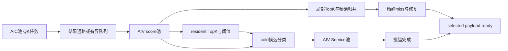
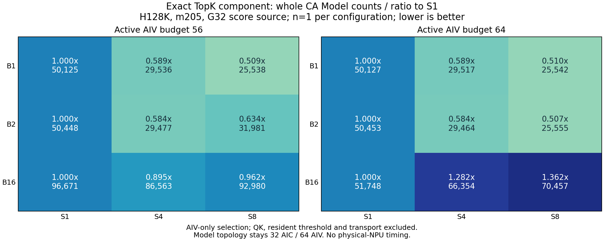
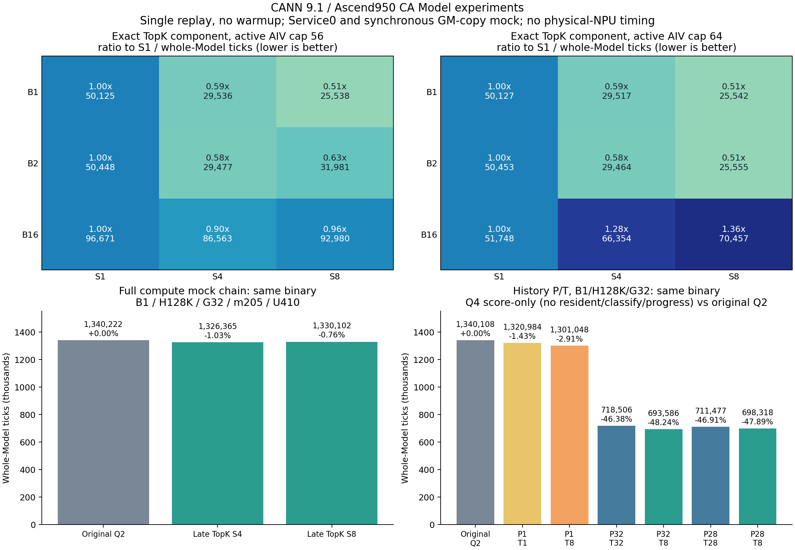

> 历史研究归档：测试基线为81b1472＋实验overlay，不代表本MR新流式main的性能。本地.aiinfra路径仅标识原始证据；可移交摘要见 results/model-records.json，当前集成状态见 README.md。

# KVIP 独立 AIC AIV 资源分配与仿真实验

用户已澄清：两档物理配置是32个AIC/64个AIV、28个AIC/56个AIV，**没有必须按1 AIC配2 AIV划分任务的硬件约束**。上一版将现有mixed执行方式提升为研究空间约束，现予以纠正。当前源码的1:2只是一个待优化的实现选择。

本轮35次CA Model运行已全部结束并通过输出与证据验证：21次TopK组件（含3次已撤回局部计时解释的历史pilot、18次修正版）、3次lateTopK完整mock链路、4次history smoke、7次标准history对照。B1/H128K/m205下，P32/T8为693586 ticks、P28/T8为698318，分别比该组原链路1340108低约48.24%和47.89%，所有score key逐字节一致。独立lateTopK S4仅低约1.03%，说明生产与选择粒度需要联合研究。60场景结构模型已完成，完整60场景Model扫描尚未执行。

研究主目标仍是selected KV ConsumerReady的关键路径。新的候选应独立分配AIC生产、AIV评分、TopK、Service和修复。本轮已验证**保留廉价QK通路、独立AIV精确TopK及生产/选择粒度解耦**的受限原型；下一步研究resident/cold阶段的角色重分配、范围就绪与服务截止时间。把全部FP32 QK中间结果经GM路由会增加很大的桥接流量，不应默认它一定更快。

## 1 源码和依赖状态

本地目录为 `${KVIP_ROOT}`。KVIP main已完整检出当前版本的166个跟踪文件，commit为 `81b1472809b7a5f3469e26467feee0ca1c61d71a`；Git历史为浅拉取，不影响当前源码完整性。原KVIPAgent业务和实验文件未修改。

本轮又下载KVAF到 `third_party/KVAF`，固定构建脚本要求的 `1c1310387ebfb6776a07316874e924265b209ada`，执行 `python3.12 scripts/build.py --prepare-only --transport ubmem` 应用六项仓库内适配patch。它仅准备依赖源码，未安装系统组件或冒称完整环境已经构建。构建依赖记录见 `.aiinfra/tasks/SPLIT-CORE-002/dependency-status.json`。

按用户选择，仅在CANN9.1/Ascend950 CA Model仿真环境验证。当前主机为macOS ARM，无物理NPU。仿真使用独立容器和工作目录，不更改Docker VM配置；共享Model预约由原owner释放后再获取，禁止并发跑两项Model实验。

本轮沿用ComputeMm1会话的标准fixture与**URMA算子六kernel计算链的同步GM-copy测试overlay**，并显式Service0。当前vLLM主接入要求UBmem，原生forward为八kernel，UBmem Service还会等待copy完成；本轮没有运行native UBmem传输或vLLM整推理。两路径共享LI计算头，源码走读与全局核配置事实见 [首轮源码分析](split_core_analysis.md) 第2—3节；其旧硬件配对解释已被本报告替换。实验“full chain”指当前受控计算与mock后半链路，不能解释为生产接入的端到端TPOT。

## 2 纠正软件执行方式与物理资源的混淆

| 当前代码的1:2耦合 | 位置 | 对新模型的含义 |
|---|---|---|
| `KERNEL_TYPE_MIX_AIC_1_2` | LI的 `op_kernel/indexer.cpp:13`，URMA/UBmem两版 | 当前kernel类型，不是芯片总资源必须成对分配 |
| AIV编号除2归属AIC | `indexer/indexer.h:421-426` | 可替换的任务映射 |
| FIX按M拆半送双目的UB | `indexer_cube.h:450-472` | 当前廉价数据路径有局部目的约定，不能免费任意路由 |
| 两个VC信用、两个CV通知 | `indexer_cube.h:158-159,315-316` | 重用bank的协议随新数据路径改变 |
| AIV用 `%2` 分query/score行 | `indexer_vector.h:464-469,555-556,610-633` | 新任务池需显式query/range owner |
| Service按core/sub编号切换 | `indexer_vector.h:51-59` | 不代表必须用计算组中的AIV做Service |
| serviceLanes=2g，F预算≤2P | `include/runtime_shape.h:39-45` | 当前ABI/shape公式，不能限制候选角色池 |
| effective AIC=min(C,V//2,32) | `python/kvip/runtime/device.py:22` | 当前软件为mixed kernel换算预算，不能作为物理上限推理 |

旧报告中B1仅用2 AIC、C28/B16整体回退Q4等表格仍能描述**现代码基线**，不再限制新的C/V分配。两个AIV按query分工、D128点积在AIC、heads归约在AIV等源码事实保持。

官方接口有AIC_ONLY、AIV_ONLY以及不同mixed类型；文档还要求kernel实现与所选类型一致。可以设计独立kernel/grid，但是否支持特定跨kernel并发、共驻留和通信，仍需目标运行时验证，不能只改枚举。[Setting Kernel Type](https://www.hiascend.com/doc_center/source/en/CANNCommunityEdition/900/API/ascendcopapi/atlasascendc_api_07_0218.html)

### 2.1 整体分核解决的不只是算力分摊

| 阶段 | 当前任务划分及主要目的 | 优化时必须保留的边界 |
|---|---|---|
| Resolve | batch×F；各worker读取同一请求8192个selected，复制去重/rank/slot计划，再分写locations与唯一miss范围 | 全Q4保护集合、immutable mapping、首次TopK出现顺序、唯一descriptor writer |
| Plan | 每batch一个512线程SIMT block，验证src/dst单射并闭合置换路径 | 完整路径/环计划先完成，不能把独立片段视为互不关联scatter |
| Apply | batch×4个key字段组；各worker拥有4个uint64 key字段，末worker处理scale/address/logical metadata | 当前先快照本字段全部源记录再写目标，保护任意置换环；字段及metadata遵循同一置换 |
| 输出发布 | URMA与Plan同block发布，UBmem为Plan→PublishOutputs→Apply | 逻辑ID从旧owner/token映射读取，输出关联必须在旧映射被覆盖前固定 |
| URMA Fetch | 每batch一个AIV，内部遍历F个descriptor范围 | 非冲突区间→join预取→冲突区间；每queue单owner，源地址预快照 |
| UBmem Fetch | batch×F消费token范围，再每batch一个Complete汇总 | copy完成、完成计数、最终聚合与失败回滚；不能只看提交或hot-valid |

源码依据：`common/lifetch/resolver_front.h:2`、`resident_selection.h:54`、`resolver_plan.h:9`，URMA `op_kernel/index_cache_update.cpp:83,110`、`index_cache_update.h:54,261`、`lifecycle.cpp:293`，UBmem `op_host/launch.cpp:29`、`op_kernel/lifecycle.cpp:100,168`。

因此当前分核同时是在安排**静态所有权、复制计算、字段独立性和完成顺序**，不是简单把一个可任意切开的工作量均分到更多核。Resolve总计划工作可随F复制；关键路径近似包含一个完整 `t_plan(8192)`，而非直接变成 `t_plan/F`。一次计划加范围发布可减少重复工作并释放AIV，但是否缩短关键路径仍取决于单计划延迟和额外通信。

URMA early-update还可能在fetch前发布residency；hot-valid不等于ConsumerReady，失败会撤销owner热驻留。新的独立核池必须把这些所有权和可见性约束带入DAG，而不能因资源数量独立就并行覆盖slot。

## 3 独立资源的计算模型

令C/V为物理预算，c为QK生产者，v_s/v_k/v_f/v_t分别为score、TopK、Service、尾部AIV配额。每个时刻只要求：

`0≤c(t)≤C`

`v_s(t)+v_k(t)+v_f(t)+v_t(t)≤V`

允许跨阶段复用资源，**不添加v_s=2c、V_active=2C_active或c≤V/2**。buffer、带宽、队列owner与依赖约束仍然存在；物理独立不等于中间数据可以无代价随意发送。

### 3.1 服务率与反压

统一单位为query-history tile，N=128。每AIC矩阵含q个query（Q4/Q2/Q1对应q=4/2/1），耗时 `t_C(qG,N,D)`；AIV消费q_v个query耗时 `t_V(q_v,G,N)`。

`λ_C=c·q/t_C`，`λ_score=v_s·q_v/t_V`

稳定流水受 `λ≤min(λ_C,λ_score,BW_bridge/bytes_tile,…)` 约束。平均生产超过消费会积压，需credit反压；最佳v_s/c由有效服务率和形状决定，没有固定2的理由。resident TopK或Service借走AIV时，消费速率会下降，队列预算也应随之调整。

若暂忽略共享带宽干扰，平衡点为 `v_s/c≈q·t_V/(q_v·t_C)`，再按整数核数、角色保留和阶段期限取可行解。t_C/t_V应包括实际形状、cache和并发干扰，并使用同一已校准时间域；本轮worker raw计数与whole-Model footer不能直接相加代入该式。更一般的调度下界为DAG最长依赖、AIC总服务工作/C、AIV总服务工作/V与必要流量/BW的最大值；实际计划还要计入非抢占任务与离散尾部。

有界队列需定义 `0≤produced−consumed≤capacity`。每slot至少包含request/query、history范围、generation、payload位置和完成事件。顺序为payload写入完成→release发布→acquire可见→消费结束→归还credit；score/hits ready和payload fetch完成是两类事件。跨块自旋前需保证producer能获得执行资源，避免消费者占满资源等待尚未调度的producer。

### 3.2 关键路径



有限调用目标是 `min max_b T_ConsumerReady,b`，在线另看request分位数与TPOT。不能只看稳态吞吐：阈值早出、最终归并、最后一批miss和传输completion会构成长尾。cold数值评分本身不依赖阈值，分类才依赖；先算后分类必须计入暂存和二次读取。

### 3.3 工作量与桥接量

Q=4、D=128、G=32/64。a为query组数1/2/4，S为history分片：

当前heads折入MMAD的M维，AIV完成每token的完整head归约；优先history分片可保留这个语义。若按head分核，必须先合完整score再做精确TopK，各head局部TopK不足以恢复全局赢家；按D拆则必须先合partial dot再ReLU，不能分别ReLU后相加。G32/G64是模型形状的敏感性分析，不是可任意减半而保持模型语义的调参项。

- 点积总逻辑运算：`2BQGHD`，与miss无关。
- K逻辑扫描：`BaHD` bytes；history不重叠分片不再乘S，query组复制会乘a。
- 最终score写：`2BQH` bytes。
- 如果raw FP32 QK经GM桥接：写+读为 `8BQGH` bytes。
- 精确分片候选数：`BQ·Σ_s min(K,H_valid,s)`，不能在短shard还固定按SK。
- 若候选score2B+id4B，候选数组体量为上述数量×6B，归并读写和原ID回查另计。

B1/G32/H128K的raw-QK GM桥接是128MiB/request；Q4 K扫描只有16MiB/request，score数组为1MiB/request。全QK materialization还需64MiB驻留空间。有界队列减少峰值空间，不能消除总交通；L2命中可能缓解外部HBM交通，但需单独测量，当前quiet Model配置不能代表真机L2行为。

因此可优先保留局部低成本QK通路，把**低体量的score、TopK候选或Service任务**交给其他AIV。它保留了独立分配的自由，不要求所有中间结果都跨GM路由。

只计逻辑K扫描、最终score与raw-QK桥接，Q4/G32的算术强度从 `2QGD/(D+2Q)≈240.94 FLOP/B` 降为 `2QGD/(D+2Q+8QG)≈28.25 FLOP/B`；G64则从约481.88降为30.01。raw桥接占主导时上限趋近 `D/4=32 FLOP/B`。这些是逻辑流量比，不是实测HBM roofline；真实cache命中、Q/scale/页表和同步流量还需补入。它说明“物理资源独立”与“任意中间结果跨GM消费值得做”之间仍有一个通信代价优化问题。

结构计数已生成 [split_core_v2_model.csv](split_core_v2_model.csv)，覆盖60场景×2档资源×3种S，共360行。它按真实stride任务映射计算每worker最大的16K trunk轮数，再加merge阶段，未把轮数当周期。

H128K下的关键trunk轮数代理如下；还没有包含每轮实际长度差异、histogram数据分布、GM与launch成本：

| B | V64 S1/S4/S8 | V56 S1/S4/S8 |
|---:|---|---|
| 1 | 8 / 3 / 2 | 8 / 3 / 2 |
| 2 | 8 / 3 / 2 | 8 / 3 / 3 |
| 4 | 8 / 3 / 3 | 8 / 5 / 4 |
| 8 | 8 / 5 / 5 | 8 / 7 / 6 |
| 16 | 8 / 9 / 9 | 16 / 12 / 12 |

这给出可证伪预测：小B长H可能从分片获益；B16/V64本来已有64个query任务，分片的merge开销可能使其更慢；B16/V56则可能用细粒度history任务改善64个query在56worker上的离散尾部。实际结果必须检查周期和完整kernel边界，而非只按轮数选S。

更直接的选择代价形式为 `T_K(S)≈ceil(BQ·S/V)·t_local(H/S,K)+1[S>1]·ceil(BQ/V)·t_merge(SK,K)+L(S)`。若在未饱和区暂取 `t_local≈αH/S`、`t_merge≈βSK`，连续驻点为 `S≈sqrt(αH/(βK))`，还要与S1及launch成本单独比较，并受整数、UB和任务容量限制。达到容量后局部项可能因波次不再下降，归并仍增长；BQ>V时更必须离散计算。此式仅用于组织候选，不预设α/β或最优S；真实16K trunk、K前缀、数据分布与带宽均会使成本非线性。本轮S1/4/8不代表穷尽，后续应包含S2和非2幂候选。

## 4 可实现方案和实验顺序

| 方案 | 改动和收益假设 | 必须验证的代价 |
|---|---|---|
| A 现代码Q2/Q4 | 同一设备代码，显式选择query分组，建立可复算全链mock基线 | M效率、K重读、每AIV query数、TopK trunk及F变化 |
| B 独立AIV最终TopK池 | LI写score后，AIV-only做完整/分片TopK；v_k可独立到56/64，AIC此阶段为0 | 额外launch、候选数组、merge和原ID回查；阶段屏障 |
| C resident/cold history任务化 | resident优先阈值，cold局部评分/TopK并行，分片发布range-ready | 前缀串行下界、resident merge、乱序范围与scratch |
| D AIC-only→GM→AIV-only | 最清楚的完整解耦正确性对照，独立grid | raw QK桥接128MiB/request起，失去原FIX直达UB收益 |
| E 双池有界队列 | 生产/评分池并发、信用反压、动态让出Service/TopK | 并发驻留、可见性、队列容量、轮询与取消处理 |
| F 局部快通路加溢出窃取 | 通路空闲时保局部，失衡时只把低体量任务转交 | 路由判定和抢占开销，避免重复owner |
| G 单目的FIX与AIV角色专用 | 在合法mixed路径内让一个AIV接收整块QK，另一个做TopK/Service | 评分AIV服务率、CV/VC信用改造、UB容量和score-ready新协议；尚未实现 |

B的独立TopK组件已完成pilot，同binary原链路与接回完整LI的lateTopKpool S4/S8均已通过。后者保留现有QK/score通路及resident阈值，只把最终TopK移到独立AIV池；它不是D/E的raw-QK双池完整解耦。C另有score-only history原型，标准七例已通过，移除了resident/classify/progress，必须用同overlay S1消融；D/E/F仍待实现。

B1/2长history优先展开history任务；B8/16需要防止局部候选归并和带宽超过并行收益。C28/B16不应被旧shape的整体Q4回退困住，但一个新全局细粒度调度必须实际实现，不能把简单32任务分两波称作已解决。

### 4.1 分核选择应解哪个优化问题

对离线规划，可以把每个候选计划写成 `p=(query组、resident分片、cold分片、AIV角色时段、buffer容量、预取窗口)`。先删去不满足UB/L1、局部路径、当前runtime和完成依赖的计划，再比较实测服务时间填充的资源约束DAG makespan。性能模型至少区分以下项：

`T(p) = makespan(DAG(p), c(t)≤C, Σv_role(t)≤V, BW约束, credit约束)`

`T_ready,b = max(T_selected,b, T_payload_completed,b, T_mapping_visible,b)`

其中payload完成时间要逐批按release time、传输服务量和completion约束计算；不能简单写成 `T_LI−T_network`。resident阈值是分类的gate，最终全局TopK是精确选择的gate，两者不是同一个完成点。

| 工作区间 | 首要待解问题 | 首批候选与拒绝条件 |
|---|---|---|
| B1/2、长H | 独立request/query不足以占满矩阵和向量资源 | Q4保K复用，history展开；比较S1控制与多个S。若merge、score物化或阈值延迟吃掉收益则降低S |
| B4/8 | K复用、矩阵形状、局部TopK和任务数平衡 | 联合比较query分组与history分片，避免只按活动核数选最大S |
| B16、C32/V64 | 基线query任务较充足，继续细分可能只增流量 | 优先保复用、减尾部/同步，必须保留S1；TopK分片不预设更快 |
| B16、C28/V56 | 原全局回退及不整除波次造成资源尾部 | 更细任务与静态均衡，跨batch混排；不把简单两波当作已经消除尾部 |
| 任意B、高U | payload deadline、去重与Service完成 | Service配额按U与剩余时间调；若只提高submit数而未减少exposed fetch，则拒绝 |

分核数不是最终研究结论；应该输出**输入特征→候选计划→实测成本→切换边界**。当前没有生产/消费和传输的真机服务率，因此不能精确断言哪一个 `c/v_s/v_f` 最优。本轮可检验分片与精确归并的正确性、给出Model内排序，并收缩下一轮搜索空间。

一个容易忽略的离散效应是C28/B16的uniform分片。假设Q4生产工作随H近似线性、各片等长且只有完整波次：S1为16个H任务，S2为32个H/2任务，后者仍需两波，理想化最长时间都为H，利用率同为16/28≈57.1%。S4需3波，时间3H/4；S7有112任务、恰好4波，时间4H/7才达到线性工作下界。C32/B16的S2则恰好一波、H/2。**增加分片不保证减少关键路径，整除关系与任务粒度同样重要。**

这个例子是等速生产模型，不是测量；现prototype的virtual batch上限32还不能直接执行112任务，需persistent task list或多轮派发。TopK也不能照搬S7：H/7略超16K trunk，可能让每片多一次pass，故生产的理想P与选择的理想T会不同。应把细tile调度、MMAD形状、K复用和TopK trunk非线性共同纳入代价模型。

### 4.2 history原型与完整目标的距离

原型把 `[b,producer shard]` 映射为virtual producer任务，每任务Q4；128-token页表共享原K/Kscale，复制小体量Q/W/Qscale。新v2允许生产分片P与选择分片T独立：score为 `[b,P,q,Hpad]`，局部候选为 `[b,q,T,K]`，再精确merge。评分每task仍使用原mixed软件的1 AIC/2 AIV局部路径，**这是该原型的合法性条件，不是物理资源模型**；最终TopK池独立分配且分阶段复用AIV。

B1/H128K下，S32每块4096；S28每块4608或4736、行stride4864。S1/Q4 score-only控制用于隔离history并行收益。原型当前只接受完整queryEnds、每块大于2048、Service0；30% history直接用S28/S32会使块短于K，应使用更少S或实现 `min(K,localLen)`/空块协议。不能绕过guard后直接宣称支持所有场景。

std控制包括P32/T32、P28/T28，新增P32/T8与P28/T8直接按逻辑history区间读取多个producer行，跳过行padding，不重排整个score数组；P=T保留连续读分支。后两种的候选数组均为384KiB，相比P32/T32的1.5MiB少75%、相比P28/T28的1.3125MiB少约71.43%；这是结构量变化，对应时延计数见7.5节。新driver为`3fdfdc73…`，旧v1编译物未运行且保留，完整对照均已在该新同binary内结束并通过。

另保留P1/T8控制：P1/T1→P1/T8比较选择粒度；P1/T8→P32/T8或P28/T8在固定T下比较生产方案的整体影响；各P的T=P→T8比较选择与gather代价。不同P仍有布局、缓冲和片段读取差异，不能把全部差值归因为某条MMAD指令的纯核数收益。

原型删除resident选择、cold分类和Progress，仅验证精确评分/选择及mock后半链路。它不能证明预取语义保持，也不能替代后续resident优先、range-ready和Service deadline方案。当前数值验收是与同binary原baseline的全部score key逐token一致，再保留原完整链路oracle，而不只比较最终TopK。

## 5 按独立资源重新整理论文

下列映射是工程推论，论文收益数字均不作为KVIP预测值。

正式标题、年份与一手链接另存 [split_core_references.csv](split_core_references.csv)。Flash-Decoding是作者技术文章；Roofline当前链接为2008技术报告，不能与2009 CACM版混写年份；2026预印本不据模板页眉推定正式会议发表。

| 一手来源 | 可迁移的优化思想 | KVIP要保留的边界 |
|---|---|---|
| [DeepSeek-V3.2](https://arxiv.org/html/2512.02556v1) | 定义完整LI评分及每query TopK语义 | selected稀疏不等于Indexer可漏扫history |
| [Flash-Decoding](https://pytorch.org/blog/flash-decoding/) | 长history拆分补足小batch并行 | LI用精确TopK归并，不照搬softmax归并 |
| [FlashAttention-2](https://arxiv.org/abs/2307.08691) | 改工作划分，减少非矩阵工作与通信 | AIC形状与AIV压力需独立测量 |
| [FlashInfer](https://arxiv.org/html/2501.01005v1) | 按长度切长任务、代价平衡与离线规划 | LI还带阈值、range-ready和Service依赖 |
| [NanoFlow](https://www.usenix.org/conference/osdi25/presentation/zhu-kan) | 资源需求驱动的操作流水和干扰建模 | 吞吐最优不自动等于selected-ready最优 |
| [InfiniGen](https://arxiv.org/html/2406.19707v1) | 预测与预取提前量、预算共同优化 | 下一层近似预测不等同当前层精确阈值筛选 |
| [HiSparse](https://arxiv.org/html/2608.07009v1) | 缓存解析/搬运融合，共享selection提供精确提前量 | LRU可能已吸收可预测复用；投机hint未必有增量收益 |
| [FlashOffloading](https://arxiv.org/html/2611.07542v1) | id/slot编码随TopK传递、hit计算隐藏miss load | SFA内部重叠不同于LI内部Service |
| [StreamIndex](https://arxiv.org/html/2605.02568v1) | streaming partition-merge TopK | 统一全序定理不同于torch.topk经验set parity |
| [Multi-layer Indexer](https://arxiv.org/html/2611.03768v1) | 改变选择依赖以扩大并行窗口 | 使用前一indexer层selection，涉及模型质量，非透明精确替换 |
| [FlashAttention-3](https://arxiv.org/html/2407.08608v2) | producer/consumer分工、多级buffer、信用释放和矩阵/向量交错 | Hopper TMA/WGMMA不能直接当Ascend接口 |
| [FlashAttention-4](https://arxiv.org/html/2603.05451v1) | 多资源roofline及瓶颈随算力迁移 | LI无softmax，应分析score/TopK/桥接/队列屋顶 |
| [Tawa](https://arxiv.org/html/2510.14719v1) | put/get/consumed表达发布、借用与释放 | 其实现与支持通信模式不等于本设备任意路由 |
| [HyperParallel-MoE](https://arxiv.org/html/2605.23764v1) | Ascend上CTQ给AIC、VTQ给AIV，事件驱动静态taskflow | A3 MoE训练不同于LI动态候选/阈值和传输完成 |
| [Roofline原始技术报告](https://www2.eecs.berkeley.edu/Pubs/TechRpts/2008/Archive/EECS-2008-134.pdf) | 用可持续带宽与运算强度建立上界 | 还需叠加队列、同步和DAG最长链 |

HyperParallel-MoE已经有独立AIC/AIV任务队列和事件调度，FA3/Tawa已有producer-consumer信用协议。因此不能把“首次独立核池”“首次异构队列”“首次双buffer”当作创新。

### 5.1 可研究的创新假设

1. **LI阶段驱动的AIV角色自适应。** resident阶段优先阈值，cold阶段按生产/消费率调score与Service，末尾转TopK/repair。对比固定独立配额和旧mixed方式，测T_ready及队列积压；若收益只来自窗口预算修正，则不能归因于新调度。
2. **桥接流量感知的局部通路与远端消费。** 只在局部失衡时转移低体量score/候选/服务任务，避免所有raw QK落GM。若新增流量与轮询超过减少的等待，假设被否证。
3. **range-ready、精确TopK、预取deadline联合计划。** 完整评分、候选生产时刻和payload完成共同驱动任务次序。若只提前doorbell却未改善completed-before-needed或exposed fetch，则没有达到目标。
4. **静态基础计划加少量credit反馈。** 按B/H/G规划任务，只在队列/Service压力改变时调整额度，避免每128token进行重调度。用静态/全动态/轻量反馈消融，计算控制字节和派发周期。

本轮只按用户选择做仿真验证，不宣称未经验证的新颖性。若将来用于物理设备性能结论，再另做真机复核。最可能形成系统性贡献的是LI特有阈值/精确选择/动态缺失与独立资源分配的联合模型，而不是一般双池本身。

### 5.2 当前原型最具体的三项创新实验

**先把生产分片P与选择分片T解耦。** 初版v1令P=T=S，当前v2已解耦；二者目标不同：生产要补足矩阵并行，选择要平衡扫描与归并。B1/Q4/K2048、6B/candidate时，P32/T32会物化1.5MiB候选，P28/T28为1.3125MiB，已经大于完整score数组的1MiB。可固定P32/P28，而令T=1/4/8/P，TopK直接读多个producer score段，避免先重排全部score。保持score producer相同，测候选读写、segment读取代价、归并与whole Model；若最优始终T=P，或读取成本抵消收益，则假设被否证。与Flash-Decoding/StreamIndex的差别是矩阵生产粒度与精确选择粒度的联合优化，不是局部TopK定理本身。

**再检验精确下界能否压缩候选。** 任一已完成、至少有K项的合法集合，其第K大分数θ是全局第K大分数的下界。后续score<θ项可不传递给最终merge；不省略评分，score=θ保守保留。第一版用固定前缀形成θ，计入阈值生成/过滤/变长数组成本；比较赢家集中前缀、集中末段、均匀分布、大量ties、全零及padding。若θ形成太晚、过滤过贵或ties使候选仍接近固定K，则没有系统收益。若要求与现main具体tie结果一致，须另证明同tie契约，不能只引用统一全序定理。

补充的**CPU数据潜力统计**读取12个受控fixture、48个query：保留resident精确K项，并保守保留cold中score≥resident第K大θ的项。每query cold幸存恰为61/102/205/307，总候选2109/2150/2253/2355，全部global严格赢家和本fixture的2048项最终集合均保留。H128K/m205的四个θ为49836/49815/49749/49841；Q4合计9012对、54072B，较P32固定local-K候选少约96.56%，较P28少约96.07%。这只是当前feature-band分布的候选体量潜力，**不是已实现的过滤kernel或时延收益**；此次cold边界无ties，最坏分布可能保留全部cold token。原始逐query统计见 [split_core_v2_threshold_potential.csv](split_core_v2_threshold_potential.csv)，threshold构建、过滤和变长scratch成本仍待测量。最坏保留全部cold时，H128K/Q4的候选可达2.671875MiB，反而大于固定P32/P28；当前score-only原型还删除了resident TopK，恢复阈值生成也不是免费操作。

最小有界实现可按cold shard先统计score≥θ的项：不超过K时直接传递；超过K时回退该片精确local TopK，再与resident K归并。这样候选数有界于 `K·(1+S_cold)`，避免无界append；计数/压缩与回退代价都计入对照。第一版先等score完成再生成resident θ以验证数值，下一版才让resident优先并发布θ；若θ来晚则cold评分仍可先做并暂存score。此方案尚未实现；指定ID的tie契约仍需一致，不能由上述候选数上界替代精确性证明。

**最后研究生产并行度与选择重叠的取舍。** 当前producer全结束才启动TopK；可在C32/V64用P16生产、最多32 AIV消费TopK，在C28/V56用P14、最多28 AIV消费。这里2P是保留mixed局部路径的实现占用。比较满P串行、半P串行、半P重叠三组，才能隔离减少producer与新增重叠的效果。range-ready队列必须有唯一writer、payload完成后发布、读完后归还credit及有界积压；未证明共驻留前不能依赖自旋。FA3与HyperParallel-MoE已有生产消费/taskflow，因此差异应落在完整数值评分、精确选择尾部和LI deadline，而非“首次异构流水”。

半P只是最简单的共驻留正确性对照，性能搜索应进一步试少量保留，例如C32/V64内P28留8个TopK AIV；按实测生产损失与可隐藏选择时间画Pareto前沿。若TopK尾部很小，减少生产核数可能反而变慢，不应预先固定一半资源给消费者。

其中P/T解耦已实现，smoke四例与标准七例Model验证均已通过；候选压缩和有界重叠尚未实现。本轮已计划的Model运行均已结束。下一轮优先级P/T解耦→精确候选压缩→有界重叠；它们利用本轮score parity与TopK oracle作为正确性基础。

**由B16/V56结果派生的下一轮假设：只拆尾部query。** 64个query在56 AIV上，先让56个完整query直出，再把剩余8个query各拆7片；每worker处理一个H任务和一个约H/7任务。线性均匀扫描的理想负载为64H/56，实际按128-token页粒度向上取整，且只需合并8个query。部分结果为56×2048个候选对（约0.656MiB），相较均匀S4的256×2048对（3MiB）显著减少。真实TopK成本并非线性，H/7又跨16K trunk，所以这只是待测方案，不能据工作量下界宣称加速；应与FlashInfer类代价均衡规划及当前S1/S4/S8对照。该方案尚未实现，不增加本轮已固定实验列表。

整体链路还应独立评估Resolve/Plan/Apply/Fetch的任务粒度：按plan entries、key字段和回填token组织AIV工作，而不是固定沿用batch倍数。扩并行必须保留字段写入所有权、置换环依赖、slot保护及最终可见性；先取得阶段测量再判断其是否位于关键路径。本轮没有将这些未改动阶段的性能归因为已定位瓶颈。

### 5.3 编程接口落地边界

官方 [CubeResGroupHandle](https://www.hiascend.com/doc_center/source/zh/CANNCommunityEdition/910beta3/API/ascendcopapi/atlasascendc_api_07_0290.html) 有2 AIC、10 AIV的client/server分组例子，但 [AssignQueue支持表](https://www.hiascend.com/doc_center/source/en/CANNCommunityEdition/850/API/ascendcopapi/atlasascendc_api_07_0292.html) 不能证明该接口在本目标A5可用。既有CrossCore mode2也是特定通信语义，不能直接用作任意可寻址队列。

[ReadGmBypassDCache](https://asc.gitcode.com/api/SIMD-API/basic_api/scalar_compute/ReadGmBypassDCache_ISASI.html)、[WriteGmBypassDCache](https://asc.gitcode.com/api/SIMD-API/basic_api/scalar_compute/WriteGmBypassDCache_ISASI.html) 展示scalar数据写、DDR barrier、flag发布；FIX/MTE payload仍需其流水完成同步。[IBSet](https://asc.gitcode.com/api/SIMD-API/basic_api/sync_control/inter_core_sync/IBSet.html)在分离模式对AIC不提供同样同步。asc-devkit master文档是持续开发预览，不能代替已安装CANN9.1编译与运行验证。

### 5.4 单目的FIX：另一条需要优先验证的低桥接路线

官方 [GetTaskRatio产品支持/返回值](https://www.hiascend.com/document/detail/en/CANNCommunityEdition/910/API/ascendcopapi/docs/en/api/SIMD-API/basic_api/tool_interface/system_resources_and_variables/GetTaskRatio.md) 与 [kernel类型表](https://asc.gitcode.com/api/SIMD-API/basic_api/Kernel-Tiling/set_Kernel_type.html)列有950的MIX1:1；本地SDK也确有1,1 metadata及同步实现。但 [Fixpipe L0C→UB的参数与约束](https://asc.gitcode.com/api/SIMD-API/basic_api/cube_compute_ISASI/cube_compute_store/Fixpipe_L0CToUB.html)只承诺整个接口用于MIX1:2。**类型支持1:1，不能证明1:1＋FIX直达UB的组合合法。** 当前LI使用的 [CrossCoreWaitFlag mode4约束](https://asc.gitcode.com/api/SIMD-API/basic_api/sync_control/inter_core_sync/CrossCoreWaitFlag_ISASI.html)也只对应MIX1:2；真1:1须采用合法的新同步协议。持续开发文档与本地SDK佐证均不是尚未运行组合的验收证据，更不能重新解读成物理资源必须1:2。

更明确的最小候选是：保留合法MIX1:2启动，FIX设 `dualDstCtl=0, subBlockId=0`，AIV0消费整个QK块，AIV1承担明确分配的TopK/Service。评分角色与辅助角色不再必须一起做同一tile的评分；可减少全量raw-QK GM桥接需求。源代码须同时改Cube只等待/通知scoring AIV的信用、query起点/数量、score输出偏移、FIX第二N-plane dstNdStride与向量qkVLstride，而不只改kernel枚举或目的参数。AIV1的score-ready必须在MTE3写出后发布，不能用现有“QK已消费”的VC信号替代；resident阈值交回与Service完成仍是另外的依赖。

还可构造静态混合计划：c个producer组中有s组使用单目的，其余双目的，则该**局部实现族**有 `v_score=2c−s`、`v_aux=s`，s从0到c搜索；两种评分服务率不同，history区间可按实测服务率加权分配。这样既保留低成本局部交接，又能改变角色配额。这个实现族不穷尽独立物理资源空间，也不证明跨kernel共驻留；动态切换还须排空旧bank信用并明确epoch，先做静态对照更稳妥。

| 单scoring AIV形状 | raw QK双缓冲 | 显式TBuf静态估算与可行性 |
|---|---:|---|
| Q2/G32 | 64KiB | 可复用现有batch2 VF；含16K TopK trunk约188416B，低于223232B预算 |
| Q2/G64 | 128KiB | 16K trunk超预算；8K约221184B，只余2KiB，风险较高 |
| Q4/G32 | 128KiB | 需两次batch2或新增batch4；完整辅助缓冲＋8K trunk约229888B，超6656B；宜移走TopK或改布局 |
| Q4/G64 | 256KiB | raw缓冲单项已超预算，须Q2子tile、单缓冲或其他布局 |

以上仅显式缓冲求和，不替代编译、流水依赖与Model验证。首个实验应为Q2/G32、单目的评分＋独立final TopK，逐token key/selected/完整mock oracle对照；之后才恢复resident与Service。单AIV工作增加也可能使AIC等待，所以它是**服务率和角色分工假设**，不是预定加速方案。本轮已验证的history原型仍用原双目的评分，未把这一新方向冒充实测。

## 6 本轮仿真实验设计

### 6.1 全链基线的复用

从原会话导入B1/Q4/G32/H131072/R16384、205 miss/query、410 unique/request的完整CA Model记录。实际LI为Q2、2 AIC，最终F4。日志有 `Total tick: 1340113` 与正常结束，Index字段、outputs、guards oracle通过。

这是一条**复用既有记录**，不是本轮新跑；设备LI字节与当前main一致，full-chain测试overlay使用同步GM-copy mock并显式Service0。原capture的 `clock_equivalence_unverified=true`、`valid_for_standard_performance=false` 完整保留。1340113只能按该记录的raw Model ticks展示，不能转成真实网络收益或与不同计时口径直接做比例。

原始小文件已复制到 `.aiinfra/tasks/SPLIT-CORE-002/imported-baseline/`，路径与哈希见 `baseline-import.json`。另准备相同device archive的新host，只增加显式Q2/Q4与C预算输入，保持mock及oracle，用于同环境重跑。

### 6.2 新的独立AIV TopK实验

实现文件为 `experiments/split_core_v2/topk_kernel.cpp`、`topk_host.cpp`。两个kernel均AIV_ONLY：local用 `min(B·4·S,Vcap)` 个worker跨步处理分片；merge另起 `min(B·4,Vcap)` 个worker。AIC worker数为0，Vcap独立设56/64，没有V=2C约束。

仿真仍使用同一dav_3510 Model拓扑，56/64是本实验显式限制的AIV活动worker上限，不冒称已经切换了两种物理芯片拓扑。TopK阶段不使用AIC，不能从该组件推出C32对C28的QK吞吐差。

实际 `config_stars.json` 是32 AIC/64 AIV，serial simulation（parsim=0）；quiet配置的L2 cache关闭。构建 `SOC_VERSION=Ascend950PR_9599`，运行时HAL日志报告 `Ascend950PR_9589`，实际库为dav_3510；完整指纹及配置内容保留在 `simulator-topology.json`。两档预算是同一Model上的活动资源限制，不是两个已校准SKU，尤其不能用本配置估计真机L2收益或host wall加速比。

对比S=1/4/8。S1是**复用main LITopk的组件基线**，固定16K trunk并返回score；它不等同main所有Q4路径的8K trunk指令序列。所有变体使用相同输入、同一uint16 TopK primitive，分片时完整计入local候选写、merge读、position→原token ID映射。显式UB为97824B，包含32B计时buffer；模型配置与driver/kernel哈希保留。

输入覆盖3种H×4种r，batch按1/2/4/8/16复制，G32只是输入来源而非本组件的矩阵吞吐测量。主fixture来自main的controlled feature-band分数，映射物理token坐标，再通过可记录的hot/cold score交换保证每query精确m和有效长度。有效正BF16 bits按main XOR0x8000转成sortable key，padding保持key0。78次调整包括padding winner迁移及精确m交换，不能全部称padding修正。

实际U应读取manifest，不能一律设2m：H30%为122/180/230/360；H50%为122/204/384/384；H100%为122/204/410/614。每次运行验证：全局strict-boundary的selected集合和对应score、各shard的范围/唯一性/Kth阈值/所有GT赢家、输入未修改和allocation尾guard。局部阈值ties允许合法等价集合，不承诺输出按rank排序。

| 有效H比例 | shape H / cold扫描token | r3%：U / KiB | r5%：U / KiB | r10%：U / KiB | r15%：U / KiB |
|---|---:|---:|---:|---:|---:|
| 30% | 39424 / 23040 | 122 / 78.16 | 180 / 115.31 | 230 / 147.34 | 360 / 230.63 |
| 50% | 65536 / 49152 | 122 / 78.16 | 204 / 130.69 | 384 / 246.00 | 384 / 246.00 |
| 100% | 131072 / 114688 | 122 / 78.16 | 204 / 130.69 | 410 / 262.66 | 614 / 393.34 |

KiB只计每request必要cold payload `656·U/1024`，未计metadata、投机错误和传输协议；batch不共享物理KV池时再乘B。实际m为61/102/205/307，对应2.9785%/4.9805%/10.0098%/14.9902%。此表的U来自本轮受控fixture，不代表真实trace的普遍重叠分布。

R固定16384时，缩短H不仅减少总扫描，也提高resident前缀占比；30% H的cold工作量只是H100%时的约20.1%。阈值前缀占比、cold分类和可重叠窗口会同时变化。相同miss率也不能推出相同U或相同最优Service资源；应以实际去重与完成时间驱动计划。

### 6.3 计时范围

保存两个互不混用的指标：

- **局部标记与修正版完成计时**：初版V2只在同核读取GetSystemCycle，但缺少起止PIPE_S与V依赖，已撤销其“完成的worker-body周期”解释。原始值仅保留为scalar-marker差值，不作为性能依据。另版V4加入开始S→V和结束V→S链，18组独立复测已通过；区间包含必要同步及end前少量scalar记账，排除Init、dispatch、kernel边界、timer的GM写回和Destroy，不能当两kernel端到端时延。
- **whole Model Total ticks**：包含该单独进程的Model启动、kernel、收尾等，可作同配置组件重放的另一观察；不能直接作为完整LI或真实NPU TPOT。

部分Model重放期间有独立构建活动，已记录 `host-work-overlap.json`；host wall受此影响，仅说明仿真器运行成本，不用于加速结论。本轮计数均作为单次Model观测，仍缺少严格隔离真机的重复测量。

先pilot B1/H128K/r10/S1/4/8，再根据实际运行时间扩展。全链对照始终保留固定V2 binary；修正计时另建V4并独立重放，未替换运行中的binary。B1/S8只有32个local任务，56/64预算都没满；要识别资源上限差异，需B2/S8或B4/S4等至少64任务。重复次数、执行顺序和未完成样本均原样记录，不把单次结果包装成稳定P99。

## 7 运行结果

本节由实际完成的Model日志、host oracle和执行记录更新。尚未结束的运行不计入性能；编译成功和CPU数学一致性不能替代CA Model运行。

复用全链记录：B1/H128K/G32/205 miss，raw Model ticks=1340113，完整oracle通过，Service0、同步GM-copy mock、未校准标记保留。

本轮新跑的同binary原链路基线已完成：**1,340,222 whole-Model ticks**，host实际耗时2200.11秒（仅说明仿真运行成本）。B1/H131072/G32/R16384、原Q2使用2 AIC/4 score AIV、205 miss/query、410 unique/request，完整Index/outputs/guards通过，Service0、同步GM-copy mock。它与复用记录的数值略有不同，比较本轮候选时使用本轮同binary基线，不混用旧1340113。证据：`runs/20261112-131643-full-chain/baseline-q2/`。

### 7.1 已完成的完整链路对照

| 方案 | whole-Model ticks | 相对本轮基线计数变化 | LI打分 AIC/AIV | 独立local/merge TopK AIV |
|---|---:|---:|---:|---:|
| 原mixed Q2基线 | 1,340,222 | — | 2 / 4 | — |
| 保原评分与resident的late TopK S4 | 1,326,365 | −1.033933% | 2 / 4 | 16 / 4 |
| 保原评分与resident的late TopK S8 | 1,330,102 | −0.755099% | 2 / 4 | 32 / 4 |

同一 `full_pool_sim` SHA为 `f3495a69…`，相同输入路径、CANN/Model配置和实际B1/H128K/G32/Service0。三次均完整正常结束，原Index全部字段、全部有效热槽payload、输出关联与guard通过，两个候选的中间数组guard通过。读取三案捕获的raw文件，topk、locations、logical-output、slot-output、changes/counts、plans与status逐字节相同；每query205 miss、request U410复核通过。

S8同driver/runtime/cgroup，显式绑定fixture哈希，原全链oracle与中间guard均通过，独立读取raw selected验证205/U410与尾guard。S8比S4多3737 ticks（约0.281747%），与pilot组件的whole-Model排序相反；不能据此把差异归因某一launch、cache或归并成本，当前没有相应阶段测量。

这是CA Model整测试计数的观察，不是物理TPOT。仿真器host运行成本从baseline2200.11秒变为S4的2544.55秒、S8的2738.05秒，不能与Model计数混作同一性能指标；也未按物理频率换算。每种一次、无预热，不宣称统计稳定性或普遍最优。组件收益被完整链路摊薄，下一步应检验history生产并行、生产/选择粒度与尾部，而非仅扩大最终TopK worker数。

前两次execution缺少per-run fixture hash，当前标准fixture的manifest哈希与导入旧capture预先固定的哈希相同，另有基线完成后的独立receipt记录核对时点；未改写旧execution。后续S8/history记录显式绑定输入哈希。S4最初按旧marker选出的理由也保留为历史记录，已由计时更正撤回，不称其最优。

实际结果CSV见 [split_core_v2_full_results.csv](split_core_v2_full_results.csv)。两个候选都已完成，后续修正版组件和history控制的结果分别汇总，避免跨scope比较。

新的组件实验结果文件和状态见 `.aiinfra/tasks/SPLIT-CORE-002/active-run.json` 与 `.aiinfra/local/SPLIT-CORE-002/runs/`。当前独立C/V完整流水、所有60种负载的端到端收益、Service及真实transport未由TopK组件覆盖，必须分别补实验。

### 7.2 已完成的pilot组件结果

B1、H131072、有效H131072、m205/query、实际U410/request，Vcap64；每种一次，未预热。三次Model正常结束，局部/全局候选、score、输入未改和尾guard均通过。独立审查从4096B原始timer逐worker重算并核对driver内AIV ELF。随后对PIPE_S同步的追加审查发现旧timer缺少完成依赖：因此原始算术成立，完成周期解释已撤回；数据oracle和whole Model计数仍有效。

| 分片S | local/merge AIV worker | 未同步local标记差值 | 未同步merge标记差值 | 标记差值之和 | 有效whole Model ticks |
|---:|---:|---:|---:|---:|---:|
| 1 | 4 / 0 | 31757 | 0 | 31757 | 49452 |
| 4 | 16 / 4 | 3412 | 2214 | 5626 | 27898 |
| 8 | 32 / 4 | 3404 | 2940 | 6344 | 24091 |

这个单次组件观察中，S8的whole Model计数最低，比S4低约13.65%。未同步的S标记虽给出另一排序，但不能解释为完成时间，因此不再用它比较算法快慢。不能将两种计数相减并把差额归因某一launch或某一项开销，也不能用物理设备GetSystemCycle的频率换算本Model为微秒。

full最初在追加计时审查前按旧标记选择S4，保留该历史理由；后来追加S8同环境全链消融。完整结果中本次S4计数低于S8，仍不能把已撤回的旧标记恢复成有效依据。后续自动候选选择改用有效whole Model计数并保留完整链路消融，修正版局部计时只作诊断。

数据见 [split_core_v2_component_results.csv](split_core_v2_component_results.csv)，原始记录在 `runs/20261112-125609-pilot`。B1最大仅32个local worker，尚未形成V56/V64容量对照；未测QK、resident阈值、Service、完整LI和物理NPU收益。

官方[GetSystemCycle文档](https://asc.gitcode.com/api/SIMD-API/basic_api/tool_interface/system_resources_and_variables/GetSystemCycle_ISASI.html)说明该接口属于PIPE_S；实际CANN9.1 SDK也确认MOV SYS_CNT无自动fence、MTE3_V不等于V_S。文档未提供本CA Model跨AIV同epoch或与footer TotalTick的映射保证，故不跨worker原始时间戳直接相减。

### 7.3 修正版V4组件结果

B1/H128K/m205的六组已完成。每预算每S一次、无预热；原始timer、输入/driver/instrumentation哈希、worker IDs、inactive全零、local/global oracle均独立通过。V56与V64下实际workers分别仍为4/0、16/4、32/4，未到容量边界；同步区间数值在两预算下相同。

| S | local最大同步区间 | merge最大同步区间 | 两phase最大值之和 | V56 whole Model | V64 whole Model |
|---:|---:|---:|---:|---:|---:|
| 1 | 47126 | 0 | 47126 | 50125 | 50127 |
| 4 | 14526 | 9628 | 24154 | 29536 | 29517 |
| 8 | 7827 | 12258 | 20085 | 25538 | 25542 |

这是包含必要同步和少量scalar记账的同worker区间，不按物理频率换算。B1的S8在此修正版组件内两项指标都低于S4；旧V2的marker排序继续撤回。完整lateTopK对照使用已固定V2 binary，仅比较whole Model，不能把不同binary/测量scope混为一组。

B2六组也已独立raw复核通过：

| Vcap | 同步区间之和 S1/S4/S8 | whole Model S1/S4/S8 | 本次已测候选的较低whole计数 |
|---:|---|---|---|
| 56 | 47586 / 24109 / 26677 | 50448 / 29477 / 31981 | S4 |
| 64 | 47586 / 24109 / 20106 | 50453 / 29464 / 25555 | S8 |

B2/S8有64个local任务，V56用56 workers，其中8个各2任务，最慢worker3确有2任务、local区间14551；V64各1任务、local最大8029。两个预算的merge仍各8 workers。这是离散波次与数据/服务成本共同作用的实际例子，不能把64→56按平均比例缩放；也不能只按相同trunk次数断言S4/S8等价。每配置一次、无预热，结论限本组件与当前输入。B16也已完成，18组合及其原始timer均独立复核通过。

| B16 Vcap | 同步区间之和 S1/S4/S8 | whole Model S1/S4/S8 | 本次已测候选的较低whole计数 |
|---:|---|---|---|
| 56 | 93814 / 80893 / 87532 | 96671 / 86563 / 92980 | S4 |
| 64 | 48810 / 60755 / 64698 | 51748 / 66354 / 70457 | S1 |

B16/V56最慢worker对应S1/S4/S8的2/5/10个local任务，分片方案merge最慢为2个query；V64对应1/4/8个local任务和1个merge query。V64已能容纳64个完整query任务，继续分片增加归并而本次未缩短关键路径；V56则从S4得到更小计数。当前观测的选择表是B1两预算S8、B2/V56 S4与V64 S8、B16/V56 S4与V64 S1，不能扩展为全部H/r的固定策略。

B16/V64的T1较低计数只约束选择粒度，不能推出生产也应保持P1。下一轮可比较Q4的P2/T1与当前main Q2：B16×P2正好32个producer、64个score AIV，TopK仍64个完整query任务。前者每core扫半H、M128，后者每core扫全H、M64；逻辑K扫描从两query组重复变为两history不重叠片，代价是Q/W复制与score分段读取。L2可能已吸收部分重复K流量，真实收益仍须实测；当前B1 full7与B16组件数据不能证明该生产方案加速。C28/B16还需非均匀或persistent计划，不能直接照搬32任务一波。

原始21次组件记录包含3次历史pilot和18次V4，CSV显式区分版本；旧V2计时列置空。全部18组及resource release独立通过，仍没有物理NPU、native transport或完整60场景实测。



### 7.4 history P/T 的实际smoke结果

同一v2 driver `3fdfdc73…`，B1/H8192/R4096/G32/Q4/K2048、zero-miss、Service0/同步GM mock；每例一次，无预热。这里zero表示零miss，输入前2048 token的K为0x38、后面为0，不能称全零分数输入。

| 方案 | whole-Model ticks | 评分AIC / AIV | local / merge AIV |
|---|---:|---:|---:|
| 原链路 | 238927 | 1 / 2 | 原LI内选择 |
| score-only P1/T1 | 223147 | 1 / 2 | 4 / 0 |
| score-only P2/T2 | 210124 | 2 / 4 | 8 / 4 |
| 分段直接读取 P2/T1 | 199293 | 2 / 4 | 4 / 0 |

四例全部32768个uint16 score key逐字节相同。独立读取实际local候选重算16组范围/唯一性、原token分数、Kth阈值和全部严格赢家；全局selected集合均为每query的0…2047，尾guard及原Index/payload/输出oracle通过。各query kth key为0xC300，strictly-greater数量为0，说明本分布中边界上的全部2048项均须保留；不是全局全相等分数测试。

这验证了实际gather、T1直出与T2合并路径。原始footer、driver和27个provenance源文件亦独立复核。此表只用于该smoke正确性及Model观测，不能外推H128K性能。标准H128K/m205的七例同binary对照也已全部通过，原始记录为 `runs/20261112-165632-history-full/`。

### 7.5 H128K标准history对照：七例全部通过

此组使用同一新binary `3fdfdc73…`，原链路基线为 **1,340,108 whole-Model ticks**。B1/H131072/R16384/G32/Q4、实际原LI为Q2的2 AIC/4 AIV、m205/U410；全部七例每种一次、无预热、Service0/同步GM mock。每例原Index/payload/输出/guard与全局TopK独立重算均通过。

每例真实Model回读全部524288个uint16 score key，与原链路及组件 `h100-m10.bin` 的1048576字节逐字节一致，SHA均为 `47c7ba77…`，mismatch=0。四query的全局Kth key为49950/49929/49856/49950，严格大于阈值的2044/2033/2038/2036项全部包含，≥阈值各恰2048项。独立读取共340组实际local候选与28组global TopK，范围/唯一性/分数/阈值/严格赢家/guard通过；本输入七例最终topk.bin连顺序也与原链路相同。这不扩大为任意ties输入的相同顺序保证。

本表百分比以本组1,340,108为基准；lateTopK S4/S8仍以其同binary1,340,222为基准。

| 已完成方案 | whole-Model ticks | 相对本组原链路 | producer AIC / score AIV | local / merge AIV |
|---|---:|---:|---:|---:|
| 原链路Q2 | 1340108 | — | 2 / 4 | 原LI内选择 |
| Q4 score-only P1/T1 | 1320984 | -1.427049% | 1 / 2 | 4 / 0 |
| Q4 score-only P1/T8 | 1301048 | -2.914690% | 1 / 2 | 32 / 4 |
| Q4 history P32/T32 | 718506 | -46.384471% | 32 / 64 | 64 / 4 |
| Q4 history P28/T28 | 711477 | -46.908980% | 28 / 56 | 56 / 4 |
| Q4 history P32/T8 | 693586 | -48.244022% | 32 / 64 | 32 / 4 |
| Q4 history P28/T8 | 698318 | -47.890916% | 28 / 56 | 32 / 4 |

P1/T1是Q4、score-only及独立TopK的组合控制，不能将约1.43%归因于AIC核数一项。P1/T1→P1/T8固定P，本次计数低1.509178%。

固定生产方案时，P32的T32→T8低3.468308%，P28的T28→T8低1.849533%；候选数组分别减少75%与约71.43%。这是生产/选择粒度解耦在本输入上的实际支持，包含选择、merge、gather和launch变化，不拆成未经测量的单项收益。

固定T8时，P1→P32低46.690207%，P1→P28低46.326500%。生产方案仍同时改变布局、缓冲、chunk和评分活动资源，不能据此提取某条MMAD的纯核数加速比。P32/T8较P28/T8低0.677628%；而T=P时P28/T28反比P32/T32低0.978280%，更说明不能脱离选择计划只按核数排序。

P32每producer4096 token；P28为4608/4736、stride4864。评分producer仍沿用局部mixed软件路径，随后TopK分阶段复用AIV；本轮没有实现任意C/V并发队列、resident优先预取或真实传输。结果是同Model受限原型的计数观察，不是真机TPOT或稳定分位数。

实际数据见 [history结果CSV](split_core_v2_history_results.csv)，全部组件与链路对比见下图。



### 7.6 固定T8的最小计数代理与留出检查

为避免只给符号模型，在最后P28/T8结果可见前（2026-11-12 12:09:24 UTC），用P1/T8和P32/T8的两个已完成端点冻结一个局部插值：

`y = A + W·x, x=max_producer_chunk/H`

`A=673990.451613, W=627057.548387`，单位仅为本Model的whole ticks。x1=1、x32=1/32；P28最大37页、H1024页，故x28=37/1024。

预测 `y28=y32+(5/992)·(y1−y32)=696647.804435` ticks；同时冻结零阶对照 `y28=y32=693586`。输入execution/driver/fixture、脚本及当时running且无结束footer的本地快照均绑定哈希，两条只读咨询支路独立复核一致。冻结文件见 `.aiinfra/tasks/SPLIT-CORE-002/history-proxy-frozen.json`。

A/W是拟合计数，不能解释为实测串行阶段和纯矩阵工作量；P、评分核数、chunk与padding同时变化。P28/T28此前已知，因此这不是全研究预注册；单个邻近点也不能验证全P泛化。最终P28/T8实测698318，比预测高1670.195565 ticks；以实测为分母，残差为+0.239174%。零阶对照绝对误差4732，插值误差约1670.20，且P32低于P28的排序预测一致。这是一次邻近点检查，不以任意阈值称“模型通过”；评估记录为 `history-proxy-evaluation.json`。

## 8 复现入口

已准备的容器、输入、固定构建及完整runner命令见 [实验README](../../../experiments/split_core/README.md)。每次重放创建新目录；不要覆盖本轮driver或对正在使用的Model资源重复排队。以下命令重新检查本轮已保存证据并生成结果：

```bash
python3 experiments/split_core_v2/verify_experiments.py
python3 experiments/split_core_v2/analyze_threshold_candidates.py
python3 experiments/split_core_v2/plot_results.py
python3 experiments/split_core_v2/build_evidence_index.py
```

`run_simulator.py --profile matrix --build-name build-topk-v4 --repeats 2` 是后续完整组件矩阵重放入口，不表示该矩阵已经运行。history原型只支持文中限定的区间与queryEnds；不能用该命令替代完整LI/transport实验。

Model runner只获取并释放自己的project/machine lease；已有预约不会自动抢占。构建与fixture目录独立，容器内挂载源码只读；失败和取消的原始记录保留。当前未提交/推送业务变更，新增实验是组件验证和实现候选的起点。
