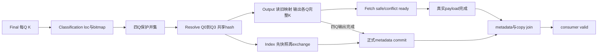

# 当前生产与split-core实验：分核策略、Top2048及Q4去重

核对版本：`cf32f4dd27069aaeb56a8393bf05b9b2b4bf10fe`。本次是源码梳理，不修改kernel、不新增Model/NPU运行。先前[逐阶段例子](stage_walkthrough.md)解释了工作量；本文进一步核对实际映射、TopK原语与去重实现。

**结论：当前不是全通路统一按BS×Q分核。** 生产是“shape决定history/query布局＋Final T1＋每request固定三角色＋Q×W Fetch条带”；独立split-core实验是“BQT个local任务＋BQ个merge任务”；历史P/T原型还研究了B×P个history producer。三者不能混称一个已整链接入的方案。

## 1. 已实现、研究入口与待实现方案

| 项目 | 当前生产streaming | 历史P/T研究原型 | 当前独立TopK组件 | 动态owner/Fetch池建议 |
|---|---|---|---|---|
| 版本/入口 | 当前MR生产入口，源自main13d2898 | 81b1472＋固定overlay/mock | `common/lifetch/split_topk.cpp`及TopK driver | 设计，未实现 |
| score分核 | 条件history P2，否则query分组 | B×P个producer，P/T可分别配置，要求B×P≤C | 不计算QK，输入已是完整score | 拟按shape、tile服务率和期限规划 |
| Final选择 | 每Q完整H滚动Top2048，T1 | local T路＋按query merge | local BQT；T>1时merge BQ | 拟按BQ并行度和merge代价选T |
| classification/publication | 完整生产逻辑 | 部分路径被移除/简化 | 不含生产classification/publication | 必须保留后才能接入 |
| Resolve/Index/Output | 每request三个固定角色 | 旧版本尾部/mock，非当前流水性能 | 不包含 | 拟有界owner、PO复用、独立Index |
| Fetch | Q×W，按b mod W分request | Service0/GM-copy mock | 不包含 | 拟按ready字节、依赖及credit调度 |
| miss驱动核数 | 无 | 未实现全通路自适应 | 无；T/V是配置 | 待实现和校准 |

历史P32/T8主要是B1标准点，不表示所有batch都能用P32。已有结果含删除resident/classify/progress等组合变化；不能当作当前完整生产通路的加速。当前42组脚本是独立TopK组件，AIC工作数为0；完整生产仍T1。

## 2. 生产各阶段到底如何分核

下表的B是BS，Q固定4，K固定2048；C/V是独立AIC/AIV预算。描述的是当前实现，不是未来可拆维度。

| 阶段 | 当前分核/派发 | 每个任务处理的范围 | 数据相关变化是否改变核数 |
|---|---|---|---|
| Init/reset | 一AIV/request，b=blockIdx | 该request的状态、映射和日志初始化 | 否 |
| Hot/Cold QK | 满足条件时P2；否则query组 | P2每request两个history owner，各处理resident一半及每cold窗口一半，均计算Q4；fallback按Q2/Q4组 | P2条件由shape决定，miss不参与 |
| Resident TopK | 按query | 每Q完整R的score→K，取K中最小key为θ | 否 |
| Service | LI工作核轮流承担epoch/lane，b按lane条带 | 已发布范围的候选合并、去重、admit/提交 | 候选/预算改变工作量，不改变lane规划 |
| Final Top2048 | T1；P2/general Q2一Q/AIV，general Q4每AIV顺序两Q | 每Q有效H，按8K/16K trunk维护K | 否 |
| Classification | 跟随Final所在AIV | 本Q K个selected＋R元数据，写loc/bitmap/error | 尚未拆成BQK任务池 |
| Resolve/Plan | block3b，一个Producer/request；核内512线程 | 该request四Q共4K位置，共享保护图/hash/slot | M改变hash容量，不增减AIV |
| Index exchange | block3b+1，一个Consumer/request | prefetched及各Q新增事件、置换闭包和metadata提交 | E改变循环及sparse/dense分支，不增减AIV |
| Output/pack | block3b+2，一个Output/request | 逐Q输出全部K结果，另按新增D打包 | 不增减AIV |
| Fetch | 4W个worker，按q/lane派发，b mod W分request | 分到本lane的safe/conflict描述符 | W显式配置1/2/4，默认2，不按miss自动选 |
| Finalize | Producer结束后同一role0 block复用 | prefetch/四Q完成、错误、最终valid | 否 |

shape先决定`splitQ=(auto且2B≤C)`、`LI=B(1+splitQ)`、actual rounds=`min(requested,LI)`。只有G32、完整长度及窗口对齐/排空等条件成立才使用history P2；不能只看splitQ字段就说每个producer只算Q2。当前score mixed仍使用每AIC两AIV的软件布局，与物理硬件是否强制配对是两件事。

固定B16/G32/H128K/Q4、默认requestedWindows=8、完整有效长度且其余P2条件满足时：

| 预算 | score/Final | 默认W2尾部 |
|---|---|---|
| C32/V64 | P2，32AIC/64AIV；Final各AIV一Q，T1 | 48个P/C/O＋8Fetch＝56AIV |
| C28/V56 | P1/general Q4，16AIC/32AIV；Final每AIV顺序两Q，T1 | 同为56AIV |

所以“逻辑上BQ=64条query”不等于当前每种配置都启动64个Final AIV。`finalCores=4B`还有publication记录布局含义，不能把记录数当额外驻留工作核。

## 3. 三种容易混淆的“二次Top2048”

1. **Resident TopK→Final TopK：**生产前面从R得到θ供预取，后面仍从完整H选择最终K。不是把resident K与若干cold local K合并，也没有因此跳过Final对hot score的读取。
2. **T1内部滚动TopK：**一条query的H放不进一次处理块，首轮对trunk取K，后续把旧K与新trunk合并，再取K；同一query在一个AIV上多轮执行，不是T路跨核。
3. **T>1的local→merge：**独立实验把H切T片，各片取K，然后每Q从TK个候选再选K。这才是本研究所说的两级选择。

## 4. 每次Top2048原语具体怎么计算

生产与当前研究组件都调用`LITopk<uint16_t>`。score先经过当前QK/归约及BF16舍入，再按实现转换成uint16比较key；这里的精确性针对该key合同，不等价于直接对原始FP32无限精度分数排序。

原语不是对全部输入做完整降序排序，而是**两级8-bit直方图定位阈值＋压缩筛选**：

```text
输入L个16-bit key，目标K=2048
    ↓
第K大等价于升序第 r=L−K+1 个
    ↓
对高8位统计累计直方图，定位目标high桶
    ↓
在目标high桶内对低8位统计，定位low
    ↓
得到第K大阈值 θ=(high<<8)|low
    ↓
压缩所有 key>θ 的位置
再从 key==θ 中补足K个位置
    ↓
需要时按这些位置gather对应score
```

阈值寻找、GT/EQ、score gather分别见`topk_common.h:1169–1185`。不能把这种选择过程称为已经把全部K按分数排序。代码没有显式的(score,tokenID)二级排序；cutoff相同key时，也不能宣称任意输入下T1/T8的ID集合与顺序完全相同。当前组件oracle还拒绝全局cutoff tie，验证范围须保持这个边界。

T1滚动例：H128K、trunk16K时，每Q首轮16384→2048；后面7轮各对`2048+16384=18432`取2048，同时维护旧赢家的原索引。合计送入原语的逻辑key量是`H+7K=145408`。general Q4的trunk8K则有16轮，逻辑量`H+15K=161792`。这些是算法工作量，不是实测指令数或耗时。

## 5. split-core的local和二次merge如何映射

独立组件的连续score布局为`[B,Q,H]`，local候选为`[B,Q,T,K]`：

```text
local任务 = BQT，worker=min(BQT,V)
task = blockIdx + n×worker
qFlat=task/T，t=task%T，b=qFlat/4，q=qFlat%4
begin=floor((H/256)×t/T)×256
end=floor((H/256)×(t+1)/T)×256

local：从score[qFlat,begin:end]取K
  candidateScore[qFlat,t,k] = 原score
  candidateId[qFlat,t,k] = begin + 片内赢家位置

merge任务 = BQ，worker=min(BQ,V)
每Q对T×K个candidateScore再调用同一个TopK原语
  finalScore[q,k] = 对应候选score
  finalId[q,k] = candidateId[q,被选中的候选位置]
```

local索引加begin是Vector Adds；merge的idMap是256线程SIMT gather。blockId只决定任务/地址，不能推导由实际score决定的赢家。两个kernel同stream依次启动，中间候选经GM交接，不假设同一物理核/UB跨kernel保持。

B1/Q4/T8/H128K：32个local任务，每个16K→2048；每Q共16384候选，4个merge任务各16384→2048。各local和merge都使用上节直方图原语，得分不相加。

旧history原型还允许P个producer的score分散在`[b,p,q,Hpad]`行，T可与P不同。研究reader按逻辑history范围从P行取交集，恢复UB中的连续顺序后仍可加begin，不需要先重排完整H score；这不是生产P2已把整个Final替换为该reader。

## 6. Q4去重的真实算法

去重是**合并重复的新增分槽/搬运任务**，不是合并四Q的score，也不是把四份Top2048删成一个输出集合。每Q仍保留2048个结果。

当前Producer为每request执行：

1. 从GM读四Q的selected/location；OR四份保护bitmap，保证后面的victim分配不会覆盖任何Q仍要使用的slot。
2. `StagedInitializeReady`扫描8192个位置，统计`M=count(selected非PAD且loc未满足)`，选择hash桶：M≤1024用2048桶，M≤2048用4096桶，否则8192桶；由512线程初始化共享UB hash。
3. Q0→Q1→Q2→Q3顺序处理，同一张hash跨Q保留。Q2/Q0、Q3/Q1如果同位置token相同，直接复用早先location；不同位置的重复仍走hash。
4. 对其他未满足token，用`SparseHash(token)&(buckets−1)`定位，CAS占桶，冲突线性探测。本Q重复用atomic_min选最小位置代表；早先Q已分配的rank带高位tag，不能被后Q重新认领。
5. prefix同时统计新增unique数Dq和pending位置数，给新增代表连续rank。它不是对全部miss位置各分一个新slot。
6. 优先从未保护LRU候选分配slot并立即保护；不足时汇总所有已知location的保护，再扫描resident bitmap寻找其他未保护hot槽。超过LRU2048不自动意味着必然失败，仍受总可用槽/保护/事件容量约束。
7. 通过hash的rank→slot把重复位置回填为相同slot；只有新增unique产生相应change/event。逐Q发布location与Dq，Output据此生成完整K输出及新增描述符。

示意逻辑（省略prefix/错误/可见性细节）是：

```text
protect = OR(四Q的保护图)
hash = request私有的共享表
for q in Q0..Q3:
    对本Q未满足token并行探测hash
    只让首次代表认领新rank和slot
    其他位置通过同一rank查slot
    发布该Q的locations和新增Dq
```

不同batch不共享这张hash。即使fixture复制了相同token编号，不同cache owner也不能直接共享同一个slot。相同owner的并发request另需串行或版本化，不能只用B增加就假定无依赖。

## 7. BS×2048与miss现在如何影响Resolve

正确的基础位置量是`B×Q×K=8192B`，不是只看B×2048。但核分配不等于位置数：当前每request只有一个Producer、一个Consumer、一个Output，核内各自处理数据；没有将8192B平铺成多核Resolve任务池。

以下仅是标准受控交叠fixture在**无prefetch、hot均有效、无其他tail/失效**时的计数，不能当运行时实测：

| miss目标 | 每Q m | 每request M=4m | 每request unique新增ΣD=2m | Ready hash桶 |
|---:|---:|---:|---:|---:|
| 3% | 61 | 244 | 122 | 2048 |
| 5% | 102 | 408 | 204 | 2048 |
| 10% | 205 | 820 | 410 | 2048 |
| 15% | 307 | 1228 | 614 | 4096 |
| 20% | 410 | 1640 | 820 | 4096 |
| 50% | 1024 | 4096 | 2048 | 8192 |

以10%为例，Q0/Q2共享205个cold，Q1/Q3共享另一组205个：D=(205,205,0,0)。B1时M820、unique410、输出8192；B16时合计M13120、unique6560、输出131072，但仍是16个独立Producer/hash，不是一张13120位置的大hash，也不是给每个unique token一个核。

有预取后M/D会变化，不能用名义miss直接确定。当前已实现的“自适应”只有hash容量、Index sparse/dense及循环/事件长度；**未实现的**包括按M/D增减Resolve核、跨request剩余时间调度、按safe/conflict字节重分Fetch、按credit自动选W。

## 8. 后半路径的依赖与下一步方案



该图是依赖关系，不是按比例实测时序。Output不等正式metadata commit；反过来Consumer须等所有旧映射输出完成才commit。当前固定角色正是用这种依赖尝试重叠阶段。

更合理的后续研究是：shape阶段决定P/T与合法资源；Resolve阶段按每owner实际M、hash探测/分槽成本、D估计剩余时间；Fetch阶段按实际ready字节、依赖、credit派发。先沿独立owner/batch并行，再评估一个request是否大到值得跨核协作；小数组可合并多个request的短任务，避免为了铺满核重复R元数据/初始化。

动态池完成后，可将固定3B+4W替换成实时驻留预算，但必须改descriptor/queue/完成关联和blocking wait：严格串行阶段各自≤V，重叠阶段任意时刻worker总和≤V，并保留不会饥饿的progress。当前仍执行旧检查，不能先删除guard。

## 9. 源码与核验

主要定位：[shape](../../../csrc/operators/lightning_indexer_with_fetch/include/runtime_shape.h#L35)、[P2条件](../../../csrc/operators/common/lifetch/sequence_schedule.h#L9)、[生产Final映射](../../../csrc/operators/lightning_indexer_with_fetch/op_kernel/indexer/indexer.h#L680)、[T1滚动](../../../csrc/operators/lightning_indexer_with_fetch/op_kernel/indexer/indexer_vector.h#L879)、[TopK直方图/阈值](../../../csrc/operators/lightning_indexer_with_fetch/op_kernel/indexer/topk_common.h#L1155)、[TopK状态与索引](../../../csrc/operators/lightning_indexer_with_fetch/op_kernel/indexer/topk.h#L155)、[local/merge映射](../../../csrc/operators/common/lifetch/split_topk.cpp#L127)、[Ready hash与去重](../../../csrc/operators/lightning_indexer_with_fetch/op_kernel/resolver_staged_dma2.h#L83)、[四Q保护及顺序](../../../csrc/operators/lightning_indexer_with_fetch/op_kernel/streaming.cpp#L147)、[角色派发](../../../csrc/operators/lightning_indexer_with_fetch/op_kernel/streaming.cpp#L599)、[Output](../../../csrc/operators/lightning_indexer_with_fetch/op_kernel/output_worker.h#L65)、[Index闭包](../../../csrc/operators/lightning_indexer_with_fetch/op_kernel/shadow_exchange_parallel.h#L28)。

[结构化策略与源码hash](results/strategy-inventory.json)、[本次核验和独立审查](results/strategy-inventory-validation.json)随文交付。CPU计算只核对阈值/local-merge数学关系、映射和示例计数，不模拟Ascend指令、不替代kernel数值或性能验收。

可重跑：`python3 docs/research/split_core/verify_strategy_inventory.py`。源码hash按本次审计快照核对，后续业务代码变化需重新审计，不用旧通过记录批准新实现。
