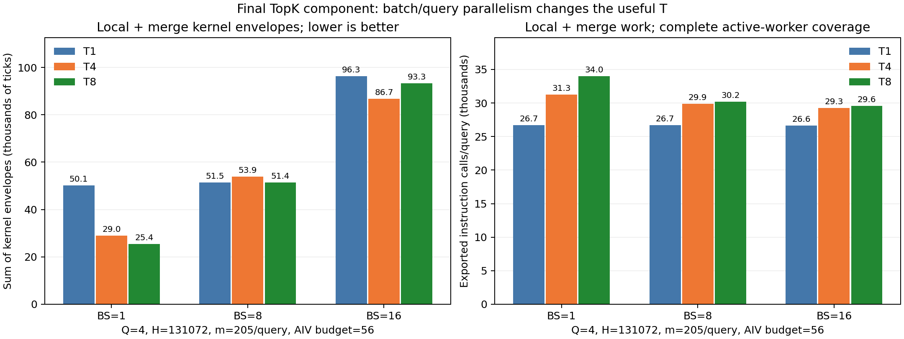
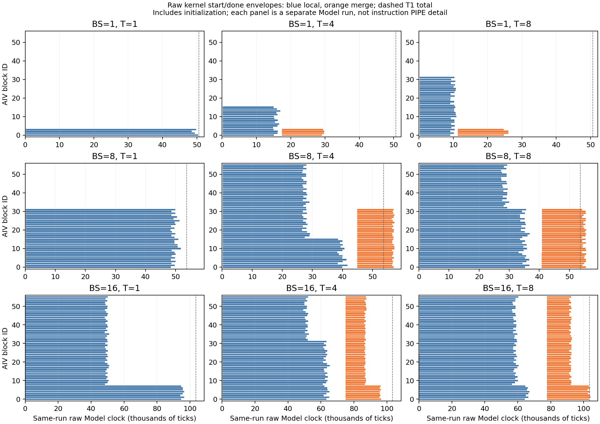

# B×Q×T：BS1/8/16的九点Model实测与历史LI指令基线

本轮固定Q4、H131072、R16384、名义miss10%（每Q205，实际10.009765625%）、score种子来自G32、AIV预算56。只测独立Final TopK：输入已经是uint16 score，不执行QK、Service、Resolve、Index或transport。9条件均为同driver/score/config下单次执行，无预热；不是NPU测量。

此前已有历史serial6/Fusion3及B1 TopK T1/T8对比。本轮是新的同标准9点数据，不能拿归档的134万ticks当作指令数，也不能把旧core0采样外推为完整kernel。

## 结果与计量范围

whole-Model ticks保留SDK正常footer；local＋merge内核包络是每阶段所有活跃worker的最早start到最晚done之和，包含kernel入口/退出，不包含阶段间间隔。worker-body是每阶段最大自计时间之和，排除Init/dispatch/Destroy等，不等于整链延迟。

当前driver在local launch后才为T>1分配并初始化最终输出buffer，并在kernel结束后读回完整input、local候选、final输出做oracle。因此whole-Model会受到随B/T变化且Model可见的alloc/copy/launch等交互影响；CPU oracle自身的wall时间不能直接算入Model ticks。下表同时保留whole-Model、内核包络和指令量；不把全部差值都归因于算法，也不将模型ticks换算真机微秒。

| BS | T | Whole-Model ticks | local+merge内核包络ticks | 包络较同BS/T1降低 | 导出调用数local+merge |
|---:|---:|---:|---:|---:|---:|
| 1 | 1 | 50,631 | 50,146 | +0.00% | 106,796 |
| 1 | 4 | 29,925 | 29,013 | +42.14% | 125,024 |
| 1 | 8 | 26,260 | 25,423 | +49.30% | 135,952 |
| 8 | 1 | 53,689 | 51,478 | +0.00% | 854,368 |
| 8 | 4 | 57,777 | 53,936 | -4.77% | 956,128 |
| 8 | 8 | 56,173 | 51,413 | +0.13% | 965,216 |
| 16 | 1 | 103,437 | 96,293 | +0.00% | 1,703,840 |
| 16 | 4 | 98,156 | 86,712 | +9.95% | 1,873,024 |
| 16 | 8 | 105,436 | 93,295 | +3.11% | 1,891,200 |

[完整CSV](results/topk-bqt-results.csv)、[逐worker/原始hash/计量范围JSON](results/topk-bqt-results.json)。正百分比为包络降低，负值为增加。指令指标是PipeUtilization模式下逐kernel/worker官方instr_exe.csv的sum(call_count)，同步细节不在本指标内；它不是所有硬件微操作，也不乘SIMT线程数。



## B/Q共同决定T，但占满核不是唯一目标

| BS | BQ | T1 local任务/worker | T4 local任务/worker | T8 local任务/worker | T>1 merge任务/worker |
|---:|---:|---:|---:|---:|---:|
| 1 | 4 | 4/4 | 16/16 | 32/32 | 4/4 |
| 8 | 32 | 32/32 | 128/56 | 256/56 | 32/32 |
| 16 | 64 | 64/56 | 256/56 | 512/56 | 64/56 |

- BS1：内核包络T1=50,146, T4=29,013, T8=25,423；本次最小为T8，较T1降低49.30%。这是单次观察；接近零的差异不能据此判定稳定优劣。
- BS8：内核包络T1=51,478, T4=53,936, T8=51,413；本次最小为T8，较T1降低0.13%。这是单次观察；接近零的差异不能据此判定稳定优劣。
- BS16：内核包络T1=96,293, T4=86,712, T8=93,295；本次最小为T4，较T1降低9.95%。这是单次观察；接近零的差异不能据此判定稳定优劣。

BS1的T4/T8增加总指令工作却缩短关键路径，支持补足小BQ并行度。BS8已有32条query，增加T虽启动56个local worker，但候选和merge会抵消收益；whole-Model和包络还可能因harness成本而排序不同。BS16虽然T1也启动56个worker，8个worker要处理两条完整query，其他48个只处理一条，存在长尾；分片可能改善这条关键路径。

每query送入TopK原语的累计key量：T1=145408；T4 local139264+merge8192=147456；T8 local131072+merge16384=147456。三者local均调用8次原语，T>1另有一次merge。这不是GM唯一读字节或ISA调用数，说明只数分片任务也不够。

一个可规划的关键路径模型是 `L_kernel(T) ≈ max_w Σ(task∈local_w) cost(H/T,K) + I(T>1)×max_w Σ(query∈merge_w) cost(TK,K)`；该近似还需计入每worker的setup/entry/exit项；同一stream顺序执行两阶段，若评估实际组件调用还须加阶段间Model可见交互。local任务数为BQT、worker数为min(BQT,V)；merge任务数为BQ、worker数为min(BQ,V)。均匀任务下最大轮次数近似为ceil(BQT/V)和ceil(BQ/V)，但它们不是实测时延预测，cost仍受TopK分块、数据及资源争用影响。BS16/T1、T4、T8的local最大轮次是2、5、10，单task长度则随T减少；merge仍有两轮长尾。

策略选择应联合(BQ,H,K,V)、每worker循环次数、候选/merge成本及阶段启动成本；本轮不修改生产默认策略。尤其组件T1不是生产Final逐指令复刻：C28/V56、BS16的生产general Q4用32AIV、每AIV顺序两Q、trunk8K；本driver用最多56AIV轮转64Q，trunk16K。接入生产还须保留classification与publication。

## 阶段内负载均衡

阶段内时间均衡度定义为 `mean(worker-body delta)/max(worker-body delta)`；只描述本次活跃worker时长分布，不是硬件有效利用率，也不是重复样本统计。

| BS | T1 local | T4 local / merge | T8 local / merge |
|---:|---:|---:|---:|
| 1 | 0.982 | 0.918 / 0.969 | 0.895 / 0.952 |
| 8 | 0.957 | 0.727 / 0.943 | 0.863 / 0.956 |
| 16 | 0.567 | 0.881 / 0.562 | 0.878 / 0.557 |

BS16的local分片会改善整条H任务的长尾，但merge仍是64个query任务分给56个worker，8个worker需要顺序处理两个query。后续可研究非均匀T、仅对尾部query分片以及就绪merge调度；这些仍是新假设，不是本轮已实现的策略。

## 指令量的可复算模型

由BS1/8实际数据拟合local计数模型：

`C_local(B,T) = B × U[T] + 612 × min(4BT,56)`

`U[1]/U[4]/U[8] = 104348 / 102488 / 99656`。612为当前binary和导出模式下每worker固定的setup/control/termination项，不是固定耗时，也不能全部称为Init或测量代码。逐PC核验发现612个非零PC组，每组系数1、每worker执行一次，无负项抵消；分解为SCALAR 597、FLOWCTRL 10、PUSHQ 2、MTE2 1、MTE3 2。

BS16 local留出验证如下；预测在读取其结果前存入任务记录：

| T | local预测调用数 | local实测 | 残差 |
|---:|---:|---:|---:|
| 1 | 1,703,840 | 1,703,840 | +0 |
| 4 | 1,674,080 | 1,674,080 | +0 |
| 8 | 1,628,768 | 1,628,768 | +0 |

另由B1/T4和B16/T4校准merge固定项620，结合B1/T8的query工作量，预先预测BS16/T8的merge为262,432、local＋merge合计1,891,200；最终实测均精确命中。此处仍是调用数预测。

这说明核内循环复用能摊薄固定导出项，但不说明其端到端一定更快：总工作、最大worker负载和merge关键路径仍需分别处理。该模型仅适用于本次重复Q4 seed、H/K、SDK与binary，不预测真实设备时延。

[PC级验证](results/topk-bqt-fixed-pcs.json)保留逐项证据；[预先保存的计数预测](results/topk-bqt-preregistered-predictions.json)保留校准与留出范围。

## 原先score流程的base指令

旧归档的完整device0配套可用当前官方工具离线解析；没有重新运行旧应用。它是B1/Q4/H8192/R4096/G32/zero-miss/Service0的混合LI kernel，包含QK、score和TopK等阶段，不是匹配本轮128K的纯score生产基线。

| 旧LI subcore | PipeUtilization导出调用数 |
|---|---:|
| core0.cubecore0 | 25,079 |
| core0.veccore0 | 64,540 |
| core0.veccore1 | 64,540 |
| 合计 | **154,159** |

原始主PC记录为155644条，与CSV导出调用数不是同一指标。旧标准128K成功记录有whole-Model ticks与oracle，但没有可用于此处完整统计的匹配指令dump；纯QK/score调用数保持未知，不乘H/B比例补造。当前TopK T1基线则是本轮同输入实测，已在上表按BS分别列出。

[历史LI基线及源archive/binary/CSV hash](results/previous-li-instruction-baseline.json)。初次只取snapshot五文件的解析失败已保留；最终使用原包真实device0的ccu/popped等配套成功导出，没有伪造缺失日志。

## 时序、正确性与复现



图中蓝色local、橙色merge，同一panel来自同一次Model运行；横轴保留原始Model clock，逐阶段核对顺序。它是start/done包络，不是逐指令PIPE或stall图。每个panel独立，虚线为同BS的T1 whole-Model参考。

9组实测共15个kernel launch，548份非空AIV worker footer/CSV覆盖完整。只有blkID覆盖0..workers-1且每worker恰一份canonical CSV才累计phase总量；不对采样乘倍数，也不按hash合并不同worker。local/global选中集合与score、所有local候选、guard和输入未修改均由driver核验。

在线collector状态与Model/离线导出分开保存：B1/T1 collector退出143后，从已正常完成的Model dump恢复全部worker导出；B8/T1退出码未在controller路径断言前落盘，保留null，Model正常footer及独立导出证据完整。其余实际状态见capture记录。另有一次改变存储位置和kernel匹配字符串的探索运行，未纳入主九点，也不用于比较收益。

[采集recipe/config/command](results/topk-bqt-recipe.json)、[捕获与离线导出收据](results/topk-bqt-captures.json)、[核验与审查](results/topk-bqt-validation.json)。原始dump、官方CSV及gzip trace在本机`.aiinfra/local/SPLIT-CORE-011`，大型文件不进MR；压缩前后逐字节SHA核对，保留恢复索引。

普通Model复跑可在匹配CANN环境使用既有脚本，只选这3个case，固定预算并复用同一个已编译driver：

```bash
for t in 1 4 8; do
  KVIP_MODEL_DRIVER="$TOPK_DRIVER" KVIP_TOPK_SHARDS="$t" \
  KVIP_BUDGET=28/56 KVIP_OUTPUT="$OUT/t$t" \
  bash scripts/split_core_sim/customer.sh \
    --case b1-h100-m10 --case b8-h100-m10 --case b16-h100-m10
done
```

该入口不自动产生本报告所需的全worker指令CSV。全量指令采集须按recipe使用隔离logging配置，验证实际block覆盖，并逐kernel/physical-core离线export。汇总重跑：

```bash
python3 experiments/split_core/topk_bqt_results.py \
  --work .aiinfra/local/SPLIT-CORE-011 \
  --source .aiinfra/tasks/SPLIT-CORE-011/capture-source.json \
  --captures .aiinfra/tasks/SPLIT-CORE-011/capture-progress-v2.json \
  --output docs/research/split_core/results
python3 experiments/split_core/plot_topk_bqt.py \
  --results docs/research/split_core/results/topk-bqt-results.json \
  --output docs/research/split_core/results
```

本轮只覆盖名义miss10%的这9个TopK条件，没有将42组矩阵或完整streaming/NPU验收标为通过。真实策略收益仍需在完整生产通路、正确缓存恢复和目标硬件上做相同语义对照。
