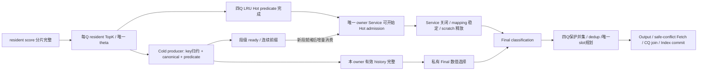

# LI 后处理持续分核：源码、方案与 Model 对照

日期：2026-11-18。需求见 `TAIL_PROMPT.md`。本文严格区分源码事实、已经执行的实验、尚待实现的生产优化。

## 关键结论

history 分片保留每个 token 的完整 D128/G32 计算，因此反量化、ReLU、head 加权归约及 Cold predicate 可以由 producer 的 AIV继续执行。跨 history 不需要额外浮点求和。需要跨片段合并的是 resident/Final 的 TopK选择集合。

resident θ必须来自完整有效resident，或来自覆盖它的局部TopK精确合并。Final也可以做局部TopK再合并，但局部计算变快不保证整链变快：候选写出、GM gather、真实token转换和额外启动都是关键路径成本。Final classification只有B×Q×2048个索引，应优先沿Q/结果列表分工，不能要求每个history核都重扫这张小列表。

当前MR14已经提供ScatterPredicate和DirectPredicate入口；本轮新增的是隔离后处理的控制实验、精确局部TopK/合并实现，以及可核验的全核动态指令与阶段统计。实验输入是相同canonical score，不执行QK、Service、Fetch或Index，因此不宣称producer/consumer已经重叠或生产ConsumerReady下降。

## 基线版本与一处慢因更正

- `origin/main`：`532df2c8dfcb27cf8ab203f70d5bdf3510d77b6c`，本轮fetch核验。
- MR14实验起点：`a6c277911807a16768af0bb55d273d0348836daa`。
- A5既有性能报告：`056fe62`，用于核对其staged源码，未重新执行该版本A5性能。

`056fe62`的`v9_staged_progress`调用`StagedColdBits`，读取已经生成的θ，只扫描本次`[begin,end)` Cold区间并发布ready。它不调用resident TopK，也没有重新生成θ。因此，“该kernel耗时45–51µs”的测量可以保留，但“8个wave各重做完整resident θ扫描”的解释应撤回。其代价主要应归到单owner Cold扫描和逐wave编排；具体硬件stall仍需原始A5 trace。

main/legacy的`ProcessBaseBlock`在resident边界执行`ProcessResidentTopK`，随后Cold的`ProcessVec1`直接调用`BatchClassifyScore`，在向量归约生成key时分类；最后一个history块完成后再执行Final TopK。它不是先等待完整H score，才开始resident和Cold后处理。

当前MR14 staged先完成Hot score waves，沿现有resident TopK路径生成θ/Hot predicate，再推进Cold waves；Separate模式通过progress扫描Cold，ScatterPredicate随scatter分类，DirectPredicate直接写真实canonical和bitmap。Service保留原epoch/owner门槛。不能把新控制组C0称为完整生产P2或SDK QLI。

## 反量化已经在score producer中

固定FP8 E4M3FN、BF16 weights、FP32 scales，当前实现可以概括为：

\[
s_{bqk}=\operatorname{sortableBF16}\left(
\alpha^K_{bk}\sum_{g=0}^{31}w_{bqg}\alpha^Q_{bqg}
\operatorname{ReLU}\left(\sum_{d=0}^{127}Q^{fp8}_{bqgd}K^{fp8}_{bkd}\right)\right).
\]

实际转换、累加和BF16舍入以`ReduceSum2LoopBody/ReduceSum2Finalize`为准。qScale合入weight，token kScale在head归约后应用，最后转换sortable uint16 key。沿H切分不改变每个key的D/G累加次序；沿D/G再分核则会引入浮点规约和舍入问题，不能混为一谈。

这里的key/history位置是QK矩阵的列维，即GEMM的N维；GEMM归约K维是D128。用户所说的history/K分核与Stream-K论文的GEMM split-K并非同一维度，只借鉴其工作量均衡原则。

每个Q4/G32/H128 tile有128×128个FP32 QK结果，共64KiB；两个AIV各接收Q2/G32/H128的32KiB，双缓冲各约64KiB。最终只有Q4×H128×2B=1024B key。完整H128K若把全部QK中间值展开将是64MiB/request，当前通路按tile在UB消费，不能把这64MiB计为最终score GM矩阵。

## 数据规模与可分核维度

下表固定每request Q4、H131072、R16384、G32、K2048；KiB/MiB按1024计算。

| 操作/数据 | 逻辑维度与类型 | B1规模 | B16规模 | 可独立处理的范围/就绪条件 |
|---|---|---:|---:|---|
| QK中间值 | B×Q×G×H，FP32，按tile驻UB | 全展开64MiB | 全展开1GiB | H片段；每个token保留完整D/G |
| 最终score | B×Q×H，sortable uint16 | 1MiB | 16MiB | producer可直写互不重叠的H区间 |
| resident TopK输入 | B×Q×R，uint16 | 128KiB | 2MiB | 局部选择可分H，唯一θ必须完整覆盖/合并 |
| resident候选输出 | B×Q×K，score uint16＋index int32 | 48KiB | 768KiB | 每Q唯一最终resident候选 |
| resident θ | B×Q个uint16 | 8B逻辑值 | 128B逻辑值 | 当前存储每Q预留256B，共1KiB/request |
| LRU列表 | B×2048个uint32，四Q共享 | 8KiB | 128KiB | owner共享，不能各Q独立抢victim |
| Hot候选比较 | B×Q×2048次比较，gather key uint16 | 16KiB keys | 256KiB keys | θ ready后可沿Q/候选分工 |
| Hot候选predicate | B×Q×2048，2bit/token | 2KiB | 32KiB | 四Q完成后Service才能规划共享LRU |
| Cold比较输入 | B×Q×(H−R)，uint16 | 896KiB | 14MiB | θ ready后沿H分片；没有H规约 |
| Cold predicate | B×Q×(H−R)，2bit/token | 112KiB | 1.75MiB | 分片必须独占完整packed byte；可段级ready |
| Final TopK输入 | B×Q×有效H，uint16 | 最多1MiB | 最多16MiB | 局部TopK可先做，全局结果需完整候选覆盖 |
| Final索引/locations | 各B×Q×2048，int32/uint32 | 各32KiB | 各512KiB | 数值选择与mapping classification可分离 |
| 共享mapping表 | B×H，uint32 | 512KiB | 8MiB | classification按选中token gather，不扫描完整表 |
| hotValid/reservedHot，生产可选 | 各owner×R，uint32/int32 | 各64KiB | 各1MiB | 生产分类按resident半区装入UB；本控制固定全valid/无reserved |
| 每Q保护bitmap | B×Q×R bit | 8KiB | 128KiB | mapping稳定后生成；每Q私有 |
| 四Q保护并集 | B×R bit | 2KiB | 32KiB | owner内OR合并后才允许slot/victim规划 |
| 每Q error | B×Q个uint32，当前每条128B对齐 | 16B逻辑值/512B存储 | 256B/8KiB | 与classification一起发布 |

resident TopK扫描R；`SaveResident`随后对**2048个LRU候选**gather/分类，不是再扫描全部R。Hot bitmap最前面的2048个predicate按LRU候选顺序存放，不能把它解释成所有resident token的顺序bitmap。

Final保护bitmap逻辑输出每Q仅2KiB；当前primitive用最多8份私有shard做UB atomic OR，再归并，R16K时scratch为16KiB/AIV。选中列表的数值规模虽小，随机mapping/LRU读取、可选Hot metadata半区装载及shard归并仍要单独计成本；本控制没有计入动态Service更新这些状态的成本。

### 当前TopK已经使用radix/直方图

`indexer/topk.h`的`LITopk<uint16_t>`已经使用256桶histogram、高/低8bit选择及候选gather。`ProcessTopK`将GM score分块搬入UB，首块选2048，后续每块与已有2048候选共同选择，再恢复真实索引；它没有在GM中对整个H执行全排序。

本轮独立TopK入口的`topkOnly=true`取16K trunk，H128K每Q最多8轮；每轮合并输入最多16K+2048个uint16，即36KiB。库上融合Q4入口在相应配置下取8K trunk，因此调用相同primitive不代表其实际kernel配置和耗时完全一致。resident R16K在独立入口通常是一块，继续切成多个小片会增加候选交换和合并。

RadiK启发的是**跨AIV合并小规模直方图**，替代当前研究实现的P×2048候选GM中转；不是首次给本库增加radix TopK。全局阈值算法仍需处理低位桶、严格GT计数、tie配额和真实token压紧，不能仅做高8bit histogram就认为已经完成TopK。

## 四个控制组与实现

| 控制组 | Cold | Final |
|---|---|---|
| C0 | 一个AIV/owner处理四Q、完整Cold区间 | 现有全有效H TopK，每Q一个AIV |
| C1 | H分片，每片两个AIV、每AIV两Q | 与C0相同 |
| C2 | 与C0相同 | 每Q/H片局部TopK2048→候选gather→相同TopK合并→真实token映射 |
| C3 | 与C1相同 | 与C2相同 |

默认resident_parts=1，直接复用库上`ProcessResidentTopK/SaveResident`，保留原prefix score/index/θ输出及LRU predicate。Final classification复用`ClassifyTopkHalf/MergeClassifyBitmap`，但实验固定mapping/LRU、Hot有效且未reserved、无tail，不模拟Service变更。

另实现resident_parts=2/4：局部resident选择→精确候选合并→真实token转换→唯一θ与Hot predicate。该研究入口不服务生产Service，未补齐与默认路径完全相同的prefix输出写入成本；其数值通过不能当作生产resident路径性能验收。

核预算是64 AIV，上限一致；B16的局部Final任务可能超过64而增加waves。B16 score的30/60限制与这里的后处理预算分别记录；实验没有执行AIC。

这些控制是在新的AIV kernel中读取GM key，复用history/Q任务归属；没有保留score kernel的UB内容，也没有实现常驻producer直接进入TopK。生产上的tile内连续执行应使用MR14 `SetStagedOutput`/DirectPredicate通路，避免把这里的GM控制成本当作已融合版本的成本。

| 阶段 | B1/P4的AIV任务数 | B16/P2的AIV任务数 | 依赖/波数 |
|---|---:|---:|---|
| resident原路径，T_R=1 | 4 | 64 | 完整有效R就绪；一次launch |
| C0 Cold | 1 | 16 | 每owner一任务、循环四Q |
| C1 Cold | 8 | 64 | 每H片两个AIV、各两Q；θ就绪 |
| C0 Final | 4 | 64 | 每Q完整有效H；一次launch |
| 分片Final局部选择/候选gather | 各16 | 各128 | B16各需两次launch |
| Final候选merge/token映射 | 各4 | 各64 | 候选全覆盖后选择，再映射 |
| Final classification | 4 | 64 | 数值选择结束、只读mapping稳定 |
| 四Q保护并集 | 1 | 16 | 四Q私有bitmap完成 |

### 精确合并为什么成立

每个H片保留自己的TopK2048。被某片丢弃的元素在该片已有至少K个元素不小于它，所以合并各片TopK后可以选择合法的全局TopK。所有严格大于全局Kth的元素必须保留；阈值处允许库上合法tie。片段的token区间互不重叠，因此同Q候选不重复；跨Q相同token合法。

候选key用0表示无效，入口明确要求真实sortable key>0。queryEnds按真实token位置处理；局部索引与候选索引显式映射为真实token。不能把候选数组长度当作原queryEnds，否则会错误截断合并输入。

## 已完成的第一轮：验证方案并定位中转代价

同一v3 binary、同一fixture，B1/Q4/H32768/R8192/P4，全核日志，四组全部PASS。此轮resident使用独立θ/Hot适配器，作为结构控制，不冒充库上resident融合kernel；最终代码的默认resident已改为直接复用原primitive，并单独补测。

| 控制组 | whole Model ticks | 相对C0 | 结论 |
|---|---:|---:|---|
| C0 | 326646 | 1.0000 | 单owner Cold扫描控制 |
| C1 | 130551 | 0.3997 | Cold分核降低约60.0% |
| C2 | 358008 | 1.0960 | Final局部计算更快，中转抵消收益 |
| C3 | 163147 | 0.4995 | 比C0快，但比C1慢 |

阶段issue窗口（包含等待，并非活跃周期或kernel完成时间）：

| 阶段 | C0全核issue包络 | C1全核issue包络 | C2全核issue包络 |
|---|---:|---:|---:|
| resident局部/全区间选择 | 8108 | 7851 | 7812 |
| 独立θ/Hot适配器 | 34594 | 35494 | 34320 |
| Cold | 235346 | 40070 | 234684 |
| Final全区间/局部选择 | 17506 | 17514 | 8320 |
| Final候选gather | — | — | 18407 |
| Final候选合并 | — | — | 6481 |
| Final真实token转换 | — | — | 16056 |
| Final classification | 22442 | 21002 | 21376 |
| 四Q保护并集 | 3681 | 3741 | 3582 |

Cold issued指令39698→47328，增加约19.2%，但issue包络235346→40070。这是最长核等待被分摊，不是删指令。C2 Final局部选择比C0快，gather/map却形成新的串行段。各阶段窗口不能直接相加当作严格kernel耗时；whole Model ticks与issue窗口是两个口径。

按opcode进一步区分Cold指令：C0/C1中predicate与整数逻辑占54.79%/47.73%，整数运算与寻址占27.43%/29.34%，GM load/store占10.26%/10.14%。这里的GM访存是`SIMT_LDG/STG`；不能根据`RVECLD/RVECST`管线名把它归为UB访存。count占比不是延迟占比，少量GM指令仍可能占据大量等待时间。完整分类和每kernel/per-AIV数据保存在`verified-phases-v2/`；新capture直接使用修正后的分类器。

原始证据：`tests/results/li-tail-20261117/b1-h32k-p4-all/`与`b1-h32k-p4-candidates/`；保留v3编译wrapper快照、binary、ELF、完整动态日志和oracle。不同binary的实验分别成表，不混用比值。

## 最终代码的补测

使用`run_tail_model.sh`，同一final binary；每个配对使用同一fixture、32/64模拟拓扑和全核mask0xffffffff。下面的“完整后处理”覆盖resident θ/Hot、Cold、Final、classification与四Q并集，不包含QK/Fetch/Service/Index。

| 几何与范围 | 控制 | whole Model ticks | 同范围相对C0 | 全AIV issued指令 |
|---|---|---:|---:|---:|
| B1/H128K/R16K/P4，完整后处理 | C0 | 1135835 | 1.0000 | 324774 |
| 同上，仅Cold分核 | C1 | 243506 | 0.2144，下降78.6% | 332392 |
| B1/H128K/R16K/P4，仅Final＋classification＋并集 | C0 | 83149 | 1.0000 | 129532 |
| 同上，Final局部选择/候选合并 | C2 | 96339 | 1.1586，慢15.9% | 180490 |
| B1/H32K/R8K，仅原resident primitive＋θ/Hot | C0 | 17454 | 单点，无速度比 | 13592 |

上述五项全部MODEL_PASSED，exit0，输出oracle/guards/输入只读检查通过；每项一次capture，未建立重复采样置信区间。完整receipt、命令、binary/fixture SHA与PC证明见`tests/results/li-tail-20261117/final-controls/`。

78.6%是相对于MR14 Separate型的单owner GM Cold控制；main/legacy的Cold已在producer归约中分类，不能把这个比值写成相对库上P2的收益。resident/Final的独立入口还使用每Q一AIV、topkOnly16K trunk，这些也与融合kernel的实际分工不同。最终生产收益必须比较同一输入下legacy与显式history/direct通路的完整LI/LIFetch和ConsumerReady。

完整H128K控制的阶段issue包络与指令数如下。resident项已包含唯一θ、prefix score/index输出及LRU predicate，不再有独立θ/Hot适配kernel。

| 阶段 | C0 issued数 | C1 issued数 | C0全核issue包络 | C1全核issue包络 |
|---|---:|---:|---:|---:|
| resident选择＋θ＋Hot | 17560 | 17560 | 18725 | 19047 |
| Cold predicate | 177682 | 185312 | 1032037 | 139780 |
| Final TopK | 93060 | 93060 | 50914 | 50403 |
| Final classification | 35881 | 35869 | 25026 | 25504 |
| 四Q保护并集 | 591 | 591 | 4898 | 4834 |

Cold issued数增加4.29%，窗口缩短86.46%；其余阶段保持接近。整链issued数增加2.35%，whole ticks却显著下降，说明收益来自工作分摊和等待减少。不是省掉resident扫描，也不是指令数减少。

H128K Final分核将局部选择issue包络50165→18146，但新增gather19043、merge7311、token map15938三个串行阶段，最终whole ticks慢15.9%。因此，即使在目标长history上，当前P4候选中转实现也不能作为Final优化接入。应保留原Final控制，先优化输出融合或跨核histogram，再重新比较完整控制链。

B1/H32K/R8K的resident_parts=2研究管线正确性PASS，whole ticks84869；原primitive控制为17454。前者多了局部选择、GM候选gather/merge/map、独立θ/Hot适配，且尚未补齐相同prefix输出成本。这是研究结构的观测，不能将比值冒充生产resident路径的严格性能对照；当前实现也没有接入生产的依据。

B16/H8K/R4K/P2缩小几何，四组完整后处理全部PASS，同binary/fixture的正交结果如下；不得把该缩小几何写成B16/H128K性能。

| 控制 | whole Model ticks | 相对C0 | 全AIV issued指令 |
|---|---:|---:|---:|
| C0 | 107992 | 1.0000 | 997143 |
| C1，只有Cold分核 | 73975 | 0.6850，下降31.5% | 1041644 |
| C2，只有Final分核 | 175426 | 1.6244，慢62.4% | 1522987 |
| C3，Cold＋Final分核 | 140404 | 1.3001，慢30.0% | 1567450 |

Cold的并行收益真实存在，Final的候选中转和两波工作将它抵消。阶段应独立选择分片数，不能因为score或Cold变快就统一增加T_R/T_F。本轮最终代码共有11项Model capture完整通过，加上v3四项结构控制共15项；原始数据分binary、几何和阶段范围保存。

额外的B1/H4096/R2048/P2 Final边界用例C2通过，whole ticks73461、全AIV issued指令71432。四Q最后一片的有效长度分别为2045/2046/2047/2048，验证不足2048时的无效候选填充、根合并、真实token映射及guard。该点没有配对C0，只用于正确性检查。15项统一汇总见`tests/results/li-tail-20261117/summary-delivery/rows.csv`；每项都有实际ELF/entry/launch归因及阶段CSV。

## 论文可借鉴的具体原则

1. [FlashAttention-2](https://arxiv.org/abs/2307.08691)：增加sequence并行，同时减少非matmul工作和共享内存通信。其warp内split-Q替代split-K用于避免部分输出求和；我们的H切分不切D/G，不能照搬该“split-K”的含义。对应这里的启示是producer在UB完成反量化/归约/predicate，避免scratch中转和额外join。
2. [Stream-K](https://arxiv.org/abs/2301.03598)：按工作量分配，减少tile/wave取整长尾。当前30核均衡片段表借鉴工作量思路，但它是静态确定分配，没有实现CUDA persistent CTA或设备原子抢任务。
3. [RadiK，ICS 2024](https://doi.org/10.1145/3650200.3656596)，[论文全文](https://arxiv.org/html/2501.14336v1)：GPU radix选择通过直方图、分层atomics、batch重排和写缓冲控制通信代价；merge-based候选规模随K扩大是其明确讨论的瓶颈。适合本通路的下一方向是uint16 key的分片高/低8bit直方图→整数合并→精确Kth阈值→过滤与tie配额，不是继续无限增加P×2048候选。

CUDA SM/warp共享内存和Ascend AIC/AIV独立UB不等价。跨Ascend核只能通过明确GM输出/flag/可见性协议传递候选或计数；不能假设跨stream必然重叠，也不能把AIC改作任意向量TopK核。RadiK的浮点重标度不能直接施加到既有uint16 key，除非证明完整排序与tie语义不变。

## 更有价值的持续分核路线

目标依赖如下；段级Service消费和跨owner Final流水属于后续生产设计，本轮实验没有实现这些重叠。



同一个B1的resident合并门槛仍可能让部分核短暂等待；B16可以安排其它owner的Hot/Cold工作来覆盖等待。不能把两个不同stream的提交顺序当作A5真实重叠，也不能让同组AIC继续依赖已经被改作Final的AIV。资源预算、CV/VC drain和私有输出生命周期必须一起设计。最终目标是ConsumerReady提前，不是让所有64 AIV在每个阶段都忙。

### 第一优先级：Cold继续继承producer并行

每个producer tile完成反量化/G32归约后，直接写canonical并使用唯一resident θ生成自己的packed predicate。完成整个段的score与bitmap可见性处理后发布ready。Service按唯一owner增量消费；乱序完成只能推进连续前缀，不能直接发布max(end)。需要越过缺口时新增ready/consumed段描述符。

必须先优先调度resident score，得到完整θ，再让Cold producer边生产边分类。若Cold先于θ完成，它只能保存key并后续分类，或者受限于UB容量等待，不能使用局部θ提前admission。H128 tile对应每Q 32B的2bit predicate，适合独占一个sector；当前控制按H256对齐分段，predicate边界64B对齐，避免不同AIV写同一个packed byte/32B sector。

这对应当前MR14的DirectPredicate方向；本轮GM输入控制验证了Cold的并行收益，没有测量score与predicate融合的额外收益。

### 第二优先级：复用resident选择，减少Final输入

有效H包含resident时，Final Kth阈值τ满足τ≥resident θ。于是可以保留resident TopK2048，加上所有Cold score>θ；在当前允许合法tie的契约下，它们足够生成合法全局TopK。不能只保留被Service admission/预取的Cold token，未被预取的高分也可能属于Final。

可在Cold分类时同时维护私有候选或直方图，然后合并。候选溢出必须精确fallback或继续局部TopK，不能截断为prefetch credit。这个复用方案尚未实现，本轮Final候选控制仍覆盖完整H。

### 第三优先级：压缩集体通信与独立调参

P_hot/P_cold、T_R、T_F、Fetch W独立选择。以B1/P4为例，局部候选score+token共192KiB；高8bit局部histogram为4Q×4片×256×4B=16KiB，但后者需要额外读取/低位选择与tie配额，必须实测。B16已有64个真实Q，可先用Q维并行；再分H会增加局部选择waves和合并。

Final下一版应让局部TopK返回UB中的选中key与index，直接转换真实token并写候选；merge在自己的kernel中消费候选token映射，消除独立gather/map启动及相应GM中转。本轮测的是score完整后串行启动的GM分片实现；producer内局部TopK融合、提前执行与重叠需要另测，尤其要验证它是否增加AIV压力并阻塞AIC的CV/VC流水。

固定B1/Q4/H128K，候选通信规模如下；尚未测量的P仅用于计算规模，不能视为性能结论。

| Final分片T_F | 每片H | 每Q合并候选数 | 四Q候选score+token | 四Q高8bit局部histogram |
|---:|---:|---:|---:|---:|
| 2 | 64K | 4096 | 96KiB | 8KiB |
| 4 | 32K | 8192 | 192KiB | 16KiB |
| 8 | 16K | 16384 | 384KiB | 32KiB |
| 16 | 8K | 32768 | 768KiB | 64KiB |
| 32 | 4K | 65536 | 1.5MiB | 128KiB |

本轮局部选择另外写int32索引、gather读取索引和key、merge读取候选key、map再读token；上表只计候选表示本身，不是总GM流量。T_F=32的候选表示已大于完整1MiB score，说明将score的32核参数直接套给Final可能适得其反。

调参还要按实际window长度计算：整段H128K/P32每片H4K，若W8每窗约H16K仍用P32，每片仅H512。整段score的最优分片数不能直接套给每个短window。当前数据支持Cold持续分核的方向，没有确定全局最优P_cold；先保留Final/T_R=1，单独扫描P_cold，再在A5比较DirectPredicate和原legacy的完整ConsumerReady。

B16默认resident/Final已经各有64个真实Q任务，可占满64 AIV。再取T_F=2变为128个任务、两波；理想计算量只是由一波完整H变成两波H/2，额外候选传输和merge却仍在关键路径上。Cold单owner控制只有16个任务，P2后变64个任务，反而存在继承history并行的空间。这是应分别调参的结构原因，完整H128K的实际幅度仍需A5。

### Final分类和owner闭包

Final数值选择在私有buffer上进行；classification等Service停止新增admission、mapping/Row稳定且共享scratch释放。每Q生成locations/error/保护bitmap，owner合并四Q后才进行dedup和slot/victim规划。之后仍需safe/conflict Fetch、CQ join、Output消费旧映射，再Index commit。这里的共享状态闭包不能交给各Q独立执行。

## 复现和A5入口

原七点/八点/B16 score实验仍沿用原入口，新后处理入口独立：

```bash
# A5宿主机：更新已确认的共享目录，不依赖Docker CLI
bash experiments/li_qk/update_shared_a5.sh --no-proxy
# 原A5容器：先只对比Cold，再执行包含Final分核的四组控制
bash /home/w00568585/li_qk_shared/run_tail_in_container.sh --batch 1 --parts 4 --controls C0,C1 --profile
bash /home/w00568585/li_qk_shared/run_tail_in_container.sh --batch 1 --parts 4 --profile
bash /home/w00568585/li_qk_shared/run_tail_in_container.sh --batch 16 --parts 2 --profile
```

需要路径时加`--cann-root`/`--kvaf-include`。脚本只读取当前共享release的离线bundle，建立容器可见的新worktree，fresh NPU build，warmup4/iterations20、丢弃r0、三轮交错四组、按同轮C0配对，msprof另采。它不用Docker CLI，不在容器联网fetch。

在已有同一NPU build上手工比较：

```bash
python3 experiments/li_qk/tail.py bench --build /path/to/tail-build \
  --batch 1 --history 131072 --resident 16384 --parts 4 \
  --output /home/w00568585/li_tail_b1_new
python3 experiments/li_qk/tail.py profile --build /path/to/tail-build \
  --batch 1 --parts 4 --output /home/w00568585/li_tail_profile_new
```

Model复现见`run_tail_model.sh`。`tail_instructions.py`使用实际kernel起始PC、ELF和launch列表分阶段；大prologue可能两次读取PARA_BASE，只有function start算新kernel。动态总分母与完整issue日志逐核总数相等。

## 结果口径与边界

Model ticks不能换算A5微秒。issue窗口含等待空档，不是活跃周期、最后指令完成时间或算法耗时百分比。常规事件计时与msprof分开。FullH与smoke、B1与B16、不同binary、独立consumer与真实依赖链分别统计。

所有已通过的控制逐项核验readonly score、完整resident θ、Hot/Cold bitmap、TopK唯一/合法/严格高于Kth必选/tie、真实token转换、Final locations/bitmap/error和四Q并集；没有模拟动态Service映射、URMA或Index状态机。只有A5真机的score/LI/ConsumerReady数据能决定生产接入收益。

fresh CANN9.1.0/Ascend950PR_9599 NPU构建成功；七个tail入口的实际生成元数据均为K_TYPE_AIV，compiled C++/headers与Model/NPU receipt一致。共享发布脚本通过真实本地Git bundle校验、脚本/包/commit篡改拒绝、重复发布保留旧release检查；这些编排检查没有执行NPU。原七项score与七项launcher回归检查通过，新增七项tail CPU检查通过。
